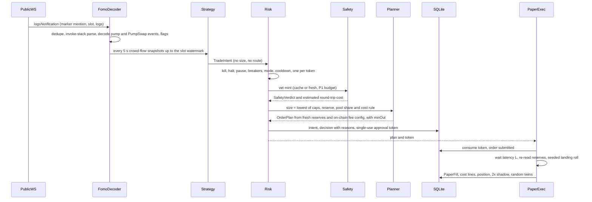
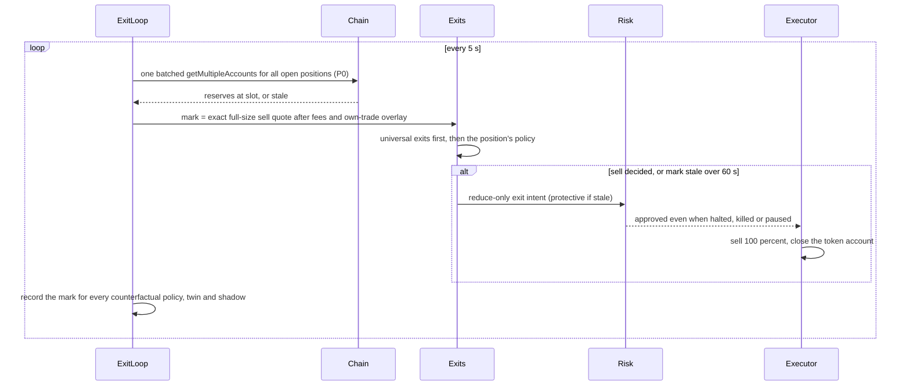
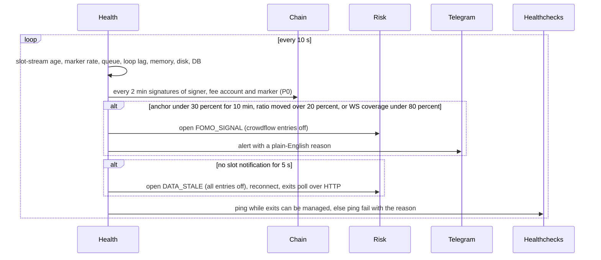
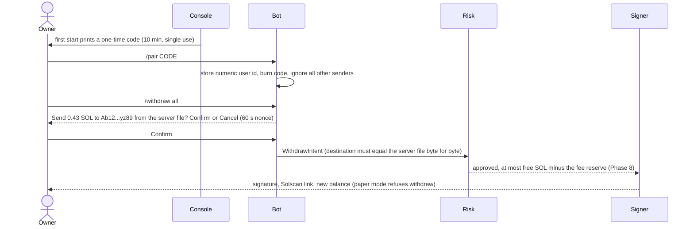
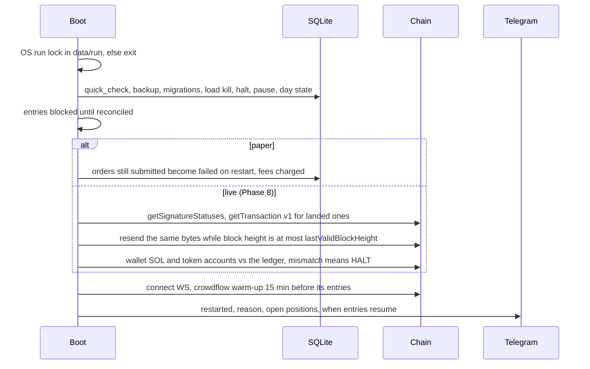
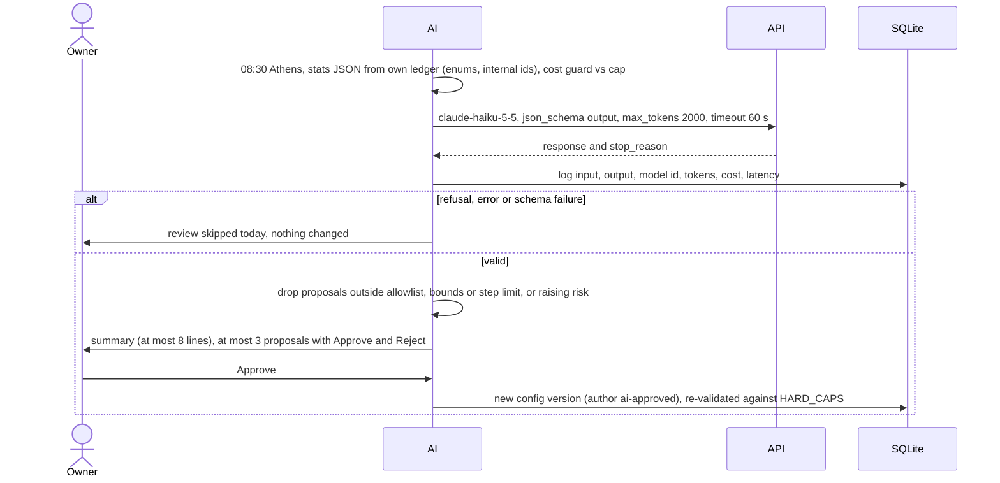

# Architecture (Phase 1 design)

Design for the owner's approval, 2026-11-07; no code exists. Facts only from
`VERIFIED_FACTS.md`; UNVERIFIED items are designed around (section 13). Numbers:
`RISK_POLICY.md`; attacks: `THREAT_MODEL.md`; tests: `TEST_PLAN.md`. D1-D3 apply: no
copy-trading or per-user FOMO tracking, repository possibly public, free endpoints only.

## 1. In plain English

- One program in one Docker container (VPS, or PowerShell on your PC) listens to the free
  public Solana stream that carries every FOMO trade. Strategies only *suggest* trades.
- Every suggestion passes the safety filter, then the risk engine, which picks the size and
  issues a one-time permission slip. No slip, no trade. Exits are always allowed.
- Until Phase 8 trades are a pessimistic paper simulation on real prices and fees; no key
  exists. Bad or silent data stops new trades and alerts you; exits keep running. In Phase 8
  the key lives in a tiny offline container; arming live needs you at the server.

## 2. Module map (`fomo-bot/src/`) and loops

No folder is named `state`, `secrets`, `backups`, `build` or `dist` (root guard hook,
.gitignore). Node 26.13.0 runs `.ts` directly (type stripping: erasable syntax only, no
enums, namespaces or parameter properties); `tsc --noEmit` type-checks; no build folder.

| Folder | Responsibility | May import |
|---|---|---|
| core/ | branded bigint units, checked integer math, ids, clock (UTC + Athens day), Result | nothing |
| config/ | zod schemas, `HARD_CAPS`, layered loading, versioned tunables, /set and AI bounds | core, storage |
| storage/ | `sqlite.ts` (only importer of `node:sqlite`), migrations, repositories, backup | core |
| chain/ | ProviderClient (JSON-RPC over fetch, WebSocket), BudgetGovernor, v1-only reads, block height, clock drift | core, config |
| venues/ | pump curve, PumpSwap, Raydium CPMM: decoders hand-written from the official IDLs, fee-config readers, exact quote math rounded in the venue's favour, PDAs; Phase 8 instruction builders | core |
| ingest/ | provider data to `MarketEvent`s, dedupe, slot watermark | core, chain, venues, fomo |
| fomo/ | invoke-stack log parser, trade decoder with completeness flags, aggregate crowd flow, health anchors, stream audit | core, venues |
| safety/ | raw mint/TLV parser, extension policy, authorities, holders, sell probe, liquidity and cost estimate, verdict cache | core, chain, venues |
| strategies/, exits/ | crowdflow, momentum, launch / universal exits, exit policies, tournament scoring: all pure and synchronous, data in, intents out | core, type-only imports |
| risk/ | the only gate: sizing, caps, flags (kill, halt, pause, daily stop), breakers, approval tokens | core, config, storage, portfolio (read) |
| execution/ | planner (`OrderPlan`), paper executor, reconciler; Phase 8 live executor and signer client | core, venues, chain, storage, risk (verify only) |
| signer/ | Phase 8: own entry point, zero npm dependencies, no network, own policy | Node built-ins |
| portfolio/, research/ | cost-line ledger, positions, marks, equity, PnL in SOL/USD/EUR / 2x-cost shadow ledger, random-entry twins, gate evaluator, `stats:export` | core, storage / portfolio, exits |
| telegram/ | grammy long polling, pairing, owner auth, commands, confirmations, outbox | core, app services |
| ai-review/ | stats builder, sanitiser, Anthropic call via fetch, cost guard, proposal validator | core, research, config (read) |
| reports/, ops/ | alert texts, reports, CSV export / health, heartbeat, disk, memory, loop lag, run lock, backups | core, portfolio / storage |
| app/, cli/ | composition root (the only place that constructs executors), scheduler / `kill`, `reset-halt`, `arm-live`, `pair`, `stats:export`, `backup` | all |

Import rules are enforced twice: eslint `no-restricted-imports` per folder and a vitest
test that parses every import. Loops: exit marks 5 s (mint re-read 60 s, P0); strategy
ticks crowdflow 5 s, launch 15 s (P2), momentum 30 s (P4); health 10 s (anchors 2 min,
drift 5 min); reconciliation 5 min and after every trade; equity 1 min; backup 03:30, AI
review 08:30, daily summary 09:00 Athens.

## 3. Core types (design, not code to compile)

```ts
type Lamports = bigint & { readonly u: 'lamports' };   type TokenUnits = bigint & { readonly u: 'token' }; // TEXT in SQLite
type MicroLamportsPerCu = bigint & { readonly u: 'uL/CU' }; type Bps = number & { readonly u: 'bps' };  // int 0..10_000
type Address = string & { readonly u: 'b58-32' };       type UtcMs = number & { readonly u: 'utc-ms' };
type StrategyId = 'crowdflow' | 'momentum' | 'launch';  type Mode = 'off' | 'paper' | 'live';
type Venue = 'pump-curve' | 'pumpswap' | 'raydium-cpmm'; /* else reject */ type Priority = 'P0-critical' | 'P1-safety' | 'P2-launch' | 'P3-crowdflow' | 'P4-momentum';
interface Provenance { provider: string; method: string; contextSlot?: bigint; receivedAt: UtcMs }
interface PoolState { venue: Venue; pool: Address; mint: Address; quoteMint: Address; // only wSOL-quoted pools tradable
  quoteReserve: Lamports; tokenReserve: TokenUnits; realQuote?: Lamports; realToken?: TokenUnits; complete?: boolean;
  feeBps: { buy: Bps; sell: Bps }; feeConfig: { account: Address; slot: bigint }; // re-read from chain for every plan
  layoutHash: string; slot: bigint; prov: Provenance }                              // unknown layout: never built
type MarketEvent =
  | { kind: 'fomo-trade'; id: string; ev: FomoTradeEvent }                          // id = signature:legIndex
  | { kind: 'launch'; id: string; mint: Address; creator: Address; slot: bigint; prov: Provenance }
  | { kind: 'pool-state'; id: string; pool: PoolState } | { kind: 'slot'; id: string; slot: bigint; prov: Provenance }
  | { kind: 'trending'; id: string; source: 'jupiter' | 'geckoterminal' | 'dexscreener'; mints: Address[]; prov: Provenance }
  | { kind: 'health'; id: string; component: string; level: HealthLevel; detail: string };
interface FomoTradeEvent { signature: string; slot: bigint; receivedAt: UtcMs; failed: boolean; // failed: health only
  legs: DecodedLeg[];                                  // pump TradeEvent / PumpSwap Buy-SellEvent, log order
  completeness: { user: boolean; side: boolean; mint: boolean; size: boolean; mintVia: 'event' | 'pool-cache' | 'none';
    family: 'pump' | 'other' | 'unknown' }; decoder: { name: string; idlHash: string } }
interface DecodedLeg { program: 'pump-curve' | 'pumpswap'; side: 'buy' | 'sell'; mint?: Address; pool?: Address;
  userTag?: string;   // HMAC(user, per-boot salt): memory only, dropped after 15 min, never stored or sent (D1)
  tokenAmount?: TokenUnits; quote?: { mint: Address; amount: bigint } }
interface FlowWindow { minutes: 1 | 5 | 15; distinctBuyers: number; distinctSellers: number; buys: number; sells: number;
  netQuoteLamports: bigint; topBuyerShareBps: Bps; sameSlotBuyShareBps: Bps; identicalSizeShareBps: Bps }
interface CrowdFlowSnapshot { mint: Address; at: UtcMs; watermarkSlot: bigint; windows: readonly FlowWindow[];
  accelerationBps: number;           // buyers/min, last 1 min vs prior 5-min average
  firstFomoBuyAt: UtcMs; fomoShareOfVolumeBps?: Bps; priceChangeBps: { m5?: number; m15?: number };
  completeness: { streamHealthy: boolean; globalDecodeRateBps: Bps; familyCoverageBps: Bps; scoreBps: Bps } }
interface TradeIntent { id: string;  // hash(strategy, mint, side, decision window): replays dedupe
  strategy: StrategyId; mint: Address; side: 'buy' | 'sell'; createdAt: UtcMs; inputsAsOf: UtcMs;
  sizeHint: 'min' | 'normal'; confidenceBps: Bps; exitPolicy: ExitPolicyId;     // no amounts, no routes
  reasons: string[]; inputs: Readonly<Record<string, string | number | boolean>> }
interface StrategyContext { now: UtcMs; flows: ReadonlyMap<Address, CrowdFlowSnapshot>; pools: ReadonlyMap<Address, PoolState>;
  trending: readonly TrendingEntry[]; positions: readonly PositionView[]; params: StrategyParams; health: HealthStatus }
interface Strategy { readonly id: StrategyId; evaluate(ctx: DeepReadonly<StrategyContext>): TradeIntent[] } // pure, no I/O
type SafetyCheck = 'token-program' | 'extensions' | 'authorities' | 'metadata' | 'holders' | 'creator' | 'age'
  | 'liquidity' | 'sell-probe' | 'cost-rule' | 'venue' | 'mayhem';
interface SafetyVerdict { mint: Address; verdict: 'pass' | 'reject'; checkedAt: UtcMs; expiresAt: UtcMs; ruleVersion: string;
  checks: { name: SafetyCheck; result: 'pass' | 'reject' | 'error'; detail: string }[];  // any error = reject
  tokenProgram: 'spl' | 'token-2022'; extensionTypes: number[]; estRoundTripCostBps: number; liquidityLamports: Lamports;
  sellProbe: { method: 'holder-sim' | 'probe-payer-sim' | 'own-wallet-sim' | 'none'; lossBps?: number } }
declare const approved: unique symbol;   // the constructor is not exported from risk/
type ApprovalToken = { readonly [approved]: true; id: string; intentId: string; planHash: string;
  maxSpendLamports: Lamports; minOut: bigint; expiresAt: UtcMs; mac: string };  // HMAC, per-boot key, single use in DB
type RiskDecision = { approved: false; intentId: string; reasons: string[]; checks: string[] }
  | { approved: true; intentId: string; checks: string[]; token: ApprovalToken; reduceOnly: boolean };
interface OrderPlan { orderId: string; intentId: string; mode: 'paper' | 'live';
  kind: 'buy' | 'sell' | 'close-account' | 'withdraw'; venue: Venue; route: 'direct' | 'jupiter-build' | 'jupiter-order';
  mint: Address; pool: Address; inAmount: bigint; expectedOut: bigint; minOut: bigint; slippageBps: Bps;
  feeBps: Bps; feeConfigSlot: bigint; cuLimit: number; cuPrice: MicroLamportsPerCu;
  tip: { path: 'none' | 'jito' | 'helius-swqos'; lamports: Lamports };            // never a 0.001 SOL service
  rentLamports: Lamports; closeAccountAfter: boolean; quoteSlot: bigint; lastValidBlockHeight?: bigint }
interface FillBase { orderId: string; mint: Address; side: 'buy' | 'sell'; landed: boolean; attempts: number;
  inAmount: bigint; outAmount: bigint; venueFee: Lamports; networkFee: Lamports; tip: Lamports;
  rentPaid: Lamports; rentRefunded: Lamports; slot: bigint; at: UtcMs }
interface PaperFill extends FillBase { mode: 'paper'; costMultiplier: 1 | 2; latencyMs: number; reservesSlot: bigint; seed: string }
interface LiveFill extends FillBase { mode: 'live'; signature: string; confirmedSlot: bigint; reconciled: boolean }
interface Position { id: string; mint: Address; strategy: StrategyId; mode: 'paper' | 'live'; openedAt: UtcMs;
  tokenUnits: TokenUnits; costBasis: Lamports /* every fee and rent */; rentLocked: Lamports; realized: Lamports;
  exitPolicy: ExitPolicyId; peakMark: Lamports; status: 'opening' | 'open' | 'exiting' | 'stuck' | 'closed';
  lastMark: { value: Lamports; slot: bigint; at: UtcMs; stale: boolean } } // exact sell quote, full size, after fees
interface EquitySnapshot { at: UtcMs; mode: 'paper' | 'live'; sol: Lamports; positionsMark: Lamports;
  equity: Lamports | null;  // null if any position cannot be valued: entries blocked
  staleMints: Address[]; dayStart: Lamports; peak: Lamports; dailyPnlBps: number; drawdownBps: number;
  solUsd?: string; eurUsd?: string }  // display only
interface RpcOptions { feature: string; priority: Priority; timeoutMs: number; commitment?: 'confirmed' | 'finalized' }
type RpcResult<T> = { ok: true; value: T; contextSlot?: bigint; latencyMs: number } | { ok: false;
  error: 'budget-denied' | 'rate-limited' | 'blocked' | 'timeout' | 'http' | 'rpc' | 'schema'; retryAfterMs?: number; detail: string };
interface ProviderClient { readonly id: string; readonly capabilities: ReadonlySet<'http' | 'ws' | 'send'>;
  rpc<M extends RpcMethod>(method: M, params: RpcParams[M], opt: RpcOptions): Promise<RpcResult<RpcReturn[M]>>;
  // getTransaction/getBlock always send maxSupportedTransactionVersion: 1; getTokenLargestAccounts refused locally
  subscribe(spec: SubscriptionSpec, onMessage: (m: unknown) => void, onState: (s: WsState) => void): Subscription;
  health(): ProviderHealth }
interface BudgetGovernor {
  acquire(provider: string, method: string, p: Priority, cost?: number): { granted: true } | { granted: false; reason: string; retryAt: UtcMs };
  observe(provider: string, method: string, status: number, headers: Headers): void; // learns x-ratelimit-*, Retry-After
  shedLevel(): 0 | 1 | 2 | 3; usage(): BudgetUsage[] }   // 1: P4 off, 2: +P3 off, 3: +P2 off; P0 never shed
type HealthLevel = 'ok' | 'degraded' | 'down';
interface HealthStatus { at: UtcMs; entriesAllowed: boolean; strategyEntries: Record<StrategyId, boolean>;
  exitsAllowed: true; components: { name: string; level: HealthLevel; since: UtcMs; detail: string }[];
  breakers: { id: BreakerId; open: boolean; openedAt?: UtcMs; reason?: string }[] }
type ExitDecision = { action: 'hold' } | { action: 'sell'; fractionBps: Bps; reason: string; urgency: 'normal' | 'protective' | 'emergency' };
interface ExitPolicy { readonly id: ExitPolicyId; params: Readonly<Record<string, number>>;
  decide(p: PositionView, mark: MarkSample, history: readonly MarkSample[], signals: ExitSignals): ExitDecision } // pure
// config/caps.ts: ceilings in code; files, /set and the AI can only stay at or below them.
export const HARD_CAPS = { tradePctBps: 1_000, openPositions: 4, exposurePctBps: 5_000, poolShareBps: 50,
  dailyStopBps: 3_000, peakHaltBps: 5_000, launchShareOfExposureCapBps: 2_500, entriesPerDay: 12, costRuleBps: 500,
  positionLamports: 60_000_000n, exposureLamports: 300_000_000n, equitySanityLamports: 2_000_000_000n,
  feeReserveFloorLamports: 10_000_000n, buySlippageBps: 300, sellSlippageBps: 500, emergencySellSlippageBps: 1_000,
  cuPriceMicroLamports: 200_000n, cuLimit: 300_000, tipLamports: [0n, 1_000n, 5_000n], aiMonthlyUsdMicros: 1_000_000n,
  landingSpendBps: 30, exitLandingSpendBps: 60, curveProgressMaxBps: 9_500, minTradeFloorLamports: 10_000_000n } as const;
const ServerFile = z.object({   // /config/fomo-bot.json: read-only mount, never in git, not editable from Telegram
  providers: z.array(ProviderSpec).min(1), paperStartingLamports: LamportsString,
  withdrawAddress: AddressStr.optional(), probePayer: AddressStr.optional(), // public keys only: rejects 64-byte keys, arrays
}).strict();
const Tunables = z.object({     // versioned DB rows; /set and approved AI proposals create new versions
  risk: RiskParams, strategies: z.record(StrategyIdEnum, z.object({ mode: ModeEnum, params: StrategyParams })),
  exits: ExitParams, paper: PaperModelParams, ai: z.object({ model: z.enum(['claude-haiku-5-5', 'claude-sonnet-5-5']) }),
}).strict().superRefine(withinHardCapsAndBounds); // mode 'live' only via the /golive flow, never /set
// D2: tuned thresholds and the wallet address live only in the server file and the DB; git has placeholders.
```

## 4. Sequence diagrams

(a) FOMO stream to paper fill


(b) Exit loop


(c) Health monitor and circuit breakers


(d) Telegram pairing and a confirmed dangerous command


(e) Restart and reconciliation


(f) Daily AI review


## 5. Paper engine realism model

Live data, deliberately pessimistic. (P) = proposal the owner confirms; latency and
landing stay UNVERIFIED until Phase 8 measures real sends.

| Element | Model |
|---|---|
| No look-ahead, latency | a decision at t uses only events with `receivedAt` <= t; fill at t + L, L = measured detection lag + 2.0 s send-to-land (P, ~9 slots) |
| Fill price | exact venue math on reserves re-read at the first slot after t + L; fee from the on-chain fee config; venue-favoured rounding (root `costs/memecoin.py` pattern) |
| Competition, own impact | extra adverse 0.5% per leg (P), as others land ahead of us; a virtual overlay adds our buy to the reserves when quoting our exit |
| Slippage cap, landing | fill below `minOut` = failed attempt; seeded p_fail 0.20 per attempt (P), at most 3 attempts in one blockhash window (~32 s, by block height); every failure pays base + priority, no fill |
| Network fees | 5,000 lamports per signature + priority (p75 for the trade's own writable account, clamped) + tip when landed (5,000 SWQOS-only or 1,000 Jito) |
| Rent, routes | rent from getMinimumBalanceForRentExemption (cached daily), paid on buy, refunded only after a 100% sell plus close, lost if stuck; direct venues only (Jupiter `/order` adds its fee, never under 24 h) |
| Partial exits | each extra sell pays a full transaction; rent locked until the final close; moonbag policies are charged that rent |
| 2x shadow | same decisions; fees, priority and tip x2, p_fail x2 (cap 0.95), impact on halved reserves, latency x2 |
| Random entries, tournament | per real entry K = 5 seeded twins from tokens that passed safety, liquidity and the cost rule then, same size, exits and costs (P3, shed first); every exit policy runs on every entry's price path, scored after costs |

Sell probe in keyless paper (for the security-auditor): `simulateTransaction` with
`sigVerify: false` needs an existing funded fee payer. Default `holder-sim`: simulate a sell
of our planned amount by a current non-PDA holder with enough tokens and SOL. Optional
`probe-payer-sim`: a public address the owner owns (server file) pays a full create-ATA, buy,
sell round trip. No probe possible = reject. Paper code has no signer.

## 6. Provider layer and budget governor

All reads use `ProviderClient`; another provider is a config entry, not a code change.
Public endpoint per IP: 100 requests/10 s, 40/10 s per method, 40 connections, 100 MB/30 s,
plus the header limits below. We use at most 60/10 s and the lower of published and learned
limits; a 429 closes that bucket for Retry-After and raises the shed level; a 403 marks the
provider blocked (all entries off).

| Method (public RPC) | Limit | Cap /10 s | P0 reserve | Uses |
|---|---|---|---|---|
| getMultipleAccounts | 40 | 20 | 8 | open-position reserves (1 batched call/5 s), plan re-reads, mints, fee configs (60 s cache), pool-to-mint lookups, twins |
| getProgramAccounts (memcmp mint) | 10 | 4 | 0 | holder lists (safety, launch) |
| simulateTransaction | 40 | 4 | 2 | sell probes; Phase 8 pre-send |
| getRecentPrioritizationFees | 20 | 4 | 2 | one writable account per call, 30 s cache |
| getSignaturesForAddress | 10 | 3 | 2 | anchors and stream audit (3 calls/2 min); Phase 8 own wallet |
| getTransaction (v1) | 10 | 3 | 2 | Phase 8 own trades; decode audit 1/30 s (P3) |
| getBlockHeight, getSlot / getBlockTime | 40 / 10 | 4 | 2 | expiry, clock drift |
| getLatestBlockhash, getSignatureStatuses, getBalance, getTokenAccountsByOwner, rent | 40 each | 8 total | 4 | Phase 8 sending and reconciliation; rent daily |
| getTokenLargestAccounts | 0 | 0 | - | refused locally |

| Other source | Published | Our cap | Uses (priority) |
|---|---|---|---|
| Public WebSocket | pubsub-limit 5 (meaning UNVERIFIED) | 1 connection, 3 subscriptions | logs mentioning the marker (P3), slotSubscribe liveness (P0), logs mentioning the pump mint-authority PDA for launches (P2, if the soak shows room) |
| Jupiter Price v3 keyless (bucket shared with Tokens, Swap) | 0.5 req/s | 0.35 req/s | open-position cross-check every 10 s, 50 mints/call (P0); candidates (P1); toptrending 1/min (P4) |
| GeckoTerminal | ~10/min, cached 30-60 s | 6/min | new_pools (P2), trending_pools (P4), price fallback (P0); treated as 60 s old |
| DexScreener | 300/min | 60/min | candidate enrichment (P4, P1); stays on the box: never in prompts or git |
| Telegram; Healthchecks.io; Anthropic | ~1 msg/s per chat; -; - | 1 msg/1.2 s; 1 ping/min; 1 call/day | outbox coalesces alerts |

Degrade order (a bucket over 80% for a minute, or a 429): 1 momentum polling, 2 crowd-flow
sampling (decode audit, non-pump lookups, twins), 3 launch scanning. Exits, position prices,
confirmations and reconciliation are P0, never shed; if P0 is denied, all entries stop.

## 7. Storage (SQLite WAL, only through `storage/sqlite.ts`)

WAL, busy timeout 5 s, foreign keys, `readBigInts`; amounts are TEXT of decimal digits
(CHECK), converted to bigint in one place; one writer; forward-only migrations with a backup
before each. Nothing is acted on before it is persisted (intent, decision, order).

| Tables | Hold |
|---|---|
| schema_migrations, config_versions, flags, day_state, counters | migrations; every config version (json, author owner/ai-approved/default, parent, active); kill, halt reasons, pause, breakers; day start, peak; entries per day and strategy |
| intents, risk_decisions, approvals, orders, attempts, fills, cost_lines | intents with inputs and reasons; decisions with checks; tokens (plan hash, expiry, consumed_at); order state machine; one row per cost item (venue fee, priority, tip, rent, failed attempt) |
| positions, marks, equity_snapshots, shadow_fills, twin_trades, tournament_results | positions; sampled marks (feed the tournament); equity per minute; 2x-cost ledger; random twins; per-policy counterfactuals |
| tokens, safety_verdicts, creator_blocklist, flow_minutes, health_events, budget_usage | mint facts; verdicts with TTL; creators of rugged tokens (token level, not FOMO users); per-mint per-minute counts (no user tags); health; requests per provider/method/minute |
| telegram_auth, confirmations, outbox, audit_log, ai_reviews | owner id; nonces; alert queue; hash-chained log of config changes and dangerous commands; AI calls |

Retention: flow_minutes 30 days, marks 90, raw decode samples 7, trades forever. Daily
`sqlite.backup()` to `data/backups/` (gitignored), keep 7; `quick_check` at start and daily.

## 8. Telegram (owner only, long polling, no open port)

Numeric user id from pairing only; others ignored silently. 20 commands/min, 3 dangerous per
10 min; confirmations use a 60 s single-use nonce in `callback_data` (under 64 bytes). No
copy-trading commands (D1).

| Command | Does | Confirm |
|---|---|---|
| /status /pnl /positions /trades /why id /strategies /health /limits /report /help | read-only | no |
| /pause, /resume | stop or allow entries (resume after a peak halt rebases the peak) | resume |
| /panic, /kill | sell all within the emergency cap then pause / set the persistent KILL flag (cleared only at the server) | yes |
| /off s, /paper s, /golive s | strategy mode; golive shows the gate summary and needs the server armed | golive |
| /set p v, /proposals, /approve id, /reject id, /rollback | bounded tunable change; AI proposals; previous config version | set, approve, rollback |
| /withdraw amount or all | live only: SOL to the address in the server file | yes |

Alerts: each entry and exit (reason, size, price, fees, PnL, Solscan link), 09:00 summary,
warnings (data, FOMO signal, budgets at 80%, stops, mismatches, restarts), weekly report.

## 9. Live path (Phase 8, interface level)

Live entries need `FOMO_LIVE=true` in the server environment, `fomo arm-live` run by the
owner via `docker compose exec -it` (checks the signed, fingerprinted, 30-day-fresh
`fomo-bot/ops/go-live-checklist.md` like root `live_gate.py`, then reads a typed phrase
with a fresh code from the TTY), and the per-strategy Telegram Go live tap. Arming ends at
restart: live positions keep their exits; new live entries need re-arming. The signer
container (`network_mode: none`, zero npm dependencies, Node `crypto` Ed25519, key mounted
read-only, Unix socket) signs only if its own policy passes: bot wallet pays fees; programs
allowlisted (System, ATA, Token, Token-2022, compute budget, pump, PumpSwap, Raydium CPMM);
known instructions only, max-in arguments within its caps; SOL transfers only to tip
accounts or the withdraw address; no SetAuthority, Approve or foreign close; own daily spend
counter. No Jupiter routes live until the signer can verify them. Sending: persist signed
bytes and signature first, `maxRetries: 0`, resend the same bytes until confirmed or block
height passes `lastValidBlockHeight`, re-sign only after provable expiry.

## 10. Daily AI review

Input: our own results per strategy and policy, cost breakdowns, data quality and what
rejected signals did, from our ledger and chain data only. Mints appear as internal ids;
token names, symbols, third-party API data (Jupiter, DexScreener terms) and free text never
enter the prompt. Output: `summary` (at most 8 lines) and at most 3 `{param, current,
proposed, reason, expectedEffect, risk}`, `param` an enum of allowlisted tunables. $1/month
enforced locally. No key: skip, remind about `/review-trades`. Never modes, live, withdraw,
providers, hard caps or code.

## 11. Operations

| Topic | Design |
|---|---|
| Containers | `bot`, plus `signer` in Phase 8. Node 26.13.0 image pinned by digest (UNVERIFIED), non-root, read-only root fs, tmpfs /tmp, memory 700 MB, `--max-old-space-size=400`, `restart: unless-stopped`, no published ports. Volumes `/data` (db, logs, backups, run lock), `/config` read-only, `/secrets` read-only for the signer only |
| Health, heartbeat | Docker healthcheck `node src/ops/healthcheck.ts` (`data/run/heartbeat.json` older than 60 s = unhealthy); Healthchecks.io ping each minute while exits can be managed, `/fail` with reason after a breaker is open 10 min; 5 min grace, email and Telegram channels |
| Logs | JSONL decisions `data/logs/decisions-YYYY-MM-DD.jsonl` (14 days); Docker json-file 10 MB x 5; ASCII; redactor on every line |
| Update / rollback | `ops/update.sh`: tagged commit, `npm ci --ignore-scripts`, tests, image tagged by commit, DB backup, swap, health within 2 min else automatic rollback; `ops/rollback.sh`: previous image (DB restore only if a migration ran) |
| Single instance; Windows | OS lock `data/run/run.lock`, Telegram 409 Conflict: alert and exit. PowerShell: `npm ci --ignore-scripts`, `npm run paper` (keyless, data in `fomo-bot\data\`); Telegram optional via `fomo-bot\.env`; LF, ASCII console |

## 12. Failure modes

| What fails | Detected by | What the bot does |
|---|---|---|
| WebSocket drops | close or error event | crowdflow and launch entries off; reconnect with jitter 1-60 s; gap logged; 15 min crowdflow warm-up; exits on HTTP |
| WebSocket silent stall | no slot notification for 5 s | reconnect; DATA_STALE (all entries off); over 6 reconnects in 10 min: alert, stay off |
| WS silently loses messages | 2-min audit: marker signatures over HTTP vs seen on WS | coverage under 95% degraded; under 80% FOMO_SIGNAL breaker |
| WS flood or malformed message | queue over 5,000, message over 64 KB, parse error | drop and count, incomplete-data breaker; never guess fields |
| 429 storm | status 429, Retry-After, header limits | close bucket, shed a level; P0 denied: all entries off, alert |
| 403 (IP blocked) | status 403 | provider blocked 15 min, entries off, alert; paper marks via Jupiter (stale flag); live needs a second provider (decision 3) |
| Timeouts, bad shapes, lagging node | per-call timeout (5 s; 15 s getProgramAccounts); zod failure; contextSlot over 150 behind the highest seen | an error, never a default; data rejected as stale; errors over 20% in 2 min: RPC_ERRORS breaker, entries off |
| Stale price, open position | no fresh reserves for 30 s | entries off; 60 s: protective exit at the next fresh quote; 5 min: valued 0 for stops |
| Manipulated price, thin pool | reserve price vs Jupiter over 3%; jump over 10% in 30 s | no entry; take-profit and trailing need 2 samples; stops act on the real sell quote |
| FOMO marker silent, signer active | marker under 30% of baseline 10 min; marker/signer ratio moved over 20% | FOMO_SIGNAL, crowdflow off, alert; auto-resume after 30 min at 70% of baseline |
| FOMO signer or fee account changes, or all anchors vanish | anchor drop or ratio change over 20%; all rates near zero | same breaker; alert asks for re-verification (Claude researches); momentum drops its FOMO feature |
| New tx format, decode failures | -32015-style errors, unknown version, decode rate 20 points under baseline | fail closed for that tx; DECODE breaker; alert "upgrade needed" |
| pump.fun / PumpSwap upgrade; fee config change | programData deploy slot (every 10 min); unknown discriminator or size; fee config re-read before every plan | venue entries off, self-test on live data (paper re-enables after 30 min passing, live waits for the owner); fee change: alert, cost rule re-run |
| Unsupported or 99%-fee venue (Meteora DBC); unknown Token-2022 extension | venue list; own raw TLV parser | reject with the reason logged; jsonParsed never trusted alone |
| Bait token passing static checks | holders, creator share and blocklist, identical-amount clusters, age, liquidity, non-FOMO activity | reject by default; at most 0.5% of pool; hard stop; thresholds out of git |
| Sybil "crowd flow" | distinct-buyer floor, top-buyer, same-slot and identical-size shares, median buy size, non-FOMO volume and holder growth | no entry, confidence capped, creator blocklisted after a rug; no lookups of FOMO users' wallets (D1) |
| Honeypot, sell tax, blocked transfer | sell probe; re-probe every 5 min while held | reject; a held position that fails is "stuck", valued 0, alert |
| Freeze, pause, authority change; liquidity pulled, dev dump | mint re-read every 60 s while held; reserves down over 30% in 1 min; creator sell | emergency exit with the wide cap, creator blocklisted; empty pool: stuck, valued 0, rent lost |
| Curve completes while held | `complete` flag | mark stale; exit on the canonical PumpSwap pool when readable; no entries above 90% curve progress |
| Duplicate or out-of-order events | signature:leg seen (LRU 200k); DB unique keys; slot below the watermark (newest minus 10) | ignored; deterministic intent ids, one position per mint, single-use tokens; late events excluded from acceleration |
| Restart mid-trade | orders still submitted at boot | paper: failed on restart, fees charged; live: diagram (e) |
| Double buy on retry; blockhash expiry (live) | order state machine; block height past lastValidBlockHeight | resend identical bytes only; re-sign only after expiry with no status; then reconcile from chain |
| Clock drift or jump | offset vs HTTP Date (3 sources) and blockTime; wall vs monotonic differ over 2 s | over 2 s entries off, over 10 s halt; timers monotonic; day moved backwards: halt |
| Disk full | free space every 5 min; write errors | under 1 GB stop raw samples; under 300 MB or a failed write: entries off, alert |
| SQLite damage; node:sqlite change | quick_check, SQLITE_CORRUPT or IOERR; storage tests on the pinned Node | halt entries, alert with restore steps, never auto-restore, live rebuilds from chain; Node pinned, one replaceable file |
| Telegram outage | send and getUpdates errors | outbox retries; after 30 min no entries and heartbeat `/fail` so email reaches the owner |
| Telegram account hijack | owner-id commands the owner did not send | bounded power (no address change, nothing above HARD_CAPS, live needs server arming, withdraw only to the fixed address); audit log; `fomo kill` at the server |
| Bot token leak | 409 Conflict, unexpected webhook | heartbeat fail, entries off; owner rotates the token with BotFather |
| Heartbeat outage; VPS reboot | ping errors; run lock shows an unfinished run | heartbeat: logged, one note a day; reboot: restart policy, reconciliation, restart alert, Healthchecks alerts after grace |
| OOM, leak, blocked event loop | RSS over 80% of limit; OOM kill; loop lag over 1 s | shed cold-token tracking; over 90% controlled restart; lag over 5 s for 30 s or over 3 restarts in 30 min: entries off, alert |
| Equity misread; our own sizing or accounting bug | sanity max, +50% in 1 h without fills; runtime invariants re-checked by executor (and signer) | halt and alert; absolute SOL caps hold regardless; property tests before release |
| Bad config, /set or AI proposal | zod + HARD_CAPS + bounds validator | rejected or dropped and logged, never auto-applied; invalid config at start: refuse to start |
| Malicious dependency; second instance | lockfile, cooldown, no install scripts, isolated signer; run lock, Telegram 409 | THREAT_MODEL.md; exit with a clear message |

## 13. UNVERIFIED items designed around

Marker logsSubscribe (not a real account): first Phase 3 check, fallback = subscribe to the
signer and keep only swap-program log lines. pubsub-limit meaning: 3 subscriptions, 1
connection. WebSocket 24/7: Phase 7 soak. Landing and latency: pessimistic defaults. CU and
fee medians: own recorder. Graduation timing: no entries above 90% curve progress. Legacy
SPL holder query: else probe-payer or reject. AMM v4, CLMM, DLMM, Orca fees: unsupported.
Jito tip floor: minimum tips only. Docker digest, Node env-file flag: Phase 2. Anthropic
spend cap: enforced locally.

## 14. Decisions for the owner

1. **Signer in its own offline container (Phase 8)**, so a poisoned package cannot steal
   the key. Recommended: yes.
2. **Paper sellability check**: simulate a sale by a current holder (needs nothing from you)
   or also use a public address of a wallet you own. Recommended: holder only.
3. **Live needs a second data provider**, or exits fail if the free endpoint blocks us.
   Recommended: no live money until one is configured.
4. **Who lifts the -50% halt**: Telegram (brief) or server only (root). Recommended:
   Telegram in paper, server for live.
5. **Daily -30% stop** resets at 00:00 Athens; recommended: two in a row need /resume.
6. **Weekly database copy to your Telegram** (no secrets inside). Recommended: yes.
7. **Telegram down 30 minutes stops new entries.** Recommended: yes.
8. **After a pump.fun upgrade**, paper resumes after a self-test; live waits for your tap.
9. **Live limits**: brief (10% per trade, -30% daily, -50% peak) or root (5%, -3%, -15%).
   Decide before Phase 8; paper uses the brief's.
10. **No lookups of FOMO users' wallets** (D1) makes baiting easier; recommended: accept.
