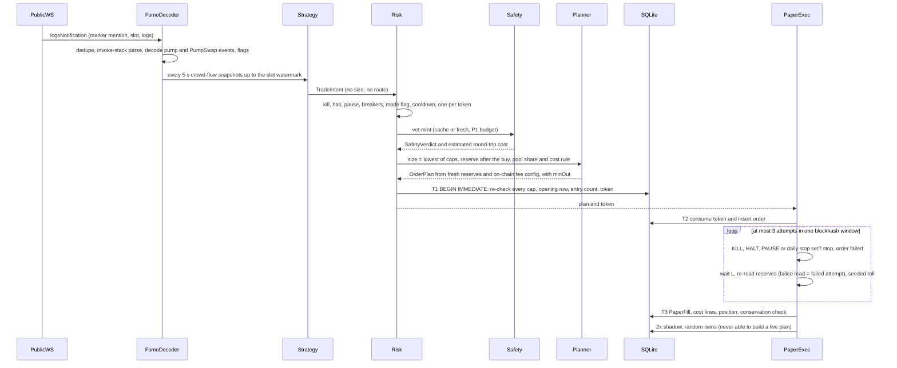
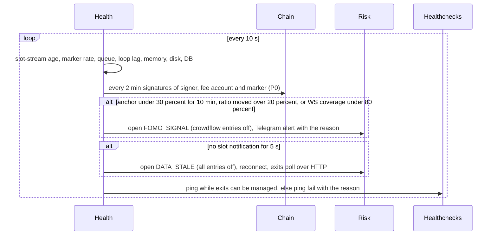
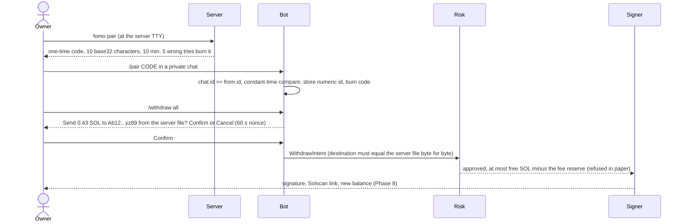
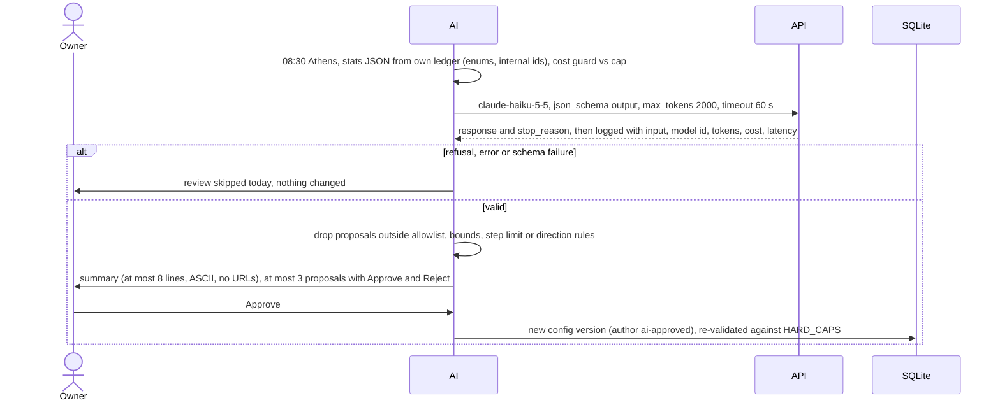

# Architecture (Phase 1 design)

Design for the owner's approval, 2026-11-07, revised the same day after the risk-guardian
and security-auditor reviews; no code exists. Facts only from `VERIFIED_FACTS.md`; UNVERIFIED
items are designed around (section 13). Numbers: `RISK_POLICY.md`; attacks: `THREAT_MODEL.md`;
tests: `TEST_PLAN.md`. D1-D3 apply: no copy-trading or per-user FOMO tracking, repository
possibly public, free endpoints only.

## 1. In plain English

- One program in one Docker container (VPS, or your PC) listens to the free public Solana
  stream that carries every FOMO trade. Strategies only *suggest* trades.
- Every suggestion passes the safety filter, then the risk engine, which picks the size and
  issues a one-time permission slip. No slip, no trade. Exits are always allowed.
- Until Phase 8 trades are a pessimistic paper simulation on real prices and fees; no key
  exists. Bad or silent data stops new trades and alerts you; exits keep running. In Phase 8
  the key lives in a tiny offline container with its own rules; arming live needs you at the
  server. No settings change can switch a strategy to live: only your Go live tap can.

## 2. Module map (`fomo-bot/src/`) and loops

No folder is named `state`, `secrets`, `backups`, `build` or `dist` (root guard hook,
.gitignore). Node 26.13.0 runs `.ts` directly (type stripping: erasable syntax only, no
enums, namespaces or parameter properties); `tsc --noEmit` type-checks; no build folder.

| Folder | Responsibility | May import |
|---|---|---|
| core/ | branded bigint units, checked integer math (caps round down, costs round up), ids, clock (UTC + Athens day), Result, redactor | nothing |
| config/ | zod schemas, `HARD_CAPS`, `TUNABLE_BOUNDS`, `LIVE_CAPS`, layered loading, versioned tunables (no modes), /set and AI bounds | core, storage |
| storage/ | `sqlite.ts` (only importer of `node:sqlite`), migrations, repositories, backup | core |
| chain/ | ProviderClient (JSON-RPC over fetch, WebSocket), BudgetGovernor, v1-only reads, block height, clock drift | core, config |
| venues/ | pump curve, PumpSwap, Raydium CPMM: decoders hand-written from the official IDLs, fee-config readers, exact quote math rounded in the venue's favour, PDAs; Phase 8 instruction builders | core |
| ingest/ | provider data to `MarketEvent`s, dedupe, slot watermark | core, chain, venues, fomo |
| fomo/ | invoke-stack log parser, trade decoder with completeness flags, aggregate crowd flow, health anchors, stream audit | core, venues |
| safety/ | raw mint/TLV parser, extension policy, authorities, holders, sell probe, liquidity and cost estimate, verdict cache | core, chain, venues |
| strategies/, exits/ | crowdflow, momentum, launch / universal exits, exit policies, tournament scoring: all pure and synchronous, data in, intents out | core, type-only imports |
| risk/ | the only gate: sizing, caps, flags (kill, halt, pause, daily stop, strategy modes), breakers, approval transaction and tokens | core, config, storage, portfolio (read) |
| execution/ | planner (`OrderPlan`), paper executor, reconciler; Phase 8 live executor and signer client | core, venues, chain, storage, risk (verify only) |
| signer/ | Phase 8: separate image, own entry point, zero npm dependencies, no network, own policy, caps, counters and TTY arming | Node built-ins |
| portfolio/, research/ | cost-line ledger, positions, marks, equity, PnL in SOL/USD/EUR / 2x-cost shadow ledger, random-entry twins, gate evaluator, `stats:export` | core, storage / portfolio, exits |
| telegram/ | small Bot API client over fetch (getUpdates long polling, sendMessage, answerCallbackQuery; replaces grammy, THREAT_MODEL 6), pairing, owner auth, commands, confirmations, outbox | core, app services |
| ai-review/ | stats builder, sanitiser, Anthropic call via fetch, cost guard, proposal validator | core, research, config (read) |
| reports/, ops/ | alert texts, reports, CSV export / health, heartbeat, disk, memory, loop lag, run lock, backups | core, portfolio / storage |
| app/, cli/ | composition root (the only place that constructs executors), scheduler / `kill`, `reset-halt`, `arm-live`, `pair`, `apply-pending`, `stats:export`, `backup` | all |

Import rules are enforced twice: eslint `no-restricted-imports` per folder and a vitest
test that parses every import. Loops: exit marks 5 s (mint re-read 60 s, P0); strategy
ticks crowdflow 5 s, launch 15 s (P2), momentum 30 s (P4); health 10 s (anchors 2 min,
drift 5 min); reconciliation 5 min and after every trade; equity 1 min; backup 03:30, AI
review 08:30, daily summary 09:00 Athens.

## 3. Core types (design, not code to compile)

```ts
type Lamports = bigint & { readonly u: 'lamports' };   type TokenUnits = bigint & { readonly u: 'token' }; // TEXT [0-9]+
type SignedLamports = bigint & { readonly u: 'lamports-signed' };                  // PnL only; TEXT -?[0-9]+
type MicroLamportsPerCu = bigint & { readonly u: 'uL/CU' }; type Bps = number & { readonly u: 'bps' };  // int 0..10_000
type Address = string & { readonly u: 'b58-32' };       type UtcMs = number & { readonly u: 'utc-ms' };
type StrategyId = 'crowdflow' | 'momentum' | 'launch';  type Mode = 'off' | 'paper' | 'live'; // flags table only
type Venue = 'pump-curve' | 'pumpswap' | 'raydium-cpmm'; /* else reject */ type Priority = 'P0-critical' | 'P1-safety' | 'P2-launch' | 'P3-crowdflow' | 'P4-momentum';
interface Provenance { provider: string; method: string; contextSlot?: bigint; receivedAt: UtcMs }
interface PoolState { venue: Venue; pool: Address; mint: Address; quoteMint: Address; // only wSOL-quoted pools tradable
  quoteReserve: Lamports; tokenReserve: TokenUnits; realQuote?: Lamports; realToken?: TokenUnits; complete?: boolean;
  feeBps: { buy: Bps; sell: Bps }; feeConfig: { account: Address; slot: bigint }; // re-read from chain for every plan
  layoutHash: string; slot: bigint; prov: Provenance }                              // unknown layout: never built
type MarketEvent =
  | { kind: 'fomo-trade'; id: string; ev: FomoTradeEvent }                          // id = signature:legIndex, memory only
  | { kind: 'launch'; id: string; mint: Address; creator: Address; slot: bigint; prov: Provenance }
  | { kind: 'pool-state'; id: string; pool: PoolState } | { kind: 'slot'; id: string; slot: bigint; prov: Provenance }
  | { kind: 'trending'; id: string; source: 'jupiter' | 'geckoterminal' | 'dexscreener'; mints: Address[]; prov: Provenance }
  | { kind: 'health'; id: string; component: string; level: HealthLevel; detail: string };
interface FomoTradeEvent { signature: string; slot: bigint; receivedAt: UtcMs; failed: boolean; // failed: health only
  legs: DecodedLeg[];                                  // pump TradeEvent / PumpSwap Buy-SellEvent, log order
  completeness: { user: boolean; side: boolean; mint: boolean; size: boolean; mintVia: 'event' | 'pool-cache' | 'none';
    family: 'pump' | 'other' | 'unknown' }; decoder: { name: string; idlHash: string } }
interface DecodedLeg { program: 'pump-curve' | 'pumpswap'; side: 'buy' | 'sell'; mint?: Address; pool?: Address;
  userTag?: string;   // HMAC(user, per-boot salt): memory only, dropped after 15 min, never stored or sent (D1)
  tokenAmount?: TokenUnits; quote?: { mint: Address; amount: bigint } }
interface FlowWindow { minutes: 1 | 5 | 15; distinctBuyers: number; distinctSellers: number; buys: number; sells: number;
  netQuoteLamports: bigint; topBuyerShareBps: Bps; sameSlotBuyShareBps: Bps; identicalSizeShareBps: Bps }
interface CrowdFlowSnapshot { mint: Address; at: UtcMs; watermarkSlot: bigint; windows: readonly FlowWindow[];
  accelerationBps: number;           // buyers/min, last 1 min vs prior 5-min average
  firstFomoBuyAt: UtcMs; fomoShareOfVolumeBps?: Bps; priceChangeBps: { m5?: number; m15?: number };
  completeness: { streamHealthy: boolean; globalDecodeRateBps: Bps; familyCoverageBps: Bps; scoreBps: Bps } }
interface TradeIntent { id: string;  // hash(strategy, mint, side, decision window): replays dedupe
  strategy: StrategyId; mint: Address; side: 'buy'; createdAt: UtcMs; inputsAsOf: UtcMs;
  sizeHint: 'min' | 'normal'; confidenceBps: Bps; exitPolicy: ExitPolicyId;     // no amounts, no routes
  reasons: string[]; inputs: Readonly<Record<string, string | number | boolean>> }
interface ExitIntent { id: string;   // hash(positionId, exitSeq); exitSeq + 1 after a failed or expired exit order
  positionId: string; exitSeq: number; fractionBps: Bps; reason: string; urgency: 'normal' | 'protective' | 'emergency' }
interface StrategyContext { now: UtcMs; flows: ReadonlyMap<Address, CrowdFlowSnapshot>; pools: ReadonlyMap<Address, PoolState>;
  trending: readonly TrendingEntry[]; positions: readonly PositionView[]; params: StrategyParams; health: HealthStatus }
interface Strategy { readonly id: StrategyId; evaluate(ctx: DeepReadonly<StrategyContext>): TradeIntent[] } // pure, no I/O
type SafetyCheck = 'token-program' | 'extensions' | 'authorities' | 'metadata' | 'holders' | 'creator' | 'age'
  | 'liquidity' | 'sell-probe' | 'cost-rule' | 'venue' | 'mayhem';
interface SafetyVerdict { mint: Address; verdict: 'pass' | 'reject'; checkedAt: UtcMs; expiresAt: UtcMs; ruleVersion: string;
  checks: { name: SafetyCheck; result: 'pass' | 'reject' | 'error'; detail: string }[];  // any error = reject
  tokenProgram: 'spl' | 'token-2022'; extensionTypes: number[]; estRoundTripCostBps: number; liquidityLamports: Lamports;
  sellProbe: { method: 'holder-sim' | 'probe-payer-sim' | 'own-wallet-sim' | 'none'; lossBps?: number } } // never the holder
declare const approved: unique symbol;   // the constructor is not exported from risk/
type ApprovalToken = { readonly [approved]: true; id: string; intentId: string; mode: 'paper' | 'live';
  kind: OrderPlan['kind']; reduceOnly: boolean; positionId: string; planHash: string; maxSpendLamports: Lamports;
  minOut: bigint; expiresAtSlot: bigint; mac: string };  // expiresAtSlot <= plan.quoteSlot + 25; HMAC, per-boot key; single use
// planHash = sha256(canonical JSON of EVERY OrderPlan field, mode and kind included; keys sorted; bigints as decimal strings)
// maxSpendLamports = inAmount + rentLamports + allowed attempts x (5,000 x signatures + ceil(cuPrice x cuLimit / 10^6) + tip)
type RiskDecision = { approved: false; intentId: string; reasons: string[]; checks: string[] }
  | { approved: true; intentId: string; checks: string[]; token: ApprovalToken };
interface OrderPlan { orderId: string; intentId: string; mode: 'paper' | 'live';
  kind: 'buy' | 'sell' | 'close-account' | 'withdraw'; venue: Venue; route: 'direct' | 'jupiter-build' | 'jupiter-order';
  mint: Address; pool: Address; inAmount: bigint; expectedOut: bigint; minOut: bigint; slippageBps: Bps;
  feeBps: Bps; feeConfigSlot: bigint; cuLimit: number; cuPrice: MicroLamportsPerCu;
  tip: { path: 'none' | 'jito' | 'helius-swqos'; lamports: Lamports };            // never a 0.001 SOL service
  rentLamports: Lamports; closeAccountAfter: boolean; quoteSlot: bigint; lastValidBlockHeight?: bigint }
interface FillBase { orderId: string; mint: Address; side: 'buy' | 'sell'; landed: boolean; attempts: number;
  inAmount: bigint; outAmount: bigint; venueFee: Lamports; networkFee: Lamports; tip: Lamports;
  rentPaid: Lamports; rentRefunded: Lamports; slot: bigint; at: UtcMs }
interface PaperFill extends FillBase { mode: 'paper'; costMultiplier: 1 | 2; latencyMs: number; reservesSlot: bigint; seed: string }
interface LiveFill extends FillBase { mode: 'live'; signature: string; confirmedSlot: bigint; reconciled: boolean }
interface Position { id: string; mint: Address; strategy: StrategyId; mode: 'paper' | 'live'; openedAt: UtcMs;
  tokenUnits: TokenUnits; costBasis: Lamports /* every fee and rent */; rentLocked: Lamports; realized: SignedLamports;
  exitPolicy: ExitPolicyId; peakMark: Lamports; status: 'opening' | 'open' | 'exiting' | 'stuck' | 'closed';
  exitSeq: number; failedExitFeesToday: Lamports;  // sellable = min(ledger, chain) tokenUnits - in-flight sells
  lastMark: { value: Lamports; slot: bigint; at: UtcMs; stale: boolean } } // exact sell quote, full size, after fees
interface EquitySnapshot { at: UtcMs; mode: 'paper' | 'live'; sol: Lamports /* min(ledger, chain) */; positionsMark: Lamports;
  equity: Lamports | null;  // null if any position cannot be valued: entries blocked; unknown mints never counted
  staleMints: Address[]; dayStart: Lamports; peak: Lamports; dailyPnlBps: number; drawdownBps: number;
  solUsd?: string; eurUsd?: string }  // display only
interface RpcOptions { feature: string; priority: Priority; timeoutMs: number; commitment?: 'confirmed' | 'finalized' }
type RpcResult<T> = { ok: true; value: T; contextSlot?: bigint; latencyMs: number } | { ok: false;
  error: 'budget-denied' | 'rate-limited' | 'blocked' | 'timeout' | 'http' | 'rpc' | 'schema'; retryAfterMs?: number; detail: string };
interface ProviderClient { readonly id: string; readonly capabilities: ReadonlySet<'http' | 'ws'>; // paper type: no 'send'
  rpc<M extends ReadRpcMethod>(method: M, params: RpcParams[M], opt: RpcOptions): Promise<RpcResult<RpcReturn[M]>>;
  // getTransaction/getBlock always send maxSupportedTransactionVersion: 1; getTokenLargestAccounts refused locally
  subscribe(spec: SubscriptionSpec, onMessage: (m: unknown) => void, onState: (s: WsState) => void): Subscription;
  health(): ProviderHealth }   // Phase 8: SendingProviderClient extends it with sendTransaction, built only in app/ live
interface BudgetGovernor {
  acquire(provider: string, method: string, p: Priority, cost?: number): { granted: true } | { granted: false; reason: string; retryAt: UtcMs };
  observe(provider: string, method: string, status: number, headers: Headers): void; // learns x-ratelimit-*, Retry-After
  shedLevel(): 0 | 1 | 2 | 3; usage(): BudgetUsage[] }   // 1: P4 off, 2: +P3 off, 3: +P2 off; P0 never shed
type HealthLevel = 'ok' | 'degraded' | 'down'; interface HealthStatus { at: UtcMs; entriesAllowed: boolean; strategyEntries: Record<StrategyId, boolean>;
  exitsAllowed: true; components: { name: string; level: HealthLevel; since: UtcMs; detail: string }[];
  breakers: { id: BreakerId; open: boolean; openedAt?: UtcMs; reason?: string }[] }
type ExitDecision = { action: 'hold' } | { action: 'sell'; fractionBps: Bps; reason: string; urgency: 'normal' | 'protective' | 'emergency' };
interface ExitPolicy { readonly id: ExitPolicyId; params: Readonly<Record<string, number>>;
  decide(p: PositionView, mark: MarkSample, history: readonly MarkSample[], signals: ExitSignals): ExitDecision } // pure
// config/caps.ts: ceilings in code; files, /set and the AI can only stay at or below them (floors: at or above).
export const HARD_CAPS = { tradePctBps: 1_000, openPositions: 4, exposurePctBps: 5_000, poolShareBps: 50,
  dailyStopBps: 3_000, peakHaltBps: 5_000, launchShareOfExposureCapBps: 2_500, entriesPerDay: 12, costRuleBps: 500,
  positionLamports: 60_000_000n, exposureLamports: 300_000_000n, equitySanityLamports: 2_000_000_000n,
  equitySanityBankrollMultiple: 3, equityJumpBps: 5_000, planFreshSlots: 25, markStaleMs: 30_000, markProtectiveMs: 60_000,
  priceCrossCheckMaxBps: 500, tokenAgeMinMs: 180_000, curveProgressMaxBps: 9_500, hardStopMaxBps: 4_000, timeStopMaxMin: 240,
  feeReserveFloorLamports: 10_000_000n, feeReserveP95Multiple: 2, exitBudgetWindows: 9, exitAttemptsPerWindow: 3,
  buySlippageBps: 300, sellSlippageBps: 500, emergencySellSlippageBps: 1_000, cuLimit: 300_000,
  cuPriceMicroLamports: 200_000n, exitCuPriceMicroLamports: 400_000n, tipLamports: [0n, 1_000n, 5_000n],
  landingSpendBps: 30, exitLandingSpendBps: 60, minTradeFloorLamports: 10_000_000n, aiMonthlyUsdMicros: 1_000_000n,
  paperPFailMinBps: 2_000, paperExtraLatencyMinMs: 2_000, paperCompetitionMinBpsPerLeg: 50,
  strategyLiveLossLamports: 50_000_000n, liveReconcileToleranceLamports: 500_000n,
  signerDailyBuyLamports: 350_000_000n, signerDailyOtherFeeLamports: 20_000_000n, signerSignaturesPerHour: 150 } as const;
// TUNABLE_BOUNDS: every /set bound of RISK_POLICY s.12; a test asserts each max <= its HARD_CAPS entry (floors: min >=).
// LIVE_CAPS: the root's stricter values, used in live until owner decision 9 (RISK_POLICY s.2).
const ServerFile = z.object({   // /config/fomo-bot.json from /etc/fomo-bot (read-only mount), never in git or Telegram
  providers: z.array(ProviderSpec).min(1), paperStartingLamports: LamportsString,
  withdrawAddress: AddressStr.optional(), probePayer: AddressStr.optional(), // public keys only: rejects 64-byte keys, arrays
  strategyParams: TunedParams.optional(), emergencyTriggers: EmergencyTriggers.optional() }).strict(); // D2: out of git
const Tunables = z.object({     // versioned DB rows; /set and approved AI proposals create new versions; NO modes here
  risk: RiskParams, strategies: z.record(StrategyIdEnum, StrategyParams), exits: ExitParams,
  paper: PaperModelParams,      // floors in HARD_CAPS; may only become more pessimistic; never the AI
  ai: z.object({ model: z.enum(['claude-haiku-5-5', 'claude-sonnet-5-5']) }) }).strict().superRefine(withinHardCapsAndBounds);
```

## 4. Money path and sequence diagrams

Money-path transactions: each is one synchronous SQLite transaction (no `await` between
`BEGIN IMMEDIATE` and `COMMIT`), so two intents can never both take the last room.
- **T1 approve** (`risk/approve.ts`): re-read flags, modes, counters and every position in
  opening, open, exiting or stuck (open at their mark, opening at `maxSpendLamports`); re-run
  every buy cap (limits 1-8, 11, 13-24) and the fee reserve *after* this buy; insert the
  position (opening), the day's entry count and the token. Partial unique index
  `positions(mint) WHERE status IN ('opening','open','exiting','stuck')`.
- **T2 submit**: consume the token (fails if already consumed) and insert the order
  (`UNIQUE(intent_id)`, `UNIQUE(token_id)`). **T3 settle**: fill, cost lines and position.
  A buy that never lands closes its opening row with its failed fees; the entry still counts.
- **Exits**: sellable = min(ledger, chain) holding minus in-flight sells; partial unique index
  `orders(position_id) WHERE kind = 'sell' AND status IN ('approved','submitted')`. A failed
  or expired exit raises `exitSeq`, so the next ExitIntent is never deduplicated away.
  Transactions using the wSOL helper account (one derived address) run one at a time.

(a) FOMO stream to paper fill


(b) Exit loop
```mermaid
sequenceDiagram
  loop every 5 s
    ExitLoop->>Chain: one batched getMultipleAccounts for all open positions (P0)
    Chain-->>ExitLoop: reserves at slot, or stale
    ExitLoop->>Exits: mark = exact full-size sell quote after fees and own-trade overlay
    Exits->>Exits: universal exits first, then the position's policy
    alt sell decided, or mark stale over 60 s
      Exits->>Risk: ExitIntent (positionId, exitSeq; protective if stale)
      Risk-->>Executor: reduce-only token, approved even when halted, killed or paused
      Executor->>Executor: sell the sellable amount, close our empty token account
      Executor->>SQLite: failed or expired: exitSeq + 1, re-issued next tick
    end
    ExitLoop->>ExitLoop: record the mark for every counterfactual policy, twin and shadow
  end
```

(c) Health monitor and circuit breakers


(d) Telegram pairing and a confirmed dangerous command


(e) Restart and reconciliation
```mermaid
sequenceDiagram
  Boot->>Boot: OS run lock in data/run, else exit; entries blocked until reconciled
  Boot->>SQLite: quick_check, backup, migrations, load kill, halt, pause, modes, day state
  alt paper
    Boot->>SQLite: orders still submitted become failed on restart, fees charged
  else live (Phase 8)
    Boot->>Chain: getSignatureStatuses, getTransaction v1 for landed ones
    Boot->>Chain: resend the same bytes while block height <= lastValidBlockHeight and no buy block applies
    Boot->>Chain: wallet SOL and token accounts vs the ledger, mismatch means HALT
  end
  Boot->>Chain: connect WS, crowdflow warm-up 15 min before its entries
  Boot->>Telegram: restarted, reason, open positions, when entries resume
```

(f) Daily AI review


## 5. Paper engine realism model

Live data, deliberately pessimistic. (P) = proposal the owner confirms; latency and
landing stay UNVERIFIED until Phase 8 measures real sends. The three model parameters have
floors in `HARD_CAPS`; /set may only make them more pessimistic, the AI never touches them,
and any change restarts every strategy's gate count (RISK_POLICY s.11).

| Element | Model |
|---|---|
| No look-ahead, latency | a decision at t uses only events with `receivedAt` <= t; fill at t + L, L = measured detection lag + at least 2.0 s send-to-land (~9 slots) |
| Fill price | exact venue math on reserves re-read at the first slot after t + L; fee from the on-chain fee config; venue-favoured rounding (root `costs/memecoin.py` pattern). A failed re-read is a failed attempt with fees, never a fill at the decision quote |
| Competition, own impact | extra adverse at least 0.5% per leg, as others land ahead of us; a virtual overlay adds our buy to the reserves when quoting our exit |
| Slippage cap, landing | fill below `minOut` = failed attempt; seeded p_fail at least 0.20 per attempt, +0.20 (P, cap 0.95) when the priority clamp binds (our bid capped below p75); at most 3 attempts in one blockhash window (~32 s, by block height); every failure pays base + priority, no fill |
| Network fees | 5,000 lamports per signature + priority charged on the requested CU limit (CU price p75 for the trade's own writable account, clamped) + tip when landed (5,000 SWQOS-only or 1,000 Jito) |
| Rent, routes | rent from getMinimumBalanceForRentExemption (cached daily), paid on buy, refunded only after a 100% sell plus close, lost if stuck; direct venues only (Jupiter `/order` adds its fee, never under 24 h) |
| Partial exits | each extra sell pays a full transaction; rent locked until the final close; moonbag policies are charged that rent |
| Conservation | after every trade: starting SOL + fills - cost lines = paper SOL, exactly; a mismatch is HALT |
| 2x shadow | same decisions; fees, priority and tip x2, p_fail x2 (cap 0.95), impact on halved reserves, latency x2 |
| Random entries, tournament | per real entry K = 5 seeded twins from tokens that passed safety, liquidity and the cost rule then, same size, exits and costs (P3, shed first); every exit policy runs on every entry's price path, scored after costs |

Sell probe in keyless paper (`simulateTransaction`, `sigVerify: false`, needs a funded fee
payer). Default `holder-sim` (decision 2): a sell of our planned amount by a random current
holder who bought on the curve, never the creator, a top-10 or a launch-slot buyer; the holder
is never stored or logged. Probe bytes carry zeroed signatures; the paper ProviderClient has
no send capability. Blind spots: THREAT_MODEL s.6. Optional `probe-payer-sim`: an owner-owned
public address (server file) pays a create-ATA, buy, sell round trip. No probe = reject.

## 6. Provider layer and budget governor

All reads use `ProviderClient`; another provider is a config entry, not a code change.
Public endpoint per IP: 100 requests/10 s, 40/10 s per method, 40 connections, 100 MB/30 s,
plus the header limits below. We use at most 60/10 s and the lower of published and learned
limits; a 429 closes that bucket for Retry-After and raises the shed level; a 403 marks the
provider blocked (all entries off).

| Method (public RPC) | Limit | Cap /10 s | P0 reserve | Uses |
|---|---|---|---|---|
| getMultipleAccounts | 40 | 20 | 8 | open-position reserves (1 batched call/5 s), plan re-reads, mints, fee configs (60 s cache), pool-to-mint lookups, twins |
| getProgramAccounts (memcmp mint) | 10 | 4 | 0 | holder lists (safety, launch) |
| simulateTransaction | 40 | 4 | 2 | sell probes; Phase 8 pre-send |
| getRecentPrioritizationFees | 20 | 4 | 2 | one writable account per call, 30 s cache |
| getSignaturesForAddress | 10 | 3 | 2 | anchors and stream audit (3 calls/2 min); Phase 8 own wallet |
| getTransaction (v1) | 10 | 3 | 2 | Phase 8 own trades; decode audit 1/30 s (P3) |
| getBlockHeight, getSlot / getBlockTime | 40 / 10 | 4 | 2 | expiry, clock drift |
| getLatestBlockhash, getSignatureStatuses, getBalance, getTokenAccountsByOwner, rent | 40 each | 8 total | 4 | Phase 8 sending and reconciliation; rent daily |
| getTokenLargestAccounts | 0 | 0 | - | refused locally |

| Other source | Published | Our cap | Uses (priority) |
|---|---|---|---|
| Public WebSocket | pubsub-limit 5 (meaning UNVERIFIED) | 1 connection, 3 subscriptions | logs mentioning the marker (P3), slotSubscribe liveness (P0), logs mentioning the pump mint-authority PDA for launches (P2, if the soak shows room) |
| Jupiter Price v3 keyless (bucket shared with Tokens, Swap) | 0.5 req/s | 0.35 req/s | open-position cross-check every 10 s, 50 mints/call (P0); candidates (P1); toptrending 1/min (P4) |
| GeckoTerminal | ~10/min, cached 30-60 s | 6/min | new_pools (P2), trending_pools (P4), price fallback (P0); treated as 60 s old |
| DexScreener | 300/min | 60/min | candidate enrichment (P4, P1); stays on the box: never in prompts or git |
| Telegram; Healthchecks.io; Anthropic | ~1 msg/s per chat; -; - | 1 msg/1.2 s; 1 ping/min; 1 call/day | outbox coalesces alerts |

Degrade order (a bucket over 80% for a minute, or a 429): 1 momentum polling, 2 crowd-flow
sampling (decode audit, non-pump lookups, twins), 3 launch scanning. Exits, position prices,
confirmations and reconciliation are P0, never shed; if P0 is denied, all entries stop.

## 7. Storage (SQLite WAL, only through `storage/sqlite.ts`)

WAL, busy timeout 5 s, foreign keys, `readBigInts`; amounts are TEXT of decimal digits
(CHECK `[0-9]+`; signed PnL columns such as `positions.realized` allow a leading `-`),
converted to bigint in one place; one writer; forward-only migrations with a backup before
each. Nothing is acted on before it is persisted (intent, decision, order). Every free-text
column (reasons, details, audit entries) passes the redactor on write; transaction
signatures live only in typed `signature` columns.

| Tables | Hold |
|---|---|
| schema_migrations, config_versions, flags, day_state, counters | migrations; every config version (json, author owner/ai-approved/default, parent, active); kill, halt reasons, pause, breakers, strategy modes (written only by /off, /paper, /golive and auto-demote); pending live loosenings with their 24 h time; day start, peak; entries per day and strategy |
| intents, risk_decisions, approvals, orders, attempts, fills, cost_lines | entry and exit intents with inputs and reasons; decisions with checks; tokens (plan hash, mode, kind, expiry slot, consumed_at); order state machine; one row per cost item (venue fee, priority, tip, rent, failed attempt) |
| positions, marks, equity_snapshots, shadow_fills, twin_trades, tournament_results | positions; sampled marks (feed the tournament); equity per minute; 2x-cost ledger; random twins; per-policy counterfactuals (shadow, twin and tournament rows have no order or token columns) |
| tokens, safety_verdicts, creator_blocklist, flow_minutes, health_events, budget_usage | mint facts; verdicts with TTL; creators of rugged tokens (token level, not FOMO users); per-mint per-minute counts (no user tags); health; requests per provider/method/minute |
| telegram_auth, confirmations, outbox, audit_log, ai_reviews | owner id; nonces; alert queue; hash-chained log of config changes and dangerous commands; AI calls |

Retention: flow_minutes 30 days, marks 90, trades forever. Raw decode samples (they hold FOMO
users' wallets, D1) stay in memory only (ring of 500); decoder error logs carry program,
discriminator, error class and slot, never an address or signature. Daily `sqlite.backup()`
to `data/backups/` (gitignored), keep 7; `quick_check` at start and daily. The weekly
Telegram copy (decision 6) is scanned for secret patterns and not sent on a hit.

## 8. Telegram (owner only, long polling, no open port)

Pairing: `fomo pair` at the server TTY prints a code of at least 10 base32 characters (10 min,
constant-time compare); 5 wrong attempts in total burn it. Only a private chat with
`chat.id == from.id ==` the paired id counts; all else is ignored. `allowed_updates`: message,
callback_query; BotFather `/setjoingroups` Disable (owner guide). Re-pairing only at the
server, announced in the old chat. 20 commands/min, 3 dangerous per 10 min; confirmations use
a 60 s single-use nonce in `callback_data` (under 64 bytes). No copy-trading commands (D1).

| Command | Does | Confirm |
|---|---|---|
| /status /pnl /positions /trades /why id /strategies /health /limits /report /help | read-only | no |
| /pause, /resume | stop or allow entries (resume after a peak halt rebases the peak); live: /resume waits 24 h | resume |
| /panic, /kill | sell all within the emergency cap then pause / set the persistent KILL flag (cleared only at the server) | yes |
| /off s, /paper s, /golive s | strategy mode in the flags table; off and paper apply at once; golive shows the gate summary and needs the bot and signer armed | golive |
| /set p v, /proposals, /approve id, /reject id, /rollback, /cancel id | bounded tunable change, never a mode; live loosening waits 24 h; /cancel drops a pending change | set, approve, rollback |
| /withdraw amount or all | live only: SOL to the address in the server file | yes |

/set, /approve and /rollback never write a mode; changing a live strategy's signal or exit
parameters demotes it to paper (its gate used the frozen config). Live loosening (an unsafe-
direction change by /set, /approve or /rollback, compared field by field; /resume) is
announced in Telegram and via the separate Healthchecks check
`fomo-notice` pinged on `/fail` (it emails), and applies after 24 h unless cancelled
(`fomo apply-pending` at the server applies it at once).

Alerts: each entry and exit (reason, size, price, fees, PnL), 09:00 summary, warnings, weekly
report. No third-party text (names, symbols, URIs, API text): a short mint (first and last 4
characters) and our own Solscan link built from typed fields after redaction; `parse_mode`
unset; link previews off. AI-written text: ASCII only, at most 800 characters, no URLs.

## 9. Live path (Phase 8, interface level)

Arming: `FOMO_LIVE=true` in the server environment, then the owner runs `ops/arm-live.sh` at
the server TTY: `fomo arm-live` in `bot` (signed, fingerprinted, 30-day-fresh
`fomo-bot/ops/go-live-checklist.md` like root `live_gate.py`; SOL caps re-checked in EUR;
typed phrase with a fresh code), then `signer arm` (its own phrase). Each ends when its
container restarts; the signer also disarms at the first KILL it sees, yet still signs exits,
closes and the withdraw. Then the per-strategy Go live tap. Live uses `LIVE_CAPS` until decision 9.

Signer: own image from `src/signer/` only (no npm, no node_modules), `network_mode: none`,
Node `crypto` Ed25519; key `/srv/fomo-signer/live-wallet.key` (0400) and policy
`/srv/fomo-signer/policy.json` (tip allowlist, withdraw address, caps) mounted read-only and
never sent over IPC; KILL via a read-only mount of `data/run` (missing or unreadable = KILL).
Unix socket 0660 owned by a dedicated group shared only by the bot and signer uids, in a 0750
directory (under cap_drop ALL the signer cannot chown; pure Node cannot check the peer uid;
UNVERIFIED, Phase 8); requests over 2,048 bytes refused. It parses the unsigned wire message,
derives the kind (buy, sell, close, withdraw) from the instructions, refuses a request whose
stated kind differs, and signs exactly those bytes, only if
every rule of the signer policy (THREAT_MODEL s.5) holds: allowlisted programs and
instructions, value only to the bot wallet, its own ATAs, allowlisted tips or the pinned
withdraw address, and its own daily caps (0.35 SOL buys; a separate exit fee budget derived
from HARD_CAPS and LIVE_CAPS, so exits are never refused; 0.02 SOL other fees; 150
signatures/h for non-exit transactions; alerts at 80%).

No Jupiter routes live until the signer can verify them. Sending: persist signed bytes and
signature first, `maxRetries: 0`, resend the same bytes until confirmed or block height
passes `lastValidBlockHeight`. Before each buy resend, KILL, HALT, PAUSE and the daily stop
are re-checked: if set, stop, let the blockhash expire, reconcile. After expiry a new
attempt needs a new intent and approval.

## 10. Daily AI review

Input: our own results per strategy and policy, cost breakdowns, data quality and what
rejected signals did, from our ledger and chain data only. Mints appear as internal ids;
token names, symbols, third-party API data (Jupiter, DexScreener terms) and free text never
enter the prompt. Output: `summary` (at most 8 lines) and at most 3 `{param, current,
proposed, reason, expectedEffect, risk}`, `param` an enum of allowlisted tunables. $1/month
enforced locally. No key: skip, remind about `/review-trades`. Safety and anti-sybil
parameters and `exits.hardStop` only in the tighter direction. Never modes, live, withdraw,
providers, hard caps, the paper model or code.

## 11. Operations

| Topic | Design |
|---|---|
| Containers | `bot`, plus `signer` in Phase 8, separate images; no container mounts the Docker socket. Node 26.13.0 base pinned by digest (UNVERIFIED), separate numeric non-root uids, `cap_drop: [ALL]`, `no-new-privileges`, pids limit 256, read-only root fs, tmpfs /tmp, memory 700 MB, `--max-old-space-size=400`, core dumps off (`ulimits core 0`), no `--heapsnapshot-signal` or `--report` (start-up refuses them), `restart: unless-stopped`, no published ports; signer logging driver `none` |
| Files on the server | checkout `/opt/fomo-bot` holds code only; `/etc/fomo-bot/` server file and bot secrets (Compose `secrets` file mounts, 0400, bot uid); `/srv/fomo-signer/` key, policy, counters; volume `/data` (db, logs, backups, run lock) |
| Image build | multi-stage Dockerfile: `npm ci --ignore-scripts` plus the lockfile checks of TEST_PLAN s.11; tests, typecheck and lint in a throwaway stage with `RUN --network=none`; runtime stage `npm ci --omit=dev --ignore-scripts` and `src/`. Allowlist `.dockerignore`: `*`, then `!src/`, `!tests/`, `!package*.json`, `!.npmrc`, `!tsconfig.json`, `!eslint.config.js`, `!vitest.config.ts` |
| Health, heartbeat | Docker healthcheck `node src/ops/healthcheck.ts` (`data/run/heartbeat.json` older than 60 s = unhealthy); Healthchecks.io ping each minute while exits can be managed, `/fail` with reason after a breaker is open 10 min; 5 min grace, email and Telegram channels; second check `fomo-notice` for live loosenings |
| Logs | JSONL decisions `data/logs/decisions-YYYY-MM-DD.jsonl` (14 days); Docker json-file 10 MB x 5 (signer: none); ASCII; redactor on every line |
| Update / rollback | npm and node never run on the host. `ops/update.sh` deploys only an owner-created tag on main: shows tag, commit hash and subject; the owner checks on GitHub that CI passed for that hash and types its first 8 characters; then `docker build` (tests inside), DB backup, swap, health within 2 min else automatic rollback; `ops/rollback.sh`: previous image (DB restore only if a migration ran) |
| Host | SSH keys only: `PasswordAuthentication no`, `KbdInteractiveAuthentication no`, no root login (cloud-init drop-ins in `/etc/ssh/sshd_config.d/` checked too); ufw with `IPV6=yes`; fail2ban; unattended security upgrades. Phase 8 checklist item: `authorized_keys` holds only the owner's key (or a fresh VPS for Phase 8) |
| Single instance; owner PC | OS lock `data/run/run.lock`, Telegram 409 Conflict: alert and exit. PC: Docker Desktop with the same compose file and secrets in a folder outside the checkout (decision 11); LF, ASCII console |

## 12. Failure modes

| What fails | Detected by | What the bot does |
|---|---|---|
| WebSocket drops | close or error event | crowdflow and launch entries off; reconnect with jitter 1-60 s; gap logged; 15 min crowdflow warm-up; exits on HTTP |
| WebSocket silent stall | no slot notification for 5 s | reconnect; DATA_STALE (all entries off); over 6 reconnects in 10 min: alert, stay off |
| WS silently loses messages | 2-min audit: marker signatures over HTTP vs seen on WS | coverage under 95% degraded; under 80% FOMO_SIGNAL breaker |
| WS flood or malformed message | queue over 5,000, message over 64 KB, parse error | drop and count, incomplete-data breaker; never guess fields |
| 429 storm | status 429, Retry-After, header limits | close bucket, shed a level; P0 denied: all entries off, alert |
| 403 (IP blocked) | status 403 | provider blocked 15 min, entries off, alert; paper marks via Jupiter (stale flag); live needs a second provider (decision 3) |
| Timeouts, bad shapes, lagging node | per-call timeout (5 s; 15 s getProgramAccounts); zod failure; contextSlot over 150 behind the highest seen | an error, never a default; data rejected as stale; errors over 20% in 2 min: RPC_ERRORS breaker, entries off |
| Stale price, open position | no fresh reserves for 30 s | entries off; 60 s: protective exit at the next fresh quote; 5 min: valued 0 for stops |
| Manipulated price, thin pool | reserve price vs Jupiter over 3%; jump over 10% in 30 s | no entry; take-profit and trailing need 2 samples; stops act on the real sell quote |
| FOMO marker silent, signer active | marker under 30% of baseline 10 min; marker/signer ratio moved over 20% | FOMO_SIGNAL, crowdflow off, alert; auto-resume after 30 min at 70% of baseline |
| FOMO signer or fee account changes, or all anchors vanish | anchor drop or ratio change over 20%; all rates near zero | same breaker; alert asks for re-verification (Claude researches); momentum drops its FOMO feature |
| New tx format, decode failures | -32015-style errors, unknown version, decode rate 20 points under baseline | fail closed for that tx; DECODE breaker; alert "upgrade needed" |
| pump.fun / PumpSwap upgrade; fee config change | programData deploy slot (every 10 min); unknown discriminator or size; fee config re-read before every plan | venue entries off, self-test on live data (paper re-enables after 30 min passing, live waits for the owner); fee change: alert, cost rule re-run |
| Unsupported or 99%-fee venue (Meteora DBC); unknown Token-2022 extension | venue list; own raw TLV parser | reject with the reason logged; jsonParsed never trusted alone |
| Bait token passing static checks | holders, creator share and blocklist, identical-amount clusters, age, liquidity, non-FOMO activity | reject by default; at most 0.5% of pool; hard stop; thresholds out of git |
| Sybil "crowd flow" | distinct-buyer floor, top-buyer, same-slot and identical-size shares, median buy size, non-FOMO volume and holder growth | no entry, confidence capped, creator blocklisted after a rug; no lookups of FOMO users' wallets (D1) |
| Honeypot, sell tax, blocked transfer | sell probe; re-probe every 5 min while held | reject; a held position that fails is "stuck", valued 0, alert; retries only after a passing sell simulation, within its failed-fee budget |
| Freeze, pause, authority change; liquidity pulled, dev dump | mint re-read every 60 s while held; reserves down over 30% in 1 min; creator sell | emergency exit with the wide cap, creator blocklisted; empty pool: stuck, valued 0, rent lost |
| Curve completes while held | `complete` flag | mark stale; exit on the canonical PumpSwap pool when readable; no entries above 90% curve progress |
| Duplicate or out-of-order events | signature:leg seen (LRU 200k); DB unique keys; slot below the watermark (newest minus 10) | ignored; deterministic intent ids, one position per mint, single-use tokens; late events excluded from acceleration |
| Two intents race for the last cap room | T1 `BEGIN IMMEDIATE`; partial unique index on positions(mint) | the second sees the first's opening row at maxSpend and is rejected |
| Exit order fails or expires | attempt result, block height | `exitSeq` + 1, re-issued at the next tick; one in-flight exit per position |
| KILL, HALT, PAUSE or daily stop while a buy is in flight | flags re-read before every paper attempt and every live resend | paper: no further attempt, order failed with the fees so far; live: no resend, blockhash expires, reconcile; never re-signed |
| Restart mid-trade; double buy on retry; blockhash expiry | orders still submitted at boot; order state machine; block height past lastValidBlockHeight | paper: failed on restart, fees charged; live: diagram (e), identical bytes only, after expiry reconcile, a new buy needs a new intent and approval |
| Spam tokens, address-poisoning dust | token account for a mint without a position; SOL or held-mint inflow without a fill | unknown mints: out of equity, never sold, closed or touched; SOL inflows: equity uses min(ledger, chain); over 0.0005 SOL cumulative or any held-mint change: HALT |
| Clock drift or jump | offset vs HTTP Date (3 sources) and blockTime; wall vs monotonic differ over 2 s | over 2 s entries off, over 10 s halt; timers monotonic; day moved backwards: halt |
| Disk full; SQLite damage; node:sqlite change | free space every 5 min; write errors; quick_check, SQLITE_CORRUPT or IOERR; storage tests on the pinned Node | under 300 MB, a failed write or damage: halt entries, alert with restore steps, never auto-restore, live rebuilds from chain; Node pinned, one replaceable file |
| Telegram outage | send and getUpdates errors | outbox retries; after 30 min no entries and heartbeat `/fail` so email reaches the owner |
| Telegram account hijack | owner-id commands the owner did not send | bounded power (no address change, nothing above HARD_CAPS, no mode via config, live loosening waits 24 h with an email, live needs server arming, withdraw only to the fixed address); audit log; `fomo kill` at the server |
| Bot token leak | 409 Conflict, unexpected webhook | heartbeat fail, entries off; owner rotates the token with BotFather |
| Heartbeat outage; VPS reboot | ping errors; run lock shows an unfinished run | heartbeat: logged, one note a day; reboot: restart policy, reconciliation, restart alert, Healthchecks alerts after grace |
| OOM, leak, blocked event loop | RSS over 80% of limit; OOM kill; loop lag over 1 s | shed cold-token tracking; over 90% controlled restart; lag over 5 s for 30 s or over 3 restarts in 30 min: entries off, alert |
| Equity misread; our own sizing or accounting bug | sanity max, +50% in 1 h (RISK_POLICY s.4); paper conservation; runtime invariants re-checked by executor (and signer) | halt and alert, baseline and peak never move on a breach; absolute SOL caps hold regardless; property tests before release |
| Bad config, /set or AI proposal | zod + HARD_CAPS + TUNABLE_BOUNDS + direction rules | rejected or dropped and logged, never auto-applied; invalid config at start: refuse to start |
| Malicious dependency or compromised bot process; second instance | lockfile approved list, cooldown, no install scripts; signer policy, caps and counters; run lock, Telegram 409 | THREAT_MODEL A1, A17: the signer refuses anything outside policy, loss bounded by its daily caps; second instance exits with a clear message |

## 13. UNVERIFIED items designed around

Marker logsSubscribe (not a real account): first Phase 3 check, fallback = subscribe to the
signer and keep only swap-program log lines. pubsub-limit meaning: 3 subscriptions, 1
connection. WebSocket 24/7: Phase 7 soak. Landing, latency: pessimistic defaults. CU and fee
medians: own recorder. Graduation timing: no entries above 90% curve progress. Legacy SPL
holder query: else probe-payer or reject. AMM v4, CLMM, DLMM, Orca fees: unsupported. Jito
tip floor: minimum tips only. Anthropic spend cap: local. Phase 2 checks, each with its
fallback: Docker digest; Compose file secrets without Swarm (assume mode and uid are ignored:
the owner sets 0400 and ownership on the host file, and the bot refuses to start on Linux if
a secret file is readable by group or others); BuildKit `RUN --network=none` (else build the
test stage as an image and run it with `docker run --network none --read-only`); Bot API
link-preview field (we send no URLs except our own Solscan link anyway). grammy is replaced
(THREAT_MODEL s.6). Phase 8: socket ownership (shared group, 0660 socket in a 0750
directory); logging `none` (checked on the host with `docker inspect` by the backup script).

## 14. Decisions for the owner

1. **Signer in its own offline container (Phase 8)**, so a poisoned package cannot steal
   the key. Recommended: yes.
2. **Paper sellability check**: simulate a sale by a random current holder (needs nothing
   from you) or also use a public address of a wallet you own. Recommended: holder only.
3. **Live needs a second data provider**, or exits fail if the free endpoint blocks us.
   Recommended: no live money until one is configured.
4. **Who lifts the -50% halt**: Telegram (brief) or server only (root). Recommended:
   Telegram in paper, server for live (a live /resume would wait 24 h anyway).
5. **Daily -30% stop** resets at 00:00 Athens; recommended: two in a row need /resume.
6. **Weekly database copy to your Telegram** (no secrets inside). Recommended: yes.
7. **Telegram down 30 minutes stops new entries.** Recommended: yes.
8. **After a pump.fun upgrade**, paper resumes after a self-test; live waits for your tap.
9. **Live limits**: brief (10% and 0.06 SOL per trade, 0.30 SOL ~ EUR 24 exposure, 12
   entries/day, -30% daily, -50% peak) or root (5% and EUR 5 per trade, 20% and EUR 10 ~
   0.12 SOL exposure, 5 trades/day, -3% daily, -15% peak; we would count entries only, as
   exits are never blocked). Until you decide, live uses the root's, and the SOL caps are
   re-checked in euros when you arm live. Paper uses the brief's.
10. **No lookups of FOMO users' wallets** (D1) makes baiting easier; recommended: accept.
11. **On your PC**: paper in Docker Desktop (a bad package cannot reach your SSH key) or
    natively with npm (simpler, riskier). Recommended: Docker Desktop.
12. **Live loosening waits 24 h** (unsafe-direction setting or /resume) with an email, so a
    stolen Telegram cannot loosen and strike at once. Recommended: yes.
13. **Guardrails, part 1 (your OK needed; not done)**: add `fomo-bot/src/config/caps.ts` and
    `fomo-bot/ops/go-live-checklist.md` to the "ask" list in `.claude/settings.json`; block
    writes to `fomo-bot/data/` (KILL flag, database) like the root `state/`. Recommended: yes.
14. **Guardrails, part 2 (your OK needed; not done)**: Read and Edit deny for `**/*.pem`,
    `**/*.key`, `**/secrets/**`; the hook blocks `wallet-create`, `wallet-backup`, `arm-live`,
    `signer arm`, `apply-pending`, `docker inspect`, `docker compose config`, and `docker
    exec`/`run`/`cp` aimed at the signer, secrets or live wallet; a hook test each. Regexes
    miss indirection, so also enable the Claude Code sandbox with deny-read for `secrets/`,
    `*.key`, `*.pem` and env files (settings verified first) where it runs. It does not run on
    native Windows, and `docker` runs outside it everywhere, so on your PC the real control is
    that no VPS secret ever exists there (a separate paper-only Telegram bot, no Anthropic
    key). Recommended: yes; needed before any key exists.
15. **GitHub (you do this; not done)**: 2FA on your account; protect `main` (CI must pass,
    review required); only you create release tags, which `ops/update.sh` deploys.
    Recommended: yes, before Phase 7.
