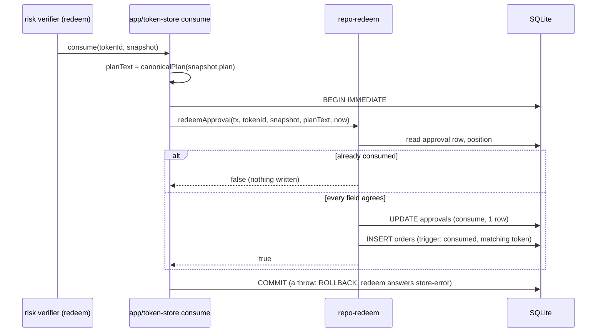

# Phase 2 step 6 design: storage layer and composition-root transactions

Status: PROPOSED by the architect (2026-11-12); built in sub-steps 6a-6e (section 7), each
reviewed by risk-guardian and security-auditor before its commit. 6a is done (REVIEWS.md N);
6b is built (REVIEWS.md O), with the differences from sections 1.1-1.3 listed in section 11.
6c is built in parts: 6c-1, the schema with the secret filter and the JSON codec (REVIEWS.md
P, differences from section 2 in section 12); 6c-2a, the authorizer, the SQL rules, the audit log
and the flags (REVIEWS.md Q, section 13); then 6c-2b in two parts: 6c-2b-1, the config and the
day state (REVIEWS.md R, section 14), and 6c-2b-2, the book and orders.
The owner accepted the four decisions of section 8 on 2026-11-13 (DECISIONS.md D5). Where this
file and ARCHITECTURE.md differ, ARCHITECTURE.md wins until a sub-step's review moves the
change there.

The design rests only on facts in docs/VERIFIED_FACTS.md (node:sqlite rows) and docs/research/phase0-toolchain.md F5-F10. Items marked UNVERIFIED are listed in section 9 for a scratch test.

Files read: fomo-bot/CLAUDE.md, docs/ARCHITECTURE.md (s.2-4, 7, 8, 11, 12), docs/RISK_POLICY.md (s.4 contracts 1-9, s.6 step 5, s.8, s.12), docs/REVIEWS.md (K, K re-review, L, M), docs/TEST_PLAN.md (s.3-4), docs/VERIFIED_FACTS.md (node:sqlite rows), src/risk/{approve,approval,daystate,blocks,recheck}.ts, src/config/{changes,tunables}.ts, src/core/{units,ids}.ts, src/portfolio/ledger.ts, tests/architecture/import-graph.test.ts, package.json.

## 0. In plain English, and what I would cut

- One file (`storage/sqlite.ts`) talks to the built-in database module. A second file (`storage/codec.ts`) is the only place amounts turn from text into bigint. Repositories are dumb typed SQL. Every money decision is written in one locked transaction in `app/`.
- The database adds its own tripwires on top of the code: one active position per mint, at most one buy order per position, at most one exit in flight per position, tokens usable once and never after their expiry slot, an order only with a consumed matching token, no mode reaches live except through go-live, and pending loosenings wait at least 24 h.
- The K gate: the token store and the slot source are bound when the authority is created in `app/`. The executor can no longer pass its own store or its own slot.
- Cuts, so it stays small:
  - no breakers table (breakers stay in memory until live owner-tap breakers exist, Phase 8);
  - no `fills`, `attempts` or `cost_lines` (they come with T3 in the paper-engine step);
  - no `ai_proposals` (Phase 5);
  - no daily `backup()` (ops step); only a synchronous `VACUUM INTO` before migrations;
  - no real clock (tests inject one).
- More I could cut if reviewers prefer: the audit hash chain (keep a plain append-only log), the audit-gated KILL and HALT triggers, and the DB copies of three hard caps (section 2.3).

## 1. Module layout

```
src/storage/            (imports core/ only at runtime; `import type` from risk/ and config/ is allowed)
  sqlite.ts             the ONLY importer of node:sqlite: openDb, Db, Tx, transaction(), quickCheck, vacuumInto, StorageError
  codec.ts              the ONLY TEXT<->bigint place: cell readers, param writers, and the SQL CHECK fragments
  migrations.ts         MIGRATIONS (ordered, literal), migrate(): version table, checksums, backup, quick_check
  schema-v1.ts          migration 1's SQL (built from codec.ts fragments; sha256 pinned in a test)
  repo-config.ts        config_versions, pending_changes
  repo-flags.ts         flags, halt_reasons, strategy_modes, entry_bans, entry_counts
  repo-day.ts           day_state, equity_snapshots
  repo-book.ts          ledger_accounts, positions
  repo-orders.ts        intents, risk_decisions, approvals, orders
  repo-audit.ts         audit_log (append, verify chain)
src/core/
  redact.ts             (new, pure) assertNoSecrets(text): refuses, never masks
  rng.ts                (new, 6d) the approval key, token ids, position and order ids
src/app/
  storage-boot.ts       open, quick_check, foreign_key_check, backup + migrate, required rows present
  authority.ts          the ONLY createApprovalAuthority call: binds the store and the slot source
  slots.ts              SlotSource: highest slot from WS and HTTP, null when older than maxAgeMs
  snapshot.ts           reads BuyWorld and EntryFlags inside a Tx
  approve-tx.ts         T1: approveBuyTx, approveExitTx, abandonOpeningTx, recordRefusalTx
  token-store.ts        T2: createSqliteTokenStore (the whole T2 runs inside consume)
  day-tx.ts             observeDayTx, confirmJumpTx, applyTransferTx, resumePeakTx, resumeStreakTx
  config-tx.ts          setTx, rollbackTx, cancelPendingTx, applyDueTx (aiApproveTx in Phase 5)
```

### 1.1 `storage/sqlite.ts`

```ts
export type SqlParam = string | bigint | null | Uint8Array;  // no `number`: nothing float-like can enter
export type SqlCell  = string | bigint | null | Uint8Array;  // a REAL cell (JS number) is refused on read
export type Row = Readonly<Record<string, SqlCell>>;

export type StorageErrorCode =
  | 'busy' | 'full' | 'io' | 'corrupt' | 'not-a-database' | 'readonly' | 'constraint'
  | 'async-in-transaction' | 'nested-transaction' | 'tx-closed' | 'poisoned' | 'closed'
  | 'bad-param' | 'bad-cell' | 'pragma' | 'foreign-file' | 'other';
export class StorageError extends Error {
  readonly code: StorageErrorCode;
  readonly detail: string;  // SQLite's errstr / RAISE text via echoText, never a bound value
}

export interface Reader {
  get(sql: string, ...params: SqlParam[]): Row | undefined;
  all(sql: string, ...params: SqlParam[]): readonly Row[];
}
export interface Tx extends Reader {
  /** One statement; returns the rows changed as a checked number. */
  run(sql: string, ...params: SqlParam[]): number;
  /** Several statements: migrations.ts only (code rule, reviewed). */
  script(sql: string): void;
}
export type NotPromise<T> = T extends PromiseLike<unknown> ? never : T;

export interface Db extends Reader {      // reads outside a transaction are autocommit, for status only
  readonly file: string;                  // ':memory:' or an absolute path
  transaction<T>(fn: (tx: Tx) => NotPromise<T>): NotPromise<T>;
  quickCheck(): readonly string[];        // [] = ok
  foreignKeyCheck(): readonly string[];
  vacuumInto(file: string): void;         // outside a transaction only
  close(): void;
}
export interface OpenOptions {
  readonly busyTimeoutMs: number;         // 5_000 in the bot; 100-200 in tests
  readonly create: boolean;               // false: a missing file is an error (never silently a new DB)
  readonly readOnly?: boolean;            // CLI status
}
export function openDb(file: string, options: OpenOptions): Db;
```

`openDb` does the following and refuses on any surprise:

- Constructs the Node class with `{ timeout: busyTimeoutMs, readBigInts: true, enableForeignKeyConstraints: true, defensive: true, allowExtension: false, readOnly }`. The class name on 26.13.0 is `Database`, with `DatabaseSync` as a deprecated alias (F7); see U1.
- Sets these pragmas: `journal_mode = WAL` (must return `wal`; `memory` only for `':memory:'`), `synchronous = FULL` (money path: no lost commit on power loss), `foreign_keys = ON` (read back as 1), `trusted_schema = OFF`, `application_id = 0x464F4D4F`.
- On a non-empty file, a different application_id gives `foreign-file`. On a file it creates, it sets the application_id. On Linux it chmods the file to 0600; the start script also sets umask 077 so `-wal` and `-shm` inherit it.

The transaction helper is the only way to write:

```ts
transaction<T>(fn: (tx: Tx) => NotPromise<T>): NotPromise<T> {
  if (this.poisoned) throw new StorageError('poisoned', '...');
  if (this.active) throw new StorageError('nested-transaction', '...');
  this.conn.exec('BEGIN IMMEDIATE');  // waits up to the busy timeout, then SQLITE_BUSY -> 'busy'
  this.active = true;
  const tx = this.makeTx();           // run/get/all/script; each checks tx.open
  let committed = false;
  try {
    const out = fn(tx);
    if (isThenable(out)) throw new StorageError('async-in-transaction', '...');  // the promise is never awaited
    this.conn.exec('COMMIT');
    committed = true;
    return out;
  } finally {
    tx.open = false;                  // a leaked tx (callback, timer) throws 'tx-closed'
    this.active = false;
    if (!committed) {
      try { this.conn.exec('ROLLBACK'); }
      catch { this.poisoned = true; } // every later call throws; app latches entries off, alerts, exits
    }
  }
}
```

A throw anywhere in `fn` (a RiskError from `approveBuy`, a CHECK or UNIQUE failure, a RAISE in a trigger, SQLITE_FULL) or in `COMMIT` ends in ROLLBACK. An `async` fn is refused before COMMIT. No `await` can sit between BEGIN and COMMIT, because `fn` runs to completion synchronously before `transaction` returns. Statements are prepared once per SQL text and cached. All SQL is constant text with `?` parameters, never built from values.

### 1.2 `storage/codec.ts`

This file wraps core/units (`toText`, `lamportsFromText`, `tokenUnitsFromText`, `signedLamportsFromText`, which already require canonical text and at most 21 characters). It is the only file that converts amounts.

```ts
export function lamportsCell(r: Row, col: string): Lamports;            // also tokenUnitsCell, signedCell
export function lamportsCellOrNull(r: Row, col: string): Lamports | null;
export function msCell(r: Row, col: string): number;    // INTEGER bigint -> number, isTimestamp
export function intCell(r: Row, col: string, min: number, max: number): number;
export function slotCell(r: Row, col: string): bigint;  // INTEGER >= 0
export function boolCell(r: Row, col: string): boolean; // 0n | 1n only
export function textCell(r: Row, col: string): string;
export function amountParam(v: bigint): string;         // u64-checked canonical text
export function signedParam(v: bigint): string;
export function msParam(v: number): bigint;
export function intParam(v: number): bigint;
export function boolParam(v: boolean): bigint;
export function codeParam(v: string): string;   // /^[a-z0-9][a-z0-9:._-]{0,63}$/: reasons are codes, never prose
export function jsonParam(v: unknown): string;  // bigints as text, ASCII only, <= 8 KiB, then assertNoSecrets
// SQL fragments; schema-v1.ts uses them, so each column's constraint and its codec are defined side by side:
const U64_MAX_TEXT = '18446744073709551615';
export const u64 = (c: string) =>
  `(length(${c}) BETWEEN 1 AND 20 AND ${c} NOT GLOB '*[^0-9]*' AND (${c} = '0' OR ${c} NOT GLOB '0*')` +
  ` AND (length(${c}) < 20 OR ${c} <= '${U64_MAX_TEXT}'))`;
export const u64OrNull = (c: string) => `(${c} IS NULL OR ${u64(c)})`;
export const signed = (c: string) => `(${u64(c)} OR (${c} GLOB '-[1-9]*' AND ${u64(`substr(${c}, 2)`)}))`;
export const ms     = (c: string) => `(${c} BETWEEN 0 AND 7258118400000)`;  // core/time MAX_TIMESTAMP_MS
export const msOrNull = (c: string) => `(${c} IS NULL OR ${ms(c)})`;
export const bool   = (c: string) => `(${c} IN (0, 1))`;
export const id     = (c: string) => `(length(${c}) BETWEEN 1 AND 128 AND ${c} NOT GLOB '*[^A-Za-z0-9_-]*')`; // = isIdText
export const code   = (c: string) => `(length(${c}) BETWEEN 1 AND 64 AND ${c} NOT GLOB '*[^a-z0-9:._-]*')`;
export const day    = (c: string) => `(${c} GLOB '[0-9][0-9][0-9][0-9]-[0-1][0-9]-[0-3][0-9]')`;
export const hex64  = (c: string) => `(length(${c}) = 64 AND ${c} NOT GLOB '*[^0-9a-f]*')`;
export const json   = (c: string) => `(json_valid(${c}) AND ${c} NOT GLOB '*[^ -~]*')`;
```

Text comparison against `U64_MAX_TEXT` is only done when the lengths are equal (20 digits), where text order equals numeric order. Slots stay INTEGER: they need numeric comparison in SQL, and a slot above 2^63-1 is refused at bind (ERR_INVALID_ARG_VALUE, F10), which fails closed. Timestamps are INTEGER ms.

### 1.3 `storage/migrations.ts`

```ts
export interface Migration { readonly version: number; readonly name: string; readonly sql: string }
export const MIGRATIONS: readonly Migration[];  // 1..N, consecutive, frozen; no '\r' in any sql (test)
export interface MigrateOptions {
  readonly now: () => number;
  readonly backupDir: string | null;  // null only for ':memory:'
  readonly nodeVersion: string;
}
export interface MigrateResult { readonly from: number; readonly to: number; readonly backup: string | null }
export function migrate(db: Db, options: MigrateOptions): MigrateResult;
```

The rules:

- An empty file (no rows in sqlite_schema) is a new DB.
- Tables but no `schema_migrations` means `foreign-file`: refuse.
- A recorded sha256 that differs from the code's means an applied migration was edited: refuse to start.
- A DB version above the code's latest means old code on a newer DB: refuse to start.
- Pending migrations: `quick_check` first, then `VACUUM INTO <backupDir>/pre-migration-v<from>-v<to>-<YYYYMMDDTHHMMSSZ>.sqlite` (no colons, so it works on Windows), then each migration in its own `transaction()` that also inserts its schema_migrations row. Then `quick_check` and `foreign_key_check` again.
- A second run is a no-op (idempotent).
- There is no down migration, ever.

### 1.4 Repositories

Plain functions of `(r: Reader | tx: Tx, ...)` returning typed rows (core types; `import type` for EquityState and similar). They never validate domain rules; the pure checkers (`checkHistory`, `checkPending`, `observeEquity` input checks, `approveBuy` input checks) re-validate everything that comes back. Each write function asserts its `changes` count: a delete or update that should hit exactly 1 row throws otherwise. A missing required row (`flags`, `day_state` for the mode, `ledger_accounts` for the mode, version 1) throws. It is never replaced by a default (contract 1).

## 2. DDL for step 6 (migration 1)

This is shown as the template string in `schema-v1.ts`. `${...}` are the codec.ts fragments above. Every table is STRICT.

```sql
CREATE TABLE schema_migrations (
  version INTEGER PRIMARY KEY CHECK (version >= 1),
  name TEXT NOT NULL CHECK ${code('name')},
  sha256 TEXT NOT NULL CHECK ${hex64('sha256')},
  applied_at INTEGER NOT NULL CHECK ${ms('applied_at')},
  node_version TEXT NOT NULL, sqlite_version TEXT NOT NULL
) STRICT;

-- config (matches ConfigVersion and PendingChange of config/changes.ts)
CREATE TABLE config_versions (
  id INTEGER PRIMARY KEY CHECK (id >= 1),
  created_at INTEGER NOT NULL CHECK ${ms('created_at')},
  author TEXT NOT NULL CHECK (author IN ('default','owner','ai-approved','rollback')),
  values_json TEXT NOT NULL CHECK ${json('values_json')},    -- encodeTunables(): lamports as decimal text
  changed_json TEXT NOT NULL CHECK ${json('changed_json')},  -- TunablePath[]
  undo_to INTEGER REFERENCES config_versions(id),
  CHECK ((id = 1) = (author = 'default')),
  CHECK (undo_to IS NULL OR undo_to < id),
  CHECK (id <> 1 OR (undo_to IS NULL AND changed_json = '[]'))
) STRICT;  -- the active version is the newest one (no "active" column)
CREATE TRIGGER config_versions_in_order BEFORE INSERT ON config_versions
  WHEN NEW.id <> (SELECT COALESCE(MAX(id), 0) + 1 FROM config_versions)
    OR NEW.created_at < (SELECT COALESCE(MAX(created_at), 0) FROM config_versions)
  BEGIN SELECT RAISE(ABORT, 'config version out of order'); END;
CREATE TRIGGER config_versions_no_update BEFORE UPDATE ON config_versions BEGIN SELECT RAISE(ABORT, 'config versions are immutable'); END;
CREATE TRIGGER config_versions_no_delete BEFORE DELETE ON config_versions BEGIN SELECT RAISE(ABORT, 'config versions are immutable'); END;

CREATE TABLE pending_changes (
  path TEXT PRIMARY KEY CHECK (length(path) <= 64 AND path GLOB '[a-z]*.[a-zA-Z]*' AND path NOT GLOB '*[^a-zA-Z0-9.]*'),
  from_value TEXT NOT NULL CHECK ${u64('from_value')},  -- every tunable is a non-negative integer
  to_value TEXT NOT NULL CHECK ${u64('to_value')},
  source TEXT NOT NULL CHECK (source IN ('owner','ai-approved','rollback')),
  requested_at INTEGER NOT NULL CHECK ${ms('requested_at')},
  apply_at INTEGER NOT NULL CHECK ${ms('apply_at')},
  CHECK (apply_at - requested_at >= 86400000)            -- LOOSENING_DELAY_MS, also enforced here
) STRICT;  -- PRIMARY KEY(path): at most one pending row per tunable

-- flags (kill, pause, entries stopped, halt cleared; the arm flag is the server's and is NOT stored)
CREATE TABLE flags (
  id INTEGER PRIMARY KEY CHECK (id = 1),
  kill INTEGER NOT NULL CHECK ${bool('kill')},
  kill_at INTEGER CHECK ${msOrNull('kill_at')},
  kill_source TEXT CHECK (kill_source IS NULL OR kill_source IN ('cli','telegram','sentinel')),
  paused INTEGER NOT NULL CHECK ${bool('paused')},
  paused_at INTEGER CHECK ${msOrNull('paused_at')},
  entries_stopped INTEGER NOT NULL CHECK ${bool('entries_stopped')},
  halt_cleared_at INTEGER CHECK ${msOrNull('halt_cleared_at')},
  updated_at INTEGER NOT NULL CHECK ${ms('updated_at')},
  CHECK ((kill = 1) = (kill_at IS NOT NULL AND kill_source IS NOT NULL)),
  CHECK ((paused = 1) = (paused_at IS NOT NULL))
) STRICT;
INSERT INTO flags VALUES (1, 0, NULL, NULL, 0, NULL, 0, NULL, 0);

CREATE TABLE halt_reasons (
  reason TEXT PRIMARY KEY CHECK ${code('reason')},  -- e.g. 'sanity-max:paper', 'peak-halt:paper', 'disk-db'
  set_at INTEGER NOT NULL CHECK ${ms('set_at')}
) STRICT;  -- HALT = at least one row; global (both modes), the stricter reading

CREATE TABLE strategy_modes (
  strategy TEXT PRIMARY KEY CHECK (strategy IN ('crowdflow','momentum','launch')),
  mode TEXT NOT NULL CHECK (mode IN ('off','paper','live')),
  changed_at INTEGER NOT NULL CHECK ${ms('changed_at')},
  changed_by TEXT NOT NULL CHECK (changed_by IN ('migration','owner-off','owner-paper','owner-golive','auto-demote')),
  gate_since INTEGER NOT NULL CHECK ${ms('gate_since')},  -- go-live count restarts (Effects.restartGate)
  CHECK (mode <> 'live' OR changed_by = 'owner-golive')    -- invariant 24 as a DB tripwire
) STRICT;
INSERT INTO strategy_modes VALUES ('crowdflow','off',0,'migration',0), ('momentum','off',0,'migration',0), ('launch','off',0,'migration',0);

CREATE TABLE entry_bans (  -- cooldowns and blocklists that EntryState needs
  kind TEXT NOT NULL CHECK (kind IN ('mint-cooldown','mint-ban','creator-ban','strategy-pause','strategy-off')),
  key TEXT NOT NULL CHECK ${id('key')},  -- a mint, a creator address or a strategy id
  until INTEGER CHECK ${msOrNull('until')},
  reason TEXT NOT NULL CHECK ${code('reason')},
  set_at INTEGER NOT NULL CHECK ${ms('set_at')},
  PRIMARY KEY (kind, key),
  CHECK ((until IS NULL) = (kind IN ('mint-ban','creator-ban'))),
  CHECK (kind NOT IN ('strategy-pause','strategy-off') OR key IN ('crowdflow','momentum','launch'))
) STRICT;

CREATE TABLE entry_counts (  -- one shared count per Athens day (paper and live together, review L)
  day TEXT PRIMARY KEY CHECK ${day('day')},
  count INTEGER NOT NULL CHECK (count BETWEEN 1 AND 12)  -- 12 = HARD_CAPS.entriesPerDay (test ties them)
) STRICT;
CREATE TRIGGER entry_counts_first BEFORE INSERT ON entry_counts WHEN NEW.count <> 1
  BEGIN SELECT RAISE(ABORT, 'a day starts at one entry'); END;
CREATE TRIGGER entry_counts_step BEFORE UPDATE ON entry_counts WHEN NEW.count <> OLD.count + 1 OR NEW.day <> OLD.day
  BEGIN SELECT RAISE(ABORT, 'entries count up by exactly one'); END;
CREATE TRIGGER entry_counts_no_delete BEFORE DELETE ON entry_counts BEGIN SELECT RAISE(ABORT, 'entry counts are kept'); END;

-- day state (EquityState of risk/daystate.ts, one row per ledger mode; contract 1 and 9)
CREATE TABLE day_state (
  mode TEXT PRIMARY KEY CHECK (mode IN ('paper','live')),
  shape INTEGER NOT NULL CHECK (shape = 1),  -- the stored shape; a new field = a migration with a backfill, never a code default
  day TEXT CHECK (day IS NULL OR ${day('day')}),
  day_start TEXT NOT NULL CHECK ${u64('day_start')},
  last_equity TEXT NOT NULL CHECK ${u64('last_equity')},
  peak TEXT CHECK ${u64OrNull('peak')},
  jump_pending INTEGER NOT NULL CHECK ${bool('jump_pending')},
  jump_held_equity TEXT CHECK ${u64OrNull('jump_held_equity')},
  jump_held_at INTEGER CHECK ${msOrNull('jump_held_at')},
  jump_ack_equity TEXT CHECK ${u64OrNull('jump_ack_equity')},
  jump_ack_at INTEGER CHECK ${msOrNull('jump_ack_at')},
  daily_stop_day TEXT CHECK (daily_stop_day IS NULL OR ${day('daily_stop_day')}),
  daily_stop_streak INTEGER NOT NULL CHECK (daily_stop_streak >= 0),
  streak_halt INTEGER NOT NULL CHECK ${bool('streak_halt')},
  updated_at INTEGER NOT NULL CHECK ${ms('updated_at')},
  CHECK ((jump_held_equity IS NULL) = (jump_held_at IS NULL)),
  CHECK ((jump_ack_equity IS NULL) = (jump_ack_at IS NULL)),
  CHECK (jump_pending = (jump_held_equity IS NOT NULL))  -- "set exactly while jumpPending"
) STRICT;
INSERT INTO day_state VALUES ('paper',1,NULL,'0','0',NULL,0,NULL,NULL,NULL,NULL,NULL,0,0,0),
                             ('live', 1,NULL,'0','0',NULL,0,NULL,NULL,NULL,NULL,NULL,0,0,0);
CREATE TRIGGER day_state_no_delete BEFORE DELETE ON day_state BEGIN SELECT RAISE(ABORT, 'day state is never deleted'); END;

CREATE TABLE equity_snapshots (  -- contract 6: raw, fully valued snapshots, the only source of equityAnHourAgo
  mode TEXT NOT NULL CHECK (mode IN ('paper','live')),
  at INTEGER NOT NULL CHECK ${ms('at')},
  equity TEXT CHECK ${u64OrNull('equity')},
  stop_equity TEXT CHECK ${u64OrNull('stop_equity')},
  PRIMARY KEY (mode, at)
) STRICT;

-- book
CREATE TABLE ledger_accounts (  -- rows are created by the app at first boot (paper: paperStartingLamports as a deposit)
  mode TEXT PRIMARY KEY CHECK (mode IN ('paper','live')),
  sol TEXT NOT NULL CHECK ${u64('sol')},
  total_deposits TEXT NOT NULL CHECK ${u64('total_deposits')},
  total_withdrawals TEXT NOT NULL CHECK ${u64('total_withdrawals')},
  updated_at INTEGER NOT NULL CHECK ${ms('updated_at')}
) STRICT;

CREATE TABLE positions (  -- the Position of portfolio/ledger.ts plus mode, status 'stuck', max_spend, p95, exit_seq
  id TEXT PRIMARY KEY CHECK ${id('id')},
  mint TEXT NOT NULL CHECK ${id('mint')},
  strategy TEXT NOT NULL CHECK (strategy IN ('crowdflow','momentum','launch')),
  mode TEXT NOT NULL CHECK (mode IN ('paper','live')),
  status TEXT NOT NULL CHECK (status IN ('opening','open','exiting','stuck','closed')),
  opened_at INTEGER NOT NULL CHECK ${ms('opened_at')},
  closed_at INTEGER CHECK ${msOrNull('closed_at')},
  max_spend TEXT CHECK ${u64OrNull('max_spend')},
  p95_exit_cost TEXT NOT NULL CHECK ${u64('p95_exit_cost')},
  exit_seq INTEGER NOT NULL DEFAULT 0 CHECK (exit_seq >= 0),
  token_units TEXT NOT NULL DEFAULT '0' CHECK ${u64('token_units')},
  cost_basis TEXT NOT NULL DEFAULT '0' CHECK ${u64('cost_basis')},
  rent_locked TEXT NOT NULL DEFAULT '0' CHECK ${u64('rent_locked')},
  realized TEXT NOT NULL DEFAULT '0' CHECK ${signed('realized')},
  bought TEXT NOT NULL DEFAULT '0' CHECK ${u64('bought')},
  sold TEXT NOT NULL DEFAULT '0' CHECK ${u64('sold')},
  venue_fees TEXT NOT NULL DEFAULT '0' CHECK ${u64('venue_fees')},
  network_fees TEXT NOT NULL DEFAULT '0' CHECK ${u64('network_fees')},
  failed_fees TEXT NOT NULL DEFAULT '0' CHECK ${u64('failed_fees')},
  tips TEXT NOT NULL DEFAULT '0' CHECK ${u64('tips')},
  rent_paid TEXT NOT NULL DEFAULT '0' CHECK ${u64('rent_paid')},
  rent_refunded TEXT NOT NULL DEFAULT '0' CHECK ${u64('rent_refunded')},
  tokens_bought TEXT NOT NULL DEFAULT '0' CHECK ${u64('tokens_bought')},
  tokens_sold TEXT NOT NULL DEFAULT '0' CHECK ${u64('tokens_sold')},
  exit_fees TEXT NOT NULL DEFAULT '0' CHECK ${u64('exit_fees')},
  basis_released TEXT NOT NULL DEFAULT '0' CHECK ${u64('basis_released')},
  updated_at INTEGER NOT NULL CHECK ${ms('updated_at')},
  CHECK ((status = 'closed') = (closed_at IS NOT NULL)),
  CHECK (status <> 'opening' OR max_spend IS NOT NULL),
  CHECK (max_spend IS NULL OR length(max_spend) < 8 OR (length(max_spend) = 8 AND max_spend <= '70000000'))  -- 0.07 SOL backstop
) STRICT;
CREATE UNIQUE INDEX positions_one_per_mint ON positions(mint) WHERE status IN ('opening','open','exiting','stuck');
CREATE TRIGGER positions_born_opening BEFORE INSERT ON positions WHEN NEW.status <> 'opening'
  BEGIN SELECT RAISE(ABORT, 'a position starts as opening'); END;
CREATE TRIGGER positions_cap BEFORE INSERT ON positions
  WHEN (SELECT COUNT(*) FROM positions WHERE status IN ('opening','open','exiting','stuck')) >= 4  -- HARD_CAPS.openPositions
  BEGIN SELECT RAISE(ABORT, 'more than 4 active positions'); END;
CREATE TRIGGER positions_identity BEFORE UPDATE OF id, mint, strategy, mode, opened_at ON positions
  BEGIN SELECT RAISE(ABORT, 'a position keeps its identity'); END;
CREATE TRIGGER positions_closed_final BEFORE UPDATE ON positions WHEN OLD.status = 'closed'
  BEGIN SELECT RAISE(ABORT, 'a closed position is final'); END;
CREATE TRIGGER positions_no_delete BEFORE DELETE ON positions BEGIN SELECT RAISE(ABORT, 'positions are kept'); END;

-- money path
CREATE TABLE intents (
  id TEXT PRIMARY KEY CHECK ${id('id')},  -- entry: hash(strategy, mint, side, window); exit: hash(positionId, exitSeq)
  kind TEXT NOT NULL CHECK (kind IN ('entry','exit')),
  mode TEXT NOT NULL CHECK (mode IN ('paper','live')),
  strategy TEXT CHECK (strategy IS NULL OR strategy IN ('crowdflow','momentum','launch')),
  mint TEXT NOT NULL CHECK ${id('mint')},
  position_id TEXT NOT NULL CHECK ${id('position_id')},  -- no FK: an entry's position exists only if approved
  size_hint TEXT CHECK (size_hint IS NULL OR size_hint IN ('min','normal')),
  confidence_bps INTEGER CHECK (confidence_bps IS NULL OR confidence_bps BETWEEN 0 AND 10000),
  exit_seq INTEGER CHECK (exit_seq IS NULL OR exit_seq >= 0),
  fraction_bps INTEGER CHECK (fraction_bps IS NULL OR fraction_bps BETWEEN 1 AND 10000),
  urgency TEXT CHECK (urgency IS NULL OR urgency IN ('normal','protective','emergency')),
  created_at INTEGER NOT NULL CHECK ${ms('created_at')},
  inputs_as_of INTEGER CHECK ${msOrNull('inputs_as_of')},
  reasons_json TEXT NOT NULL CHECK ${json('reasons_json')},
  inputs_json TEXT NOT NULL CHECK ${json('inputs_json')},
  CHECK ((kind = 'entry') = (strategy IS NOT NULL AND size_hint IS NOT NULL AND exit_seq IS NULL)),
  CHECK ((kind = 'exit') = (exit_seq IS NOT NULL AND fraction_bps IS NOT NULL AND urgency IS NOT NULL))
) STRICT;
CREATE UNIQUE INDEX intents_one_per_exit_seq ON intents(position_id, exit_seq) WHERE kind = 'exit';
CREATE TRIGGER intents_no_update BEFORE UPDATE ON intents BEGIN SELECT RAISE(ABORT, 'intents are immutable'); END;
CREATE TRIGGER intents_no_delete BEFORE DELETE ON intents BEGIN SELECT RAISE(ABORT, 'intents are immutable'); END;

CREATE TABLE risk_decisions (  -- one decision per intent
  intent_id TEXT PRIMARY KEY REFERENCES intents(id),
  at INTEGER NOT NULL CHECK ${ms('at')},
  approved INTEGER NOT NULL CHECK ${bool('approved')},
  stage TEXT CHECK (stage IS NULL OR stage IN ('blocked','sizing','plan','duplicate','error')),
  reasons_json TEXT NOT NULL CHECK ${json('reasons_json')},  -- fixed codes only: block names, sizing:x, plan:x
  size TEXT CHECK ${u64OrNull('size')},
  limited_by TEXT CHECK (limited_by IS NULL OR ${code('limited_by')}),
  binding TEXT CHECK (binding IS NULL OR ${code('binding')}),
  slot INTEGER NOT NULL CHECK (slot >= 0),
  config_version INTEGER NOT NULL REFERENCES config_versions(id),
  CHECK ((approved = 1) = (stage IS NULL))
) STRICT;
CREATE TRIGGER risk_decisions_no_update BEFORE UPDATE ON risk_decisions BEGIN SELECT RAISE(ABORT, 'decisions are immutable'); END;
CREATE TRIGGER risk_decisions_no_delete BEFORE DELETE ON risk_decisions BEGIN SELECT RAISE(ABORT, 'decisions are immutable'); END;

CREATE TABLE approvals (  -- tokens; the MAC is not stored (per-boot key: worthless after a restart)
  token_id TEXT PRIMARY KEY CHECK ${id('token_id')},
  intent_id TEXT NOT NULL UNIQUE REFERENCES risk_decisions(intent_id),
  position_id TEXT NOT NULL REFERENCES positions(id),
  mode TEXT NOT NULL CHECK (mode IN ('paper','live')),
  kind TEXT NOT NULL CHECK (kind IN ('buy','sell','close-account')),  -- withdraw has its own path
  reduce_only INTEGER NOT NULL CHECK ${bool('reduce_only')},
  plan_hash TEXT NOT NULL CHECK ${hex64('plan_hash')},
  max_spend TEXT NOT NULL CHECK ${u64('max_spend')},
  min_out TEXT NOT NULL CHECK ${u64('min_out')},
  quote_slot INTEGER NOT NULL CHECK (quote_slot >= 0),
  expires_at_slot INTEGER NOT NULL,
  issued_at INTEGER NOT NULL CHECK ${ms('issued_at')},
  consumed_at INTEGER CHECK ${msOrNull('consumed_at')},
  consumed_slot INTEGER,
  CHECK (reduce_only = (kind IN ('sell','close-account'))),
  CHECK (expires_at_slot >= quote_slot AND expires_at_slot - quote_slot <= 25),  -- HARD_CAPS.planFreshSlots
  CHECK ((consumed_at IS NULL) = (consumed_slot IS NULL)),
  CHECK (consumed_slot IS NULL OR consumed_slot <= expires_at_slot)               -- never consumed after expiry
) STRICT;
CREATE TRIGGER approvals_single_use BEFORE UPDATE ON approvals
  WHEN OLD.consumed_at IS NOT NULL OR NEW.consumed_at IS NULL
    OR NEW.token_id IS NOT OLD.token_id OR NEW.intent_id IS NOT OLD.intent_id OR NEW.position_id IS NOT OLD.position_id
    OR NEW.mode IS NOT OLD.mode OR NEW.kind IS NOT OLD.kind OR NEW.plan_hash IS NOT OLD.plan_hash
    OR NEW.max_spend IS NOT OLD.max_spend OR NEW.min_out IS NOT OLD.min_out OR NEW.expires_at_slot IS NOT OLD.expires_at_slot
  BEGIN SELECT RAISE(ABORT, 'a token is consumed once and otherwise immutable'); END;
CREATE TRIGGER approvals_no_delete BEFORE DELETE ON approvals BEGIN SELECT RAISE(ABORT, 'tokens are kept'); END;

CREATE TABLE orders (
  id TEXT PRIMARY KEY CHECK ${id('id')},  -- plan.orderId
  intent_id TEXT NOT NULL UNIQUE REFERENCES intents(id),
  token_id TEXT NOT NULL UNIQUE REFERENCES approvals(token_id),
  position_id TEXT NOT NULL REFERENCES positions(id),
  mode TEXT NOT NULL CHECK (mode IN ('paper','live')),
  kind TEXT NOT NULL CHECK (kind IN ('buy','sell','close-account')),
  status TEXT NOT NULL CHECK (status IN ('approved','submitted','landed','failed','expired')),
  plan_hash TEXT NOT NULL CHECK ${hex64('plan_hash')},
  plan_json TEXT NOT NULL CHECK ${json('plan_json')},  -- canonicalJson(validated plan)
  in_amount TEXT NOT NULL CHECK ${u64('in_amount')},
  min_out TEXT NOT NULL CHECK ${u64('min_out')},
  max_spend TEXT NOT NULL CHECK ${u64('max_spend')},
  quote_slot INTEGER NOT NULL CHECK (quote_slot >= 0),
  created_at INTEGER NOT NULL CHECK ${ms('created_at')},
  updated_at INTEGER NOT NULL CHECK ${ms('updated_at')}
) STRICT;
CREATE UNIQUE INDEX orders_one_buy_per_position ON orders(position_id) WHERE kind = 'buy';  -- K finding 4, "ever"
CREATE UNIQUE INDEX orders_one_exit_in_flight ON orders(position_id)
  WHERE kind IN ('sell','close-account') AND status IN ('approved','submitted');
CREATE TRIGGER orders_need_consumed_token BEFORE INSERT ON orders
  WHEN NOT EXISTS (SELECT 1 FROM approvals a WHERE a.token_id = NEW.token_id AND a.consumed_at IS NOT NULL
    AND a.intent_id = NEW.intent_id AND a.position_id = NEW.position_id AND a.mode = NEW.mode
    AND a.kind = NEW.kind AND a.plan_hash = NEW.plan_hash AND a.max_spend = NEW.max_spend AND a.min_out = NEW.min_out)
    OR NEW.status <> 'approved'
  BEGIN SELECT RAISE(ABORT, 'an order needs its consumed, matching token'); END;
CREATE TRIGGER orders_status_forward BEFORE UPDATE OF status ON orders
  WHEN NOT ((OLD.status = 'approved' AND NEW.status IN ('submitted','failed','expired'))
         OR (OLD.status = 'submitted' AND NEW.status IN ('landed','failed','expired')))
  BEGIN SELECT RAISE(ABORT, 'order status moves forward only'); END;
CREATE TRIGGER orders_identity BEFORE UPDATE OF id, intent_id, token_id, position_id, mode, kind, plan_hash, plan_json,
  in_amount, min_out, max_spend, quote_slot, created_at ON orders BEGIN SELECT RAISE(ABORT, 'an order is immutable'); END;
CREATE TRIGGER orders_no_delete BEFORE DELETE ON orders BEGIN SELECT RAISE(ABORT, 'orders are kept'); END;

-- audit (config commands and dangerous commands; hash-chained)
CREATE TABLE audit_log (
  id INTEGER PRIMARY KEY,
  at INTEGER NOT NULL CHECK ${ms('at')},
  actor TEXT NOT NULL CHECK (actor IN ('owner-telegram','owner-server','engine','ai')),
  action TEXT NOT NULL CHECK ${code('action')},
  detail_json TEXT NOT NULL CHECK ${json('detail_json')},
  prev_hash TEXT NOT NULL CHECK ${hex64('prev_hash')},
  hash TEXT NOT NULL UNIQUE CHECK ${hex64('hash')}  -- sha256(prev_hash '\n' canonical(at, actor, action, detail))
) STRICT;
CREATE TRIGGER audit_no_update BEFORE UPDATE ON audit_log BEGIN SELECT RAISE(ABORT, 'audit is append-only'); END;
CREATE TRIGGER audit_no_delete BEFORE DELETE ON audit_log BEGIN SELECT RAISE(ABORT, 'audit is append-only'); END;

-- owner-only clears must leave an audit row first, in the same transaction (tripwire; could be cut)
CREATE TRIGGER flags_kill_clear BEFORE UPDATE OF kill ON flags WHEN OLD.kill = 1 AND NEW.kill = 0
  AND (SELECT action FROM audit_log ORDER BY id DESC LIMIT 1) IS NOT 'server:clear-kill'
  BEGIN SELECT RAISE(ABORT, 'KILL is cleared only by reset-halt --clear-kill'); END;
CREATE TRIGGER halt_reasons_clear BEFORE DELETE ON halt_reasons
  WHEN (SELECT action FROM audit_log ORDER BY id DESC LIMIT 1) NOT IN ('server:reset-halt','owner:resume-peak','owner:resume-streak')
  BEGIN SELECT RAISE(ABORT, 'a halt is cleared only by the owner'); END;
```

### 2.1 Tables that wait for later steps

- `attempts`, `fills`, `cost_lines`: T3 settle, paper engine.
- `marks`: exit loop.
- `shadow_fills`, `twin_trades`, `tournament_results`: Phase 5.
- `tokens` (mint facts), `safety_verdicts`, `flow_minutes`, `health_events`, `budget_usage`: Phase 3.
- `breakers`: Phase 8 owner-tap breakers.
- `telegram_auth`, `confirmations`, `outbox`: Telegram step.
- `ai_reviews`, `ai_proposals` (the "approved at most once" column): Phase 5.
- A live `/resume` pending row: Phase 8.
- Rich creator-blocklist detail: Phase 3. `entry_bans` covers what T1 reads.

### 2.2 Who enforces what

| Rule | Database | Code only |
|---|---|---|
| One active position per mint | partial unique index | approveBuy one-per-mint |
| At most 4 active positions | `positions_cap` trigger (hard value) | blocks + buyLimitViolations (config, live caps) |
| One buy order per position, ever | `orders_one_buy_per_position` | re-check `buyOrdersForPosition` |
| One exit in flight per position | `orders_one_exit_in_flight` (sell and close) | re-check `inFlightExits` |
| Token single use, never after expiry, immutable | approvals CHECKs + `approvals_single_use` | verifier (MAC, plan hash, mode, kind, slot) |
| Order only with a consumed matching token | `orders_need_consumed_token`, UNIQUE(intent_id), UNIQUE(token_id) | T2 compares the snapshot with the row |
| Entry count +1 only, at most 12 | entry_counts CHECK + triggers | blocks (tunable, live 5) |
| Opening max_spend at most 0.07 SOL | CHECK | re-check backstop |
| No live mode except /golive | strategy_modes CHECK | changes.ts writes no mode |
| Pending waits at least 24 h, one per tunable | CHECK, PK(path) | changes.ts checkPending |
| Versions consecutive, immutable, first is default | triggers + CHECKs | checkHistory (changed equals the actual diff) |
| Amounts canonical u64 / signed text, no floats | CHECK fragments, STRICT, no REAL columns | codec.ts, wrapper refuses `number` |
| Day state shape and jump consistency | CHECKs, shape = 1 | observeEquity |
| KILL / HALT cleared only by the owner | audit-gated triggers (tripwire) | only owner CLI functions call clear |
| Caps, sizing, reserve, exposure, equity, freshness | no | risk/ (pure) |
| Exit fraction vs plan size (K finding 9) | no | exit plan builder (open) |

## 3. The app/ transactions

Shared dependencies:

```ts
export interface Clock { now(): number }              // the guarded clock arrives with contract 8; tests inject
export interface MarkReader {                         // synchronous, in memory (the exit loop's cache)
  /** The exact sell quote of exactly `tokenUnits` after fees; null if none, stale, future-stamped or a different amount. */
  value(positionId: string, tokenUnits: TokenUnits, now: number): Lamports | null;
}
export interface EngineDeps {
  readonly db: Db;
  readonly clock: Clock;
  readonly slots: SlotSource;                        // the same instance bound into the authority
  readonly issuer: ApprovalIssuer;                   // from app/authority.ts
  readonly marks: MarkReader;
  readonly liveArmed: () => boolean;                 // the server's arm flag; paper: () => false
  readonly liveSol: () => LiveSolCaps | null;        // today's EUR caps (live only)
}
```

Everything the transaction reads, it reads inside the transaction. Inputs from outside are only the intent, the untrusted plan, and risk's own market read (BuyMarket / exit quote), which carry their own slots and are checked by the re-check. Alerts and replies go out only after COMMIT.

### 3.1 T1 approve buy

```ts
export interface BuyRequest {
  readonly intent: BuyIntent;     // risk/approve.ts BuyIntent (strategy output); its id is the deterministic hash
  readonly positionId: string;    // engine-made (core/rng)
  readonly plan: OrderPlan;       // untrusted
  readonly market: BuyMarket;     // risk's own read (safety, quote, fee config, rent, p95)
}
export type BuyOutcome =
  | { readonly kind: 'approved'; readonly token: ApprovalToken; readonly plan: CheckedPlan; readonly positionId: string }
  | { readonly kind: 'refused'; readonly stage: 'blocked' | 'sizing' | 'plan'; readonly reasons: readonly string[] }
  | { readonly kind: 'duplicate' }
  | { readonly kind: 'error'; readonly code: string };  // rolled back; recorded by recordRefusalTx
export function approveBuyTx(deps: EngineDeps, req: BuyRequest): BuyOutcome;
```

Inside one `db.transaction` (BEGIN IMMEDIATE):

1. `now = clock.now()`, `day = athensDay(now)`, `slot = slots.currentSlot()`. A null slot throws, which rolls back and becomes `error: slot-unknown`.
2. If `intents` already has `intent.id`, return `duplicate` (the PK is the backstop). Otherwise insert the intent (reasons and inputs through `jsonParam`, so the redactor runs).
3. Read `flags`, `halt_reasons`, `strategy_modes`, the `entry_bans` with `until` > now or null, `entry_counts[day]` (0 if none), and every position where status is in (opening, open, exiting, stuck). Read `ledger_accounts[mode]` (walletSol; live later: min(ledger, chain)), `day_state[mode]` (dayStart, dailyStopActive, jumpPending) and the newest `config_versions` row (decodeTunables gives entriesPerDay, maxPositions, the caps).
4. Build ActivePosition[]: an opening position carries `maxSpend`; open and exiting ones carry `marks.value(id, token_units, now)`; a stuck one is 0. Any null mark makes `equity.current = null` (blocked).
5. `decision = approveBuy({ intent, plan, world, market, caps }, deps.issuer)`. This is pure and synchronous. It throws on malformed input.
6. If approved:
   - INSERT positions (opening, max_spend = opening.maxSpend, p95 from market);
   - UPSERT entry_counts: `INSERT ... VALUES (?, 1) ON CONFLICT(day) DO UPDATE SET count = count + 1`, then assert the stored count equals `decision.entriesToday`;
   - INSERT risk_decisions (approved, size, limitedBy, binding, slot, config_version);
   - INSERT approvals (token fields, issued_at, quote_slot = plan.quoteSlot).
7. If refused: INSERT risk_decisions (stage, reasons).
8. COMMIT. Return the token and plan only now. The token is useless without its approvals row anyway, because T2 requires it.

A throw at any point (RiskError, AmountError, ConfigError, StorageError: partial index, positions_cap, entry_counts trigger, SQLITE_FULL) rolls back steps 2-7 entirely. The caller then runs `recordRefusalTx(deps, intent, 'error', [code])` in a new tiny transaction (intent + decision, fixed code) and alerts. If that also fails, the in-memory latch `entriesBlocked = true` is set and the owner is alerted outside the DB (section 6).

```mermaid
sequenceDiagram
  participant Eng as Engine (async tick)
  participant App as app/approve-tx (sync)
  participant DB as SQLite (one connection)
  participant Risk as risk/approveBuy (pure)
  Eng->>Eng: await safety, quote, fee config (BuyMarket)
  Eng->>App: approveBuyTx(deps, req)
  App->>DB: BEGIN IMMEDIATE (busy timeout 5 s)
  App->>DB: intent exists? insert intent
  App->>DB: read flags, halts, modes, bans, count, positions, ledger, day_state, config
  App->>App: marks (memory, sync), slot (SlotSource)
  App->>Risk: approveBuy(world, market, caps, issuer)
  Risk-->>App: decision (token issued last)
  alt approved
    App->>DB: insert position (opening), count +1, decision, approval row
  else refused
    App->>DB: insert decision (stage, reasons)
  end
  App->>DB: COMMIT
  Note over App,DB: any throw before COMMIT: ROLLBACK, nothing written; then recordRefusalTx
  App-->>Eng: outcome (token and plan only after COMMIT)
```

### 3.2 T1 approve exit

```ts
export interface ExitRequest {
  readonly positionId: string;
  readonly fractionBps: Bps;
  readonly urgency: PlanUrgency;
  readonly reason: string;  // a code
  readonly origin: ExitOrigin;
  readonly plan: OrderPlan;
  readonly quote: QuoteContext; readonly quotedOut: bigint; readonly pool: ApprovedPool;
  readonly attemptsAllowed: number; readonly simulatedCu: number | null;
}
export type ExitOutcome =
  | { readonly kind: 'approved'; readonly token: ApprovalToken; readonly plan: CheckedPlan }
  | { readonly kind: 'refused'; readonly problems: readonly string[] }
  | { readonly kind: 'error'; readonly code: string };
export function approveExitTx(deps: EngineDeps, req: ExitRequest): ExitOutcome;
```

Inside the transaction:

1. Read the position (must be open, exiting or stuck) with its `exit_seq`, `token_units` and `cost_basis`.
2. Compute `intentId = exitIntentId(positionId, exit_seq)` in app/, never taken from the caller.
3. Read the in-flight exits from orders (count, and the sum of `in_amount` for in-flight sells as token units). chainTokens = ledger in paper; live comes from the reconciler.
4. Build PlanContext. Call `approveExit` (no flag input, s.9).
5. Insert the intent, the decision and, if approved, the approval row.

There are no flag reads, so no flag can block a valid exit. The exit fee-budget inputs (`budgetLeft`, `automaticStopped`) need T3's cost lines. Until then 6d passes them from `positions.failed_fees` against the hard budget. Flagged as open for T3.

`abandonOpeningTx(deps, positionId)`: closes an opening position whose token was refused or expired unredeemed, or that has no order at boot. It uses ledger.ts `abandonOpening` with no fees, and the entry still counts.

### 3.3 T2 submit (inside the bound TokenStore)

```ts
export function createSqliteTokenStore(db: Db, clock: Clock): TokenStore;
// consume(tokenId, s: RedeemSnapshot): boolean, as one db.transaction:
//   row = approvals[tokenId]; missing -> throw (store-error)
//   row.consumed_at not null -> return false (already-consumed; nothing written)
//   row fields must equal s (intent, position, mode, kind, reduceOnly, planHash, maxSpend, minOut, expiresAtSlot),
//     and planHash(s.plan) === row.plan_hash (app may call risk/plan.ts), else throw
//   UPDATE approvals SET consumed_at = now, consumed_slot = s.slot WHERE token_id = ? AND consumed_at IS NULL  -> exactly 1
//   INSERT orders from s.plan (status 'approved', plan_json = canonicalJson(s.plan))   -> triggers and unique indexes
//   return true
```

The order row is written from the verifier's validated snapshot, never from the executor's object. A CHECK on `consumed_slot <= expires_at_slot` makes a late consume impossible even if the verifier were wrong. Flags are not re-read in T2: the executor re-checks KILL, HALT, PAUSE and the daily stop before every attempt (s.8).

```mermaid
sequenceDiagram
  participant Ex as Executor (verifier only)
  participant V as risk verifier (bound store, slots)
  participant S as app TokenStore
  participant DB as SQLite
  Ex->>V: redeem(token, plan)
  V->>V: parse, MAC, validatePlan, hash, mode, kind, slot from SlotSource, expiry
  V->>S: consume(tokenId, snapshot)
  S->>DB: BEGIN IMMEDIATE; approval row matches? consume; insert order; COMMIT
  S-->>V: true (anything else, or a throw: refused)
  V-->>Ex: ok + frozen plan
```

### 3.4 Config commands (RISK_POLICY s.12 engine contracts)

```ts
export interface ConfigDeps { readonly db: Db; readonly clock: Clock; readonly liveArmed: () => boolean }
export type Actor = 'owner-telegram' | 'owner-server';
export function setTx(d: ConfigDeps, path: unknown, value: unknown, actor: Actor): PlanResult & { readonly versionId: number | null };
export function rollbackTx(d: ConfigDeps, actor: Actor): RollbackResult & { readonly versionId: number | null };
export function cancelPendingTx(d: ConfigDeps, path: unknown, actor: Actor): { readonly ok: boolean };
export function applyDueTx(d: ConfigDeps): DueResult & { readonly versionIds: readonly number[] };
// Phase 5: aiApproveTx(d, proposalId), reading the stored proposal and marking it approved in the same transaction.
```

Each is one transaction. It reads the full history (ascending, an unbroken stretch ending at the active version), the pending rows (each converted to number or bigint by its tunable's kind) and `liveStrategies` from strategy_modes. `ctx = { now: clock.now(), liveArmed: d.liveArmed(), liveStrategies }`. It calls the pure planner, then the shared writer:

```ts
function writeChangePlan(tx: Tx, active: ConfigVersion, p: ChangePlan, source: ChangeSource, now: number, undoTo?: number | null): number | null {
  for (const row of p.cancelled) repoConfig.deletePending(tx, row.path);   // exactly 1 each; before the inserts (PK)
  const v = p.applied.length > 0 ? nextVersion(active, p.values, source, now, undoTo ?? active.id) : null;
  if (v) repoConfig.insertVersion(tx, v);  // rollback with every field waiting: no version (contract M5)
  for (const row of p.pending) repoConfig.insertPending(tx, row);
  repoFlags.demote(tx, p.demote, now);     // live -> paper, changed_by 'auto-demote'
  repoFlags.restartGate(tx, p.restartGate, now);
  repoAudit.append(tx, { action: CONFIG_AUDIT_ACTION[source], detail: { applied, pending, cancelled, kept, demote } });
  return v?.id ?? null;
}
```

The audit action names a prefix that the audit CHECK of migration 1 ties to its actor (review P;
the first draft wrote `config:${source}`, which the CHECK refuses): the owner's change
`owner:set`, a rollback `owner:rollback`, the owner's approval of an AI proposal
`owner:ai-approve`, and a due change the engine applies `engine:apply-due`. They belong to the
typed union of audit actions (step 6e).

- `rollbackTx` passes `undoTo = result.undoTo`.
- `applyDueTx` writes one version per step (author = the row's source, chained `active = v`), deletes each applied row and each stale row, applies the demotions and gate restarts, and audits. A ConfigError (a clock that stepped back makes `requestedAt > now`) rolls back and becomes a clock alert with entries off.
- Refusals are returned with no writes.
- The Telegram and email notice of a new pending loosening is sent after COMMIT.

### 3.5 Day-state observation (contract 1)

```ts
export function observeDayTx(deps: EngineDeps, mode: 'paper' | 'live',
  equity: Lamports | null, stopEquity: Lamports | null): EquityResult;
```

In one transaction:

1. `now = clock.now()`. Read `day_state[mode]`. A missing row or a shape other than 1 throws.
2. `equityAnHourAgo` = the `equity_snapshots` row of this mode nearest to now - 1 h with non-null equity. It comes from the DB, never from the caller (contract 6).
3. `policy` = built from the active config for the row's own `mode`: `mode: 'live'` is held to LIVE_CAPS (contract 9). It never comes from a caller.
4. `r = observeEquity(state, { now, equity, stopEquity, equityAnHourAgo }, policy)`.
5. UPDATE day_state with `r.state`. INSERT the equity_snapshots row.
6. For each trip, level-triggered: `equity-zero`, `sanity-max`, `sanity-bankroll`, `clock-backwards`, `peak-halt` and `daily-stop-twice` go into halt_reasons as `<trip>:<mode>` (INSERT OR IGNORE). `equity-jump` and `daily-stop` need no row: they are derived from the state (`jumpPending`, `dailyStopActive`).

A RiskError rolls back and is followed by a separate transaction that inserts `day-state-error:<mode>` into halt_reasons, plus an alert (contract 2). `confirmJumpTx`, `applyTransferTx`, `resumePeakTx` and `resumeStreakTx` have the same shape. The resumes delete their halt reason after appending the owner's audit row (the trigger requires it).

## 4. The K gate: exact API change to risk/approval.ts (stays pure)

```ts
/** The highest slot seen, from the chain stream and HTTP; null when unknown or stale. */
export interface SlotSource { currentSlot(): bigint | null }

/** What redeem validated: T2 records the order from this, never from the executor's objects. */
export interface RedeemSnapshot {
  readonly intentId: string; readonly positionId: string;
  readonly mode: PlanMode; readonly kind: PlanKind; readonly reduceOnly: boolean;
  readonly planHash: string; readonly maxSpendLamports: Lamports; readonly minOut: bigint;
  readonly expiresAtSlot: bigint;
  /** The slot redeem judged the expiry at (from the bound SlotSource). */
  readonly slot: bigint;
  /** The frozen, validated plan. */
  readonly plan: OrderPlan;
}
/** true: recorded now (first use). false: already used. Anything else, or a throw: refused. */
export interface TokenStore { consume(tokenId: string, snapshot: RedeemSnapshot): boolean }

export interface ApprovalOptions {
  readonly mode: PlanMode; readonly key: Uint8Array; readonly newTokenId: () => string; readonly planFreshSlots: number;
  readonly slots: SlotSource;   // NEW: bound once
  readonly store: TokenStore;   // NEW: bound once
}
export interface ApprovalIssuer { issue(plan: CheckedPlan): ApprovalToken }      // the slot argument is removed
export interface ApprovalVerifier {
  readonly mode: PlanMode;                                                      // so app/ can assert the wiring
  verify(token: ApprovalToken, plan: OrderPlan): readonly TokenProblem[];       // VerifyContext is removed
  redeem(token: ApprovalToken, plan: OrderPlan): RedeemResult;                  // the store argument is removed
}
export type TokenProblem = /* existing */ | 'slot-unknown';
```

Inside `createApprovalAuthority`:

- `slots.currentSlot` and `store.consume` are checked to be functions and copied once (`const readSlot = slots.currentSlot.bind(slots)`), so a later mutation of either object changes nothing.
- `slotNow()` calls `readSlot()` in a try. A throw or a non-u64 result gives null. Otherwise it returns `highest = max(highest, s)`: a ratchet, so a source that goes backwards can never lengthen a token's life.
- `issue` throws RiskError when the slot is null. `verify` and `redeem` return `slot-unknown`.
- `redeem` builds the frozen `RedeemSnapshot` from the parsed token and the validated plan, then calls `consume(id, snapshot)`. Only `true` counts, as today.

Call sites in approve.ts: `issuer.issue(checked.plan)` in approveBuy and approveExit. `BuyWorld.currentSlot` and `PlanContext.currentSlot` stay (the re-check's freshness); app/ fills them from the same SlotSource inside T1. The ratchet can only make the issuer's slot higher, which is stricter.

`app/authority.ts` is the only `createApprovalAuthority` call. It uses the core/rng key and token ids, `createSqliteTokenStore(db, clock)` and the shared SlotSource. The executor receives only `verifier`. `app/slots.ts` returns null when the newest slot is older than `maxAgeMs` (proposal: 10 s). The exit loop's P0 HTTP polling must feed it during DATA_STALE, or exits stall. The approval.ts tests move to the new API with an in-memory test store.

## 5. Test plan (tests first)

storage/ unit tests, on `':memory:'` and on a temp file in `mkdtempSync(path.join(os.tmpdir(), 'fomo-db-'))`, never under fomo-bot/data/:

- Open: the pragmas read back (wal, or memory for `':memory:'`; foreign_keys 1; synchronous FULL); a foreign application_id is refused; `create: false` on a missing file throws.
- Transaction:
  - commit;
  - a throw rolls back (row count and a logical dump are unchanged);
  - an async fn is refused and rolled back;
  - nesting is refused;
  - a leaked tx used after the end throws;
  - a forced ROLLBACK failure poisons the handle;
  - `number` params and REAL cells are refused.
- Codec (property, invariant 7):
  - fast-check bigint 0..2^64-1 and signed -(2^64-1)..2^64-1 round-trip exactly through a real column;
  - random strings (including '01', '-0', '1e3', ' 1', '', '1.5', '18446744073709551616' and Unicode digits): the SQL CHECK accepts exactly what the codec accepts (agreement property).
- Migrations:
  - fresh -> v1;
  - a second run is a no-op;
  - an edited migration (checksum) is refused;
  - a DB newer than the code is refused;
  - tables without schema_migrations are refused;
  - a failing migration rolls back only itself and the backup file exists;
  - quick_check and foreign_key_check are clean;
  - the pinned sha256 of migration 1 equals a constant;
  - no `\r` in any SQL.
- Constraints:
  - each partial unique index (a second active position on a mint fails, a closed one may share it; a second buy order ever fails; a second in-flight exit fails, one after `landed` passes);
  - every trigger;
  - every CHECK;
  - the DB copies (12, 4, 0.07 SOL, 25 slots) equal config/caps.ts.

Rollback leaves nothing (exhaustive fault injection): wrap `Tx` with a counter that throws at write k, for every k from 1 to the number of writes, in T1 buy (5 writes), T1 exit, T2, setTx, rollbackTx, applyDueTx and observeDayTx. Each time the logical dump is identical to before. A crash test: a child process opens a transaction, writes and calls `process.exit(1)` without COMMIT. On reopen nothing is persisted and quick_check is ok.

Races:

- Deterministic: connection A inside its transaction tries B's `transaction()` with a 100 ms busy timeout. It gets `busy`. After A commits, B re-runs and sees A's opening row, so the cap refuses.
- Parallel: 2-6 child processes, started on one barrier with the test flags, each runs approveBuyTx for a different mint when only one slot of room is left. Exactly one is approved, the rest are refused by cap or count, and the DB invariants hold. 50 seeded rounds (TEST_PLAN invariant 17).
- `fomo kill` from another process between ticks: the next T1 is refused with `kill`.

T1/T2 properties (on SQLite):

- invariant 1: no order without exactly one approved decision and a consumed, matching, unexpired token, even with a fake executor;
- invariants 2 and 17 over random portfolios;
- a duplicate intent gives `duplicate` and no second decision;
- a token missing from approvals is refused;
- a slot source that goes backwards does not revive an expired token;
- a slot source that is null or throws refuses issue and redeem.

Config and day state:

- random command sequences through the transactions match the pure plans;
- cancelled rows are gone in the same commit;
- an all-waiting rollback makes no version;
- a missing day_state row throws;
- a round trip of EquityState through the row is exact;
- trips become halt reasons level-triggered.

Secrets canary: put fake key-shaped values (a base58 64-byte key, a JSON 64-number array, a bot token, an RPC URL with api-key) into intents, inputs and reasons. Every write is refused, and a scan of every TEXT cell after a full scenario finds none.

Windows (the owner runs `npm test` in PowerShell):

- temp paths with a space and Greek letters;
- `path.join` only;
- close every handle before `rmSync(..., { maxRetries })` (EBUSY);
- backup names without colons;
- the 0600 assertion is skipped on win32 (the only skip);
- the parallel race uses child processes, which work on Windows.

Architecture test (new rules, see 6a):

- only `storage/sqlite.ts` imports `node:sqlite` (no such rule exists in tests/architecture/import-graph.test.ts today);
- only `app/authority.ts` calls `createApprovalAuthority`;
- a canary for each.

## 6. Failure modes

| What fails | Detected by | What the bot does |
|---|---|---|
| SQLITE_BUSY (CLI or backup holds the write lock over 5 s) | StorageError 'busy' at BEGIN IMMEDIATE | that T1 refused `storage-busy`, exits retried next tick; 3 in 10 min: DISK_DB, alert. The wait blocks the event loop (loop-lag monitor covers it) |
| Disk full / IOERR on a write or COMMIT | 'full' / 'io' | ROLLBACK; in-memory latch `entriesBlocked`; try to insert halt `disk-db`; alert sent directly, NOT via the DB outbox |
| ROLLBACK itself fails | caught in transaction() | handle poisoned: every call throws; latch; alert; controlled exit; restart runs the boot checks |
| Corruption, not a database | quick_check at boot and daily; 'corrupt' / 'not-a-database' at runtime | boot: refuse to start, alert with restore steps; runtime: latch + halt; never auto-restore; live (Phase 8) rebuilds from chain |
| Migration fails | its own transaction rolls back | refuse to start; earlier migrations and the pre-migration backup stay |
| Edited migration, or DB newer than code | checksum / version | refuse to start (rollback.sh restores the DB only if a migration ran) |
| Wrong or foreign file; WAL not possible (network share, odd FS) | application_id; journal_mode read back | refuse to open |
| Required row missing or a cell non-canonical | repo throws, codec throws | entries off, alert (tampering or a bug); never a default |
| Constraint or trigger fires in T1 or T2 | 'constraint' + RAISE text | rolled back, refusal recorded with a code; the "cannot fire if the parts agree" ones also alert as a bug |
| Async code or a leaked tx in a transaction | 'async-in-transaction' / 'tx-closed' | rolled back; alert (programming error) |
| Clock stepped back (pending row in the future, ms out of range) | ConfigError / CHECK | rolled back; clock alert; entries off |
| Slot source stale or unknown | SlotSource null | no token issued or redeemed; exits need the HTTP slot feed |
| Second instance | OS run lock (existing); BEGIN IMMEDIATE as the backstop | second exits; the money path stays serialized anyway |
| DB in a OneDrive-synced folder (native Windows) | path check at boot (heuristic) | warn and refuse in paper too (recommended), see owner item 3 |
| node:sqlite changes on a Node upgrade | storage tests on the pinned Node | Node pinned exactly; one replaceable file |

Never in the database:

- private keys, seed phrases, keypair arrays, the signer policy;
- API keys, RPC URLs (they can carry keys: store the provider id only);
- the Telegram bot token, `.env` content, environment variables;
- the per-boot HMAC key and token MACs;
- FOMO users' wallets, user tags and raw decode samples (D1);
- FOMO or Privy tokens;
- exception messages verbatim (they can echo inputs): only the error class plus a fixed code;
- transaction signatures in free text (typed `signature` columns arrive with T3).

Free text is reason codes only (`codeParam`). JSON columns are ASCII, at most 8 KiB, and pass `core/redact.ts assertNoSecrets`. It refuses base58 runs of 64 characters or more, hex runs of 64 or more (hashes live in typed hex64 columns), arrays of 64 small integers, PEM headers, `api-key`/`api_key`/`token=`, the bot-token shape, and URLs. A hit throws, so the write and its command are refused (fail closed). Backups hold the owner's Telegram id and wallet address later (THREAT_MODEL); they get file mode 0600.

## 7. Proposed split of step 6

Every sub-step's Definition of Done:

- `npm test` passes, output shown;
- `npm run typecheck` is clean;
- the architecture test passes;
- the coverage gate is extended to the new files;
- risk-guardian and security-auditor verdicts are in REVIEWS.md;
- STATUS.md is updated;
- the owner gets a plain-English summary;
- a commit; no new dependency.

The steps:

- **6a K gate (pure, first).** The approval.ts API of section 4, the approve.ts call sites, an in-memory test store, rewritten approval tests (the slot ratchet, `slot-unknown`, the store bound once, a hostile store or slot source, the snapshot equal to the validated plan). It closes K security findings 2 and 3 at the API level. Extra DoD: the security-auditor re-runs its K reproductions (`{consume: () => true}`, `currentSlot: 0n`) and both are refused.
- **6b Storage core.** `storage/sqlite.ts`, `storage/codec.ts`, `storage/migrations.ts` (runner only, plus a one-table test migration), the architecture rule for `node:sqlite`, and every test of section 5 that needs no schema: open, transaction, codec property and agreement, migrations, busy, crash, corruption, SQLITE_FULL via `max_page_count`, Windows paths. Extra DoD: the scratch confirmations of section 9 are recorded in VERIFIED_FACTS.md, with Windows rows run by the owner or marked UNVERIFIED.
- **6c Schema v1 and repositories.** `schema-v1.ts`, the six repo files, `core/redact.ts`, and the constraint tests (indexes, triggers, CHECKs, cap copies equal to caps.ts, the secrets canary on writes).
- **6d T1 and T2.** `core/rng.ts`, `app/authority.ts`, `app/slots.ts`, `app/snapshot.ts`, `app/approve-tx.ts` (buy, exit, abandon, recordRefusal), `app/token-store.ts`, `app/storage-boot.ts`. Tests: exhaustive fault injection, the deterministic and parallel races, invariants 1, 2 and 17 on SQLite, the KILL from another process. Extra DoD: the K gate is closed in REVIEWS.md (store bound, slot injected, T2 records from validated data), and the review L OPEN item is tested: the helper rent comes only from the chain read and positionExitBudget is never an allowance.
- **6e Day state and config transactions.** `app/day-tx.ts`, `app/config-tx.ts`, the audit chain, fault injection, sequence properties against the pure plans.

## 8. Decisions for the owner (plain English, each with a recommendation)

1. **How strategies start the first time.** Off, until you send /paper (fails closed), or already on paper. Recommended: off. Paper cannot lose money, but this way you choose when it starts.
2. **If the database breaks, exits stop too.** The rule "nothing happens before it is written down" means a broken database blocks new sell orders as well. In paper nothing real is at risk. For live money (Phase 8) we need an emergency path that does not depend on the database (for example the signer selling everything on KILL). Recommended: accept for paper; decide before Phase 8.
3. **On your own PC, keep the bot's data folder out of OneDrive and network drives.** Synced folders can damage this kind of database. Recommended: Docker Desktop (decision 11); natively, the bot refuses to start from such a folder.
4. **A halt is shared by paper and live.** A paper -50% halt would also stop live entries. This is stricter, and it only matters in Phase 8. Recommended: accept for now.

## 9. UNVERIFIED about node:sqlite (scratch test before code depends on it)

VERIFIED_FACTS line 142 already covers on Linux, Node 26.13.0: loading under the test flags, WAL, foreign keys, readBigInts, the >2^63-1 bind refusal, TEXT 2^64-1, the simple GLOB CHECK, a partial unique index, ROLLBACK, a second connection's BEGIN IMMEDIATE busy and its success after commit, and quick_check. Still to confirm:

- U1: the class name and options on 26.13.0 (`Database` vs the deprecated `DatabaseSync`; any runtime warning under the flags); `defensive` and `allowExtension` options.
- U2: `run()` result types with readBigInts (changes and lastInsertRowid as bigint?); COUNT(*) returned as bigint.
- U3: whether a JS `number` param binds as INTEGER or REAL. We refuse numbers, but confirm that nothing slips through `exec`.
- U4: an `isTransaction`-style getter exists, and its name.
- U5: STRICT tables on 3.54 together with the stricter CHECK fragments: the canonical no-leading-zero rule, the 20-digit u64 bound by text comparison, the signed form, and GLOB classes with a trailing `-` (`[^A-Za-z0-9_-]`) and the range `[^ -~]`.
- U6: the error object shape (`code`, `errcode`, `errstr`) for CHECK, UNIQUE (the partial-index message text) and `RAISE(ABORT, ...)` from triggers.
- U7: `VACUUM INTO` on a WAL database with an open connection (synchronous, consistent output; file mode on Linux; fails if the target exists).
- U8: `PRAGMA max_page_count` gives SQLITE_FULL (our disk-full simulation); `PRAGMA application_id` set and read back; `trusted_schema` and `synchronous = FULL` take effect.
- U9: `exec()` runs a multi-statement migration script, including CREATE TRIGGER ... BEGIN ... END.
- U10: the busy timeout across PROCESSES, not only connections, and child processes under `--frozen-intrinsics` opening the same file.
- U11: Windows: WAL with -shm on NTFS, deleting files after `close()` (EBUSY), non-ASCII (Greek) and space-containing paths, `':memory:'` journal_mode returning `memory`.
- U12: `ALTER TABLE ... ADD COLUMN` with NOT NULL DEFAULT and CHECK on a STRICT table (future migrations).
- U13: `json_valid` available in the bundled build.
- U14: the async `backup()` signature (for the later daily backup).

## 10. Inconsistencies found while reading (for the main session)

- `portfolio/ledger.ts` `PositionStatus` has no `'stuck'`. ARCHITECTURE s.3, approve.ts and this schema do. One must change before T3.
- The architecture test does not yet enforce "only storage/sqlite.ts imports node:sqlite" (TEST_PLAN line 103 wants it). Added to 6b. (Done in 6b, with types included and a rule that only storage/migrations.ts calls `tx.script`.)
- ARCHITECTURE s.7 lists config_versions columns "parent, active". changes.ts uses `undoTo`, and the active version is the newest, so this design has no active column. s.7 should be updated.
- ARCHITECTURE s.4's in-flight index is `kind = 'sell'`. I propose sell plus close-account (one exit in flight per position, as s.12 says). This is stricter.
- `fomo apply-pending` (apply now at the server) has no pure plan in changes.ts. It must never be built by passing a faked `now`. It needs a reviewed `planApplyNow` (open).
- When a due pending row from a `/rollback` applies, `applyDuePending` makes a version with the default `undoTo = active.id`. Whether that keeps invariant 11 ("restores the earlier values exactly") with rollback chains needs a risk-guardian ruling.
- The exit fee-budget inputs (`budgetLeft`, `automaticStopped`) have no stored source until T3's cost lines exist.
- Phase 8: T1 must read the intent mode's own SOL and exposure, while one-per-mint and the 4-position trigger stay global (stricter).

Key files the main session will touch when merging: /home/user/samsulek/fomo-bot/docs/ARCHITECTURE.md (s.4, s.7, s.12), /home/user/samsulek/fomo-bot/src/risk/approval.ts, /home/user/samsulek/fomo-bot/src/risk/approve.ts, /home/user/samsulek/fomo-bot/tests/architecture/import-graph.test.ts, /home/user/samsulek/fomo-bot/docs/VERIFIED_FACTS.md (section 9 results), /home/user/samsulek/fomo-bot/docs/REVIEWS.md (K gate closure).

## 11. Step 6b as built: differences from sections 1.1-1.3

The scratch runs behind these are in VERIFIED_FACTS.md (the node:sqlite rows of 2026-11-13).

`storage/sqlite.ts`:

- Error codes added: `bad-sql` (a statement that breaks the rules below), `bad-option` (bad
  arguments to openDb, vacuumInto, migrate), `missing` (no bot database where create is false, or
  no schema without the setup flag), `tx-failed` (a statement of this transaction already threw),
  `schema-edited`, `schema-newer`, `schema-broken` (migrations). `StorageError` also carries
  `sqliteCode`, SQLite's extended result code. `detail` is printable ASCII, at most 200
  characters.
- Any throw from `tx.run`, `tx.get`, `tx.all` or `tx.script` marks the whole transaction failed:
  every later statement and the commit are refused (`tx-failed`) and everything rolls back.
  SQLite undoes only the failing statement and keeps the transaction open (a CHECK, a trigger, a
  UNIQUE), so a callback that caught the error would otherwise commit the rest without it, for
  example a position without its counter (review O, risk finding 1).
- A COMMIT that fails while SQLite still holds the transaction (a deferred foreign key, a busy
  lock) is rolled back as before; one that fails after SQLite let go of it (an I/O error) poisons
  the handle, because whether it reached the disk is unknown: the app stops, restarts and reads
  the truth back (review O, risk finding 3).
- One statement per call, checked before SQLite sees it, because `prepare()` drops a second
  statement silently and a flag PRAGMA takes effect when it is only prepared: ASCII text with LF,
  no semicolon, no comments, names quoted with double quotes only, plain `?` placeholders
  (counted outside quotes; `:a`, `@a`, `$a`, `#a` and `?1` are refused, since SQLite binds a
  missing parameter as NULL), and no `pragma_` anywhere (`pragma_optimize(65538)` runs ANALYZE
  from a SELECT; review O, security finding 2). The first word decides: the handle reads with
  SELECT only; `tx.get`/`tx.all` take SELECT, INSERT, UPDATE, DELETE (RETURNING); `tx.run` takes
  INSERT, UPDATE, DELETE. These checks run on every call, also for a statement already prepared.
  `tx.script` (migrations only) refuses COMMIT, ROLLBACK, SAVEPOINT, RELEASE, PRAGMA, `pragma_`,
  ATTACH, DETACH, VACUUM, BEGIN as a statement (as opposed to a trigger body), END TRANSACTION
  and comments (a comment between BEGIN and its semicolon hid the BEGIN; notes go in the
  TypeScript around the SQL); a script that ends the transaction anyway (a lone END) poisons the
  handle, also when it fails afterwards. Two result columns with one name are refused. More than 500
  different statements on one handle are refused (SQL is constant text). Parameters: text, a
  bigint within 64 bits, null or bytes; a number, boolean, undefined or object is refused.
- `Db.settings()` reads the safety settings back (diagnostics and tests), since the `pragma_`
  functions are refused.
- `PRAGMA recursive_triggers = ON` is added to the settings (read back like the others, with
  `ignore_check_constraints = 0` and the busy timeout): without it `INSERT OR REPLACE` deletes a
  row past a no-delete trigger, which the append-only tables of 6c rely on.
- Every statement in a transaction first checks that SQLite still holds the transaction: after
  SQLITE_FULL (or IOERR, BUSY, NOMEM) SQLite may roll it back itself, and the next statement
  would then be saved on its own. The commit checks the same; the final ROLLBACK runs only if
  the transaction is still open, so a full disk does not poison the handle. A script that ends
  the transaction itself poisons the handle.
- Reads, copies, checks and close on the handle inside its own transaction are refused
  (`nested-transaction`); the tx is the only way in. A kept tx used later, also inside a newer
  transaction, is refused (`tx-closed`).
- `Db.readOnly` is added; a read-only handle refuses `transaction()` before the callback runs.
  A read-only open needs `create: false` and a file already in WAL mode (`pragma` otherwise).
- `create: false` also refuses an existing empty file (a file created between the existence
  check and the open is never claimed); `create: true` claims a file with no tables and
  application id 0, and refuses any other foreign file.
- `vacuumInto` creates the copy itself, exclusively and owner-only (`wx`, 0600), then fills it
  with `VACUUM INTO ?` (the name is a bound parameter) and syncs it to disk; an existing file is
  never touched; a failed copy is removed.
- `wrapConnection(conn, file, readOnly)` puts the wrapper over a connection that is already
  open: the tests use it for a ROLLBACK that fails, a full disk (`max_page_count`) and odd
  errors. Only this file can make a real connection, so it hands nobody a way around the checks.

`storage/codec.ts`:

- Each fragment first pins the storage class (`typeof(c) = 'text'` or `'integer'`), so it holds
  outside a STRICT table too (text and bytes compare above every number, so `slot >= 0` took them,
  and a REAL passed BETWEEN; review O, risk note 8). A TEXT one then checks `octet_length(c) =
  length(c)`: `length()` and GLOB stop at a NUL inside TEXT, so `'12<NUL>abc'` passed the u64
  digit checks; the same test refuses non-ASCII.
- `code` also requires the first character to be a letter or digit (as `codeParam` does); `day`
  is a real date from year 100 (`date(c) IS c`, since date() turns 02-30 into 03-02), as `isDay`.
- Added, each with its reader, writer and fragment: `idCell`/`idParam`, `codeCell`, `dayCell`/
  `dayParam`, `hex64Cell`/`hex64Param`, `slotParam`, `msCellOrNull`, the `slot` and `int`
  fragments, `isCodeText`. `textCell` is dropped: no column holds free text. `jsonParam` and the
  `json` fragment move to 6c with `core/redact.ts`, which they need.
- Fragments take a plain lower-case column name only. A reader names the column, never the
  stored value.
- A property test (1,000 cases per column kind) proves each CHECK accepts exactly what its
  reader accepts.

`storage/migrations.ts`:

- The runner owns `schema_migrations` (`VERSION_TABLE_SQL`, sha256 pinned in a test): it is
  created in migration 1's own transaction, with CHECKs on every column (the two version columns
  are codes) and triggers that keep its rows in order and unchangeable. So `schema-v1.ts` (6c)
  does not define it.
- `migrateWith(db, list, options)` takes the list (tests use small ones); `migrate()` uses
  `MIGRATIONS`, which is empty until 6c.
- `MigrateOptions.allowFresh`: only the owner's one-time setup passes true. A normal start passes
  false, so a database without a schema is refused (`missing`) instead of quietly becoming a new,
  empty ledger with no positions, halts or peak (review O, risk finding 5).
- Inside each migration's transaction the version is read again, so a second runner at the same
  moment stops (`schema-broken`) instead of applying a migration twice.
- An empty database (version 0) gets no copy: there is nothing to restore. With data, the copy
  is `pre-migration-v<from>-v<to>-<YYYYMMDDTHHMMSSZ>.sqlite` in an existing absolute folder;
  `:memory:` takes none.
- The clock is read once (backup name and every `applied_at`); a gap or an empty version table
  is `schema-broken`; a failing migration's error names it and keeps its code.

Architecture rules added: only `storage/sqlite.ts` imports `node:sqlite` (types included) and it
re-exports none of it; only `storage/migrations.ts` calls `tx.script`; no source file uses
`wrapConnection` (a test-only seam); `src/` holds only `.ts` files (anything else would escape
these checks).

Conditions from review O for the next sub-steps (REVIEWS.md O has the details):

- 6c: a test over `MIGRATIONS` that the second argument of every RAISE is one quoted literal
  (SQLite puts whatever it evaluates into the error text) and that every END closes a trigger
  body or a CASE (a standalone `END;` is refused, with the "END; BEGIN" script of review O as its
  canary); JSON paths written into the SQL, never bound; `detail` reaches logs and
  Telegram only through `assertNoSecrets` (the `StorageError` comment now states these rules as
  the conditions for "no bound value in an error"); a schema test that every table is STRICT and every
  amount column TEXT; an architecture rule that the SQL of `get`, `all` and `run` is constant (a
  literal, a template without substitutions, or a module constant built from literals and
  fragments), with canaries; consider `setAuthorizer` (allowing ATTACH only during `vacuumInto`)
  and a `length` limit as defense in depth.
- 6d (storage boot and the app transactions): only `busy` at BEGIN and expected `constraint`
  refusals may be handled per intent, every other code latches; cap, exposure and one-per-mint
  reads go through the tx; a poisoned handle leads to a controlled exit and restart; the start
  passes `create: false` and `allowFresh: false` (only the owner's one-time setup command passes
  true for either) and refuses missing required rows; the single-instance run lock, and
  quick_check plus foreign_key_check at every boot, exist before the bot runs on a real file; the data folder is created 0700,
  existing `-wal`/`-shm` files are made 0600 (or refused), a database path that is a symbolic link
  is refused, UNC paths are refused (WAL on a network share can corrupt silently), and on Windows
  the folder stays under the user profile with the OneDrive check.
- Before any migration 2: the pre-migration copy is checked (quick_check) before migrating.

## 12. Step 6c-1 as built: the schema, the secret filter and the JSON codec

Both reviews of this step (P) first blocked it; everything below is as built after their fixes.

`core/redact.ts` (pure): `secretKinds(text)` and `assertNoSecrets(text, what)` refuse, never mask,
and never repeat the text. They find:

- runs of 64+ key-like characters (base58, base64, base64url, hex: keys, seeds, signatures,
  hashes; an address is at most 44);
- 32 or more bytes: a JSON array of small numbers, quoted or not (a seed, a keypair file, or
  bigints after `jsonParam`), or hex pairs split by spaces or colons (a Buffer as printed);
  stricter than the 64 of THREAT_MODEL;
- PEM headers, and credential words: api key, secret, password, passphrase, private key, mnemonic,
  seed phrase, authorization, bearer, `token=`, access token, refresh token;
- the Telegram bot-token shape (an id of 6-12 digits), and `sk-ant-`;
- URLs: the scheme bounded to 32 characters (an unbounded one was quadratic on long words), the
  slashes also as JSON writes them (`https:\/\/`), and `://` percent-encoded;
- twelve or more short lower-case words in a row (a recovery phrase).

Limits, written down: a 32-byte seed in 44 characters of base58 or base64 looks exactly like an
address, and an API key shaped like a UUID (Helius) looks like a random id. The exact-value list
of the bot's own secrets (6d) is the defence for both. A seed phrase in capitals, numbered or
comma-separated waits for the BIP39 word check (Phase 3). Split or escaped secrets are not
reassembled.

`storage/codec.ts`:

- `jsonParam(v)` walks the value without running its code. It reads property descriptors, never
  properties, so no getter runs, and it refuses proxies, so no trap runs. It also spends a budget
  of the characters the text will need, so a huge or self-repeating value stops after a bounded
  amount of work. It takes plain data only: finite numbers, bigints as decimal text, printable
  ASCII strings and keys, and plain objects and arrays. Holes, extra or hidden properties,
  symbols, getters and class instances are refused. At most 16 levels and 8,192 characters, then
  the secret filter. A `__proto__` key stays a key.
- `jsonCell(r, col)` reads back only the exact text `jsonParam` writes: it parses the text, runs
  `jsonParam` again and compares. The `json` fragment still lets some text in: printable ASCII,
  1-8,192 characters, valid JSON up to 1,000 levels deep. The reader refuses what the writer
  never produces: spaces, escapes (a NUL, a lone surrogate, a bidi override), `1e400`, `-0` and
  more than 16 levels. So the property test checks two things:
  - whatever the reader reads, the column takes;
  - what `jsonParam` writes, the column takes and the reader returns unchanged.
  Deep-frozen.
- `idParam` and `codeParam` also refuse text that looks like a secret, so generated ids stay under
  64 characters.
- `u64AtMost(c, bound)` (the 0.07 SOL backstops) and `u64NotAbove(a, b)` (a buy order's input at
  most its max spend) each have a property test. Every property test also checks its boundary
  values on every run.

`storage/sqlite.ts`: values above 1 MiB are refused (`limits.length`, read back; SQLITE_TOOBIG maps
to `bad-param`). Rules for migration scripts:

- Keywords and comments count only outside quoted text, so the value `'rollback'` of a config
  source is just data.
- Names in `[brackets]` or backticks are refused. A quote inside one put the quote tracking out of
  step, and review P hid a PRAGMA that way.
- `pragma_` is refused anywhere in the raw text. SQLite reads a single-quoted word as a name where
  a name belongs, so `'pragma_optimize'(65538)` ran ANALYZE.
- After every script the safety settings are read again. Any change, or a script that ended the
  transaction, poisons the handle.

`storage/schema-v1.ts` (migration 1), against section 2:

- The version table is the runner's (section 11). The SQL carries no comments, every TEXT primary
  key is NOT NULL, and every column has a fragment check. IN lists are built only from plain
  words (asserted).
- Each optional column belongs to exactly one case:
  - an intent's strategy and size only for entries;
  - its sequence, fraction and urgency only for exits;
  - its confidence never for an exit;
  - a KILL's time and its source each exactly while KILL is on.
  The first version used one combined CHECK per case, which let the other case's fields through.
  The new tests found it.
- Required rows (`flags`, `strategy_modes`, `ledger_accounts`, `day_state`) are never deleted.
  Recursive triggers are on, so INSERT OR REPLACE is refused on every table that refuses deletes.
- These tables are never changed, only inserted into (and deleted from where allowed):
  - `halt_reasons`: no rename, backdate or upsert;
  - `pending_changes`: a change is replaced, never edited, so a waiting loosening cannot be made
    due at once;
  - `equity_snapshots`: the hour-ago base of the jump test;
  - the audit log, intents, decisions and config versions.
- A ledger account keeps its mode, and a position never goes back to opening.
- Mint and creator bans stay. A cooldown or pause is never shortened; it may be lengthened, and
  removed once it is over.
- KILL keeps its time, source and audit link until it is cleared. Setting it again with
  `coalesce` changes nothing, and an upsert on `flags` runs the same triggers.
- The audit log:
  - ids run 1, 2, 3; times are recorded but not ordered;
  - each row names the hash of the row before it (zeros for the first), and hashes are unique;
  - the action names its actor: `server:*` only `owner-server`; `owner:*` `owner-telegram` or
    `owner-server`; `engine:*` only `engine`; `ai:*` only `ai`.
  The database cannot compute sha256, so 6d checks the chain at start-up.
- KILL and each halt name the id of the newest audit row when they are set (`kill_audit_id`,
  `set_audit_id`; a trigger checks it). KILL is cleared, and a halt lifted, only while the newest
  audit row is the owner's own command with a larger id. Ids, not clock times, give the order.
  So a clock that jumps forward or back cannot block a KILL, a halt or the owner's command, and
  an older owner row cannot stand in.
  - The re-check found that the first fix used times: after one audit row dated in the future,
    KILL, halts and the owner's own commands were refused (security P-R1).
  - The check is written as `count(*) = 1`. The design's `(SELECT ...) NOT IN (...)` is NULL when
    there is no audit row, and a trigger treats NULL as false.
- No time is compared across rows (audit rows, config versions, a position's close against its
  open): a safety write must never fail because the clock jumped. Within one row, only a token's
  use after its issue is checked; a retry gets a new token.
  - Which command lifts which halt: `server:reset-halt` lifts anything; `owner:resume-peak` only
    `peak-halt:paper`; `owner:resume-streak` only `daily-stop-twice:paper`. The live halts lift
    only at the server (decision D4); the 24 h wait of a live `/resume` arrives in Phase 8 with a
    reviewed migration.
- A token needs all of these:
  - an approved decision for its own intent;
  - the same position, token (mint) and mode as that intent, and a position in that mode;
  - the right kind: a buy for an entry, a sell or close for an exit;
  - a position that can take the order: a buy only while it is opening, an exit only while it
    holds tokens (open, exiting or stuck).
  It is used only while that still holds, never before it was issued, and only within its slots.
- An order needs its used token, matching in every field, and a position in its mode that can
  still take it. A buy's input is at most its max spend.
- Tests cover:
  - every table STRICT, with TEXT or INTEGER columns and each amount column carrying its check;
  - the starting rows (strategies off, D5; the empty day state, all four jump columns);
  - the copied hard limits and lists, against their sources;
  - every index, trigger and CHECK at its boundary, plus each review P probe;
  - the migration text: each RAISE has one quoted message and is ABORT only; every BEGIN and END
    pairs up in triggers or CASE (with the "END; BEGIN" canary); no NOT IN after a sub-expression;
  - the sha256 pin.
- Planted bugs (scratchpad `mut/run17.py`): 161, 159 caught. The two left are equivalent by
  design: the gate's own actor test can never decide alone, because the audit CHECK already ties
  those actions to the owner (kept as a second line).
  - The first run found four test gaps, each now with its own test: an array subclass, and three
    token rules that another rule always refused first (the intent's mode, its position, its
    kind).
  - The list includes each wrong audit link (any, older, future) and each dropped time rule put
    back (each blocks a write after a clock fault, and a test notices).

### 12.1 Conditions for the next steps (reviews P)

For 6c-2 (the repositories and the constant-SQL rule):

- The rule that SQL text never changes covers `get`, `all`, `run` and `script`, and only
  `migrations.ts` may call `script`.
- `setAuthorizer` refuses PRAGMA (except the wrapper's own reads), ATTACH, DETACH, transaction
  statements and SAVEPOINT. The security reviewer checked on 26.13 that it refuses
  `PRAGMA ignore_check_constraints` and `'pragma_optimize'`.
- No `OR REPLACE` or `OR IGNORE` anywhere, enforced by an architecture rule.
  - The halt insert uses `ON CONFLICT (reason) DO NOTHING`. `INSERT OR IGNORE` also drops a row that
    fails a CHECK without a word, so a halt could vanish (VERIFIED_FACTS, 2026-11-14).
  - Every write checks how many rows it changed.
- A 'stuck' row throws until `portfolio/ledger.ts` gains 'stuck' and its moves; it is never mapped
  silently.
- JSON:
  - every `*_json` column is bound only through `jsonParam`, and with objects
    (`jsonParam(encodeTunables(x))` would store a JSON string literal);
  - no `e.message`, signature or hash goes into JSON; those live in typed columns;
  - a test shows that the largest buy, sell and close plans pass `jsonParam`;
  - a filter refusal on the exit path alerts as a bug;
  - no raw arrays of 32 or more small numbers (bps lists).
- Ids and fixed values:
  - generated ids stay at most 63 characters (the filter refuses 64), tested on the longest one;
  - hex64 values (`plan_hash`, `prev_hash`, `hash`) are computed inside the repositories, because
    they skip the filter;
  - `pending_changes.path` comes only from the TunablePath list.
- Audit writers:
  - audit actions are a typed union;
  - `server:*` rows come only from the owner's terminal commands, and `owner:*` rows only after
    the Telegram owner check;
  - the engine cannot import those writers (architecture test).
- Audit links:
  - KILL and a halt name the newest audit id in the same statement
    (`(SELECT coalesce(max(id), 0) FROM audit_log)`);
  - setting KILL and setting a halt each also add their own audit row in the same transaction;
  - the owner's audit row is the last audit row before the clear or the deletes.
- In the same transaction, the streak resume also resets `day_state.streak_halt`, and the peak
  resume rebases the peak.
- The database cannot see the clock, so these stay code rules (risk re-check, note 1):
  - a cooldown is deleted only once `until <= now` (a repository test);
  - snapshot pruning removes only rows older than an hour.
  The ban on OR REPLACE covers both.
- The config audit actions use names the audit CHECK takes (`owner:set`, `owner:rollback`,
  `owner:ai-approve`, `engine:apply-due`; s.3.4).

For 6d and 6e:

- The audit hash chain is checked at start-up.
- A deliberate test for the branch of `setUp` where `chmodSync` fails (`sqlite.ts:701-702`, step
  6b). Today a race in another test reaches it only sometimes: 99.22% of the file's lines in one
  run, 99.48% in the next. Root in the container cannot make chmod fail, so it needs a non-root
  user or an injected file system.
- The ledger rows and config version 1 come only from the owner's setup, and a normal start refuses
  to run when they are missing.
- Snapshot pruning keeps at least an hour.
- The exact-value list of the bot's own secrets (the HMAC key, the bot token, the RPC key, the
  Anthropic key) is registered at boot in hex, base64, base64url and base58.
- Token ids are random and independent of the MAC; the MAC and the HMAC key are never stored.
- T1 blocks on any halt row of either mode (D5.4) and on KILL, never on `day_state` flags alone. A
  constraint hit that "cannot fire if the parts agree" also alerts as a bug.
- If a KILL or halt write still fails:
  - the in-memory entry latch holds;
  - the sentinel KILL file still stops orders;
  - the owner is alerted outside the database;
  - the KILL command exits the bot even if its write failed.
- A clock behind the newest audit row raises an alert (a clock fault), and never blocks a write.
  After an extreme clock fault the owner is not locked out, because ids decide. This is tested
  with an audit row at the largest timestamp the schema takes (risk re-check, note 4).
- The code is the gate for times now (risk second re-check, note 1). The schema drops these time
  rules on purpose, so a frozen migration never adds a second blocker:
  - `config/changes.ts` `nextVersion` refuses a version older than the active one, and
    `checkHistory` refuses a history out of order. So during a clock fault the owner's
    tightening is still refused by the code. 6e decides how a tightening gets through, for
    example `created_at = max(now, active.createdAt)`.
  - `portfolio/ledger.ts` `eventTime` refuses an event dated before the position opened.
- 6e sets one order for writing a halt and its own audit row, with a test. Either order is safe,
  because both still need a later owner row (risk second re-check, note 2).

For T3: settlement must not throw when the clock steps back. It books at max(now, opened_at) or
at chain time, so an exit that landed on chain is always booked.

For T3: a settlement record unique per order, so a replayed event cannot book twice.

For Phase 3: the BIP39 word check (any case, any separator), and an input cap on `assertNoSecrets`
(for example 64 KiB) before it guards a log line, a Telegram message or an AI prompt.

## 13. Step 6c-2a as built: the authorizer, the SQL rules, the audit log and the flags

`storage/sqlite.ts`, the authorizer (security condition 8b; VERIFIED_FACTS, setAuthorizer row):

- `authorize(scope, action, ...)` is a pure function, installed on the connection in the handle's
  constructor, so nothing reaches SQLite around it. It decides by who prepares the statement:
  - a statement may read and write the rows of the bot's tables and call functions;
  - a migration script may also create and drop tables, indexes and triggers, and write the schema
    table while it does (SQLite reports a REINDEX while it builds a partial index). Not ALTER TABLE
    (review Q, security 3): every form of it is refused today, and a test runs each one through the
    wrapper. ADD COLUMN on a STRICT table runs SQLite's own nested `PRAGMA quick_check`, RENAME
    reads `temp.sqlite_temp_master`, and DROP COLUMN reports the column's name where the database
    name goes (VERIFIED_FACTS, ALTER row). This fails closed; ALTER needs a reviewed change here
    before migration 2 (s.13.1);
  - only the wrapper's own fixed work may run PRAGMA, BEGIN, COMMIT, ROLLBACK, SAVEPOINT, ATTACH
    and DETACH: the settings reads, the health checks and the copy.
- Nothing ever touches another database or the other system tables, makes a view, a virtual table
  or a temporary object, runs ANALYZE or a recursive query. An action code the list does not know
  is refused.
- A denial is the error code `denied` (SQLite code 23). It means a text check missed something:
  a bug to alert on.
- The script checks of review P stay as the second line: the settings read back after a script,
  and a script that ends the transaction, still poison the handle. Each is tested on a stand-in
  without the authorizer.
- A `pragma_*` table function is checked when the statement runs, not when it is prepared.

The rules of the architecture test (review O, condition 4; reviews P, condition 8a):

- With the type checker: every use of a handle's `get`, `all`, `run` or `script` is a direct call
  with constant SQL. Constant means a literal, or a top-level const of a source file built from
  literals, other such consts, templates and `+`. The text it adds up to must hold no conflict
  clause. Only `storage/repo-*.ts`, `storage/audit-*.ts` and `storage/migrations.ts` make such
  calls; everything else calls a repository.
  - The runner may also pass a migration's `sql` and its own top-level consts (the version
    table), whose texts are pinned by sha256.
  - Aliases, references, `[]` access, destructuring (also in an assignment) and a handle typed
    `any` are refused.
  - Each canary must be caught for its own reason: every canary names the rule it expects, and a
    self-check proves the helpers refuse a case caught for another reason (review Q, security
    5). Every import between the canaries' virtual files must resolve. The first version of the
    canary test had unresolved imports and caught the canaries only because the unresolved types
    count as `any`.
- Which file writes what (review Q, security 2), read from the text each call adds up to. The
  database checks an audit row's id, link and actor but not its hash, so without this rule any
  repository could forge the owner's row that a clear needs with a raw INSERT:
  - `audit_log`: written only by `audit-chain.ts`;
  - lifting a halt (DELETE or UPDATE on `halt_reasons`), the time halts were lifted
    (`halt_cleared_at`): only `repo-owner.ts` and `repo-server.ts`;
  - clearing KILL (`kill` set to anything but 1): only `repo-server.ts`; clearing the pause
    (`paused` set to anything but 1): only `repo-owner.ts`; the KILL and pause details change only
    together with the flag;
  - a strategy's mode: only `repo-owner.ts`; `repo-flags.ts` may only demote, with exactly
    `mode = 'paper'` and `WHERE strategy = ? AND mode = 'live'`; `changed_by` and `changed_at`
    change only with the mode, and a row keeps its strategy;
  - a gate start: only as `gate_since = max(gate_since, ?)`, anywhere;
  - deleting entry bans: only `repo-flags.ts` (its prune);
  - the flags row and the mode rows are the migration's (no INSERT or DELETE);
  - an upsert's DO UPDATE counts as an UPDATE of its table; quoted names, a `main.` prefix, a
    CTE and an alias are read; every assignment to a column is checked, and on these tables a
    column set twice (SQLite takes the last), a SET of the form `(a, b) = (...)` and a write
    whose table the rule cannot read are refused.
- A database handle keeps its type (review Q, security 4): a value with a handle's methods has
  them called directly (a data property such as `db.file` is only read), goes only to a parameter
  typed `Reader`, `Tx` or `Db` of sqlite.ts (or a type parameter constrained to one), and is kept
  only where the type is one of those. So `Reflect`, `Object.*`, an assertion, a destructuring, a
  spread, a hand-written structural type or an unconstrained generic cannot carry it past the
  SQL rules, and only sqlite.ts extends or implements the handle types. This closes the LIMIT of
  the first version (a handle passed to a structural parameter).
  - Nothing calls a value of type `any`, and the name `arguments` is refused (review Q re-check,
    security R2): `arguments[0]` aliases a handle as `any`, and a call on an `any` value checks
    none of its arguments.
  - LIMIT, written down: two ways are not seen. A handle inside another value (an object, an
    array, a closure) whose type is then rewritten by hand or widened (a list of handles taken as
    a list of `object` or `unknown`; re-check, R3): that would need a deep comparison of the two
    types. And a function whose own parameter is looser than the signature it is called through
    (an overload's implementation, a class method behind an interface, a function kept in a
    variable of a function type): the call is checked against the signature, not against the
    body that runs. Both need deliberate code; review is the guard there.
- Each writer of the audit chain writes only as its own actors (review Q re-check, security R1):
  every call of `appendAuditRow` passes an actor whose type is one of the file's literals, or a
  union of them, never a string: `repo-audit.ts` only `engine`, `repo-owner.ts` only
  `owner-telegram` or `owner-server`, `repo-server.ts` only `owner-server`; any other file
  writes as nobody. The database ties an action's prefix to its actor, so this decides which
  rows each file can write at all: a wrapper in `repo-audit.ts` that took the actor as a value
  would have handed the engine the owner's rows.
- No `any`, and no `@ts-ignore`, `@ts-expect-error` or `@ts-nocheck`, in the source.
- No conflict clause (INSERT or UPDATE OR REPLACE, IGNORE, ROLLBACK, ABORT or FAIL; REPLACE INTO;
  a column's ON CONFLICT clause) in any SQL text.
- Restricted files, imported at runtime only by the files named, only with a static import, and
  re-exported by none:
  - `storage/audit-chain.ts`: only by repo-audit.ts, repo-owner.ts and repo-server.ts;
  - `storage/repo-owner.ts`: only by app/owner.ts (Telegram, after the owner check) and cli/;
  - `storage/repo-server.ts`: only by cli/;
  - `app/owner.ts`: only by its one Telegram wiring file, which Phase 3 names; nothing until then
    (review Q, security 1b).
  Their functions are only called where they are imported: never exported again, aliased,
  stored, bound or passed on, and a namespace import is used only as `ns.name(...)` (security
  1c; their data, such as the action lists, may be passed on). And nothing outside cli/ imports
  cli/ (security 1a), so the engine cannot pick up a command that wraps the server's writers.
  So the engine can never write an owner's or a server's audit row.

The repositories (STORAGE_DESIGN s.1.4):

- `repo-util.ts`: `expectChanges` (row-count), `required` (row-missing), `oneOf` (bad-param) and
  `cellOneOf` (bad-cell). A repository checks a command's preconditions before its first write,
  so a refusal leaves nothing written, even when a careless caller catches it inside the
  transaction (tested).
- `audit-chain.ts`: `appendAuditRow` takes the next id and names the hash of the row before it
  (64 zeros for the first). Its own hash is the sha256 of `fomo-audit-v1`, prev_hash, id, at,
  actor, action and detail_json, one per line. The detail is a plain object through `jsonParam`.
- `repo-audit.ts`:
  - the engine's actions only (`engine:kill-set`, `engine:halt-set`, `engine:apply-due`,
    `engine:demote`);
  - `newestAuditId`;
  - `verifyAuditChain`, which reads every row from the first and names the row where ids, links
    or hashes break, never a value. Step 6d calls it at start-up.
- `repo-flags.ts`, the engine's reads and writes. Its writes make trading stricter, and none moves
  a safety time back (review Q, risk 1 and 2). A test pins its exports, so a new write here is a
  reviewed change. Two of them can loosen, each within its rule:
  - the low-equity stop (`setEntriesStopped`) is the engine's own, set and lifted as equity moves:
    6d derives it from equity on every tick, and sizing checks the minimum trade on its own (risk
    4);
  - `pruneBans` deletes cooldowns and pauses only a day after they ended (`PRUNE_MARGIN_MS`), so
    a clock that jumps ahead by less than a day cannot erase one that is still running (risk 3).
  The functions:
  - `readFlags`, `readHalts` and `readModes`: typed, checked and frozen; a missing row throws.
  - `setKill` and `setHalt` write their own engine audit row first and name its id. A KILL or
    halt already set keeps its first time and link, and nothing is written. The halt insert
    checks first, then makes a plain INSERT that must change one row. That is stricter than the
    ON CONFLICT DO NOTHING of s.12.1, and never OR IGNORE.
  - `setPaused` and `setEntriesStopped`.
  - `demote`: live to paper only, with its own `engine:demote` audit row, and the go-live gate
    starts again (RISK_POLICY s.10; risk 6 and 10).
  - `restartGate`: `gate_since = max(gate_since, ?)`, so an earlier time (a clock that stepped
    back, a stale `now`) keeps the later start and never throws (risk 2).
  - Bans and the entry count:
    - `addBan`: a cooldown or pause is lengthened to the later end, never shortened; a ban
      already there stays as it is;
    - `activeBans(now)`;
    - `pruneBans(now)`, as above;
    - `entriesOn` and `countEntry`, an upsert that the database stops at 12.
  - The time halts were lifted is no longer written here (risk 1: the engine could have moved it
    back and cut the recovery wait short). The owner's and the server's files write it.
- `repo-owner.ts`:
  - `appendOwnerAudit`, with the actor owner-telegram or owner-server;
  - `resumeHalt`, which lifts only the paper peak or streak halt after the owner's row and records
    when halts were lifted; the day-state rebase or reset goes in the same transaction in 6e;
  - `unpause`;
  - `setStrategyMode`: off and paper; live only as owner-golive, and only from paper (risk 6).
    Leaving live starts the gate again, with the same `max` (an earlier time keeps the later
    start).
- `repo-server.ts`: `appendServerAudit`, `clearKill` (refused with nothing written when KILL is
  not set) and `resetHalts`, which records when halts were lifted. Each writes the server's row
  first, then the change.

Tests: the authorizer's decision table, and denials on the real connection when the wrapper is
skipped. Every repository function is tried at its boundary: the chain recomputed, tampering
found, the owner's paths and a refused command that a caller catches. The rules have canaries,
and the coverage gate covers the new files.

Planted bugs (scratchpad `mut/run18.py`): 99, 98 caught. The one left is equivalent:
`setStrategyMode`'s own mode check repeats what the action lookup already refuses, with the same
bad-param before anything is written. The first run found four test gaps, each now tested:
- the chain check's id order, its link and its actor list, each one alone, against a forger
  who also recomputes the hash;
- a handle method handed on as an argument.

After review Q (`mut/run19.py`): 142, 141 caught; the one left is the same equivalent one. Every
planted bug for a review Q fix is caught: each repository fix (the halt-clear time, the gate
start, demote's audit row and gate, the prune margin, live only from paper, leaving live), ALTER
in a script, and each part of the new rules (cli/ only from cli/, app/owner.ts restricted, static
imports, every write rule, a column set twice, the handle rule, restricted functions only called,
and the canary helpers' reason check). For the re-check's two rules (`mut/run21.py`): 9 of 9
caught, among them one actor too many in each writer's set.

### 13.1 What 6c-2a settles from s.12.1, and what is still open

Settled:
- the constant-SQL rule (with `script`);
- `setAuthorizer`;
- the conflict-clause ban;
- change counts in these repositories;
- the typed audit actions and the restricted writers, now also by table (the write rules), by
  call (restricted functions are only called) and by folder (cli/ only from cli/);
- KILL and halts naming their own audit row, with the owner's row last before the change;
- the cooldown prune rule, with a day's margin;
- the config audit action names (owner:set, owner:rollback, owner:ai-approve, engine:apply-due);
- a gate start only moves later, every move out of live starts the gate again, and live is
  reached only from paper.

Open for 6c-2b:
- 'stuck' throws until ledger.ts supports it;
- the JSON conditions for intents, decisions and plans (only through `jsonParam`, with objects;
  no signatures, hashes or `e.message`; the largest plans pass; no raw bps lists);
- ids of at most 63 characters, `plan_hash` computed in the repository, pending paths from the
  TunablePath list;
- snapshot pruning past an hour (done in 6c-2b-1: kept a day, s.14);
- change counts in the remaining repositories;
- where the owner's config rows are written (review Q, security 2): owner:set, owner:rollback,
  owner:cancel-pending and owner:ai-approve go in `repo-owner.ts`, or in a new file under the
  same import restriction (added to RESTRICTED_FILES, and to the write rules for
  `config_versions` and `pending_changes`). engine:apply-due goes through `repo-audit.ts`. The
  config repository itself may not write `audit_log` (the write rules refuse it). Done in
  6c-2b-1: `writeOwnerConfig` in repo-owner.ts; the engine's `applyDueStep` and
  `dropDuePending` write through `appendEngineAudit` (s.14).

New conditions from 6c-2a:
- For 6d and 6e: an app/ transaction never catches a repository's error and carries on. A
  precondition throws before any write, but a write that fails part-way is safe only because
  the whole transaction rolls back. 6d adds an architecture rule against a try/catch inside a
  transaction callback in app/.
- For later: app/owner.ts is written with the Telegram owner check (Phase 3), and the cli/
  commands that clear KILL and reset halts with the owner's terminal (Phase 7). Until then the
  owner's and the server's writers have no callers outside the tests.

New conditions from review Q:
- 6d (risk 4): the low-equity stop is derived from equity on every tick, never left as it was.
- 6d (risk 3): `pruneBans` runs only while the clock guard (contract 8, the CLOCK breaker) is
  healthy.
- 6d (risk 8): at start-up, besides `verifyAuditChain`, check that `flags.kill_audit_id` and
  every halt's `set_audit_id` are at most the newest audit id and name an engine row of the
  matching action (`engine:kill-set`, `engine:halt-set`); fail closed otherwise.
- 6d (security 6): anchor the chain's tail. At start-up, log the newest id and hash, put them in
  each backup, and compare with the last value seen: removing the newest rows cannot be seen by
  the chain check alone.
- Phase 3, and certainly Phase 8 (risk 5): lifting the pause and raising a mode (off to paper,
  paper to live) get schema tripwires like KILL's, in migration 2: a trigger that requires the
  newest audit row to be the owner's `owner:unpause`, `owner:paper` or `owner:golive`, newer
  than the flag's state, mirroring `flags_kill_clear`. Until then the write rules and review
  are the guard.
- Phase 3 and 8 (risk 6): /golive checks the strategy's gate, the server's arm flag and the live
  switch before it calls `setStrategyMode(..., 'live')`; storage already refuses live from
  anything but paper.
- Phase 8, the gate code (risk re-check N1): with a clock that stepped back, leaving live keeps
  the old gate start (`max` never moves it back, which is right), so paper trades from before
  that live period would still count. The gate counts only paper trades after the later of
  `gateSince` and the last time the strategy left live (its `changedAt` when `changedBy` is
  `auto-demote` or an owner's move out of live). A clock fault already alerts (contract 8).
- Phase 3 (security 1b): app/owner.ts exports only the handler that takes the verified owner
  update, and its one Telegram wiring file is named in RESTRICTED_FILES as its only importer.
- Before migration 2 (security 3): ALTER TABLE needs a reviewed authorizer change (reading
  `temp.sqlite_temp_master`, SQLite's own nested quick_check or integrity_check of a main table,
  and ALTER decided on its first argument being `main`), with a test that runs each ALTER form
  through the wrapper on a real connection. Until then no migration can alter a table.
- Owner question (risk 9): should clearing KILL also start the 15-minute recovery wait, as lifting
  a halt does? Recommended: yes (stricter, and costs nothing). Answered yes (decision D6); built
  in 6c-2b-1.

## 14. Step 6c-2b-1 as built: the config and the day state

The first half of 6c-2b (the second, the book and orders, follows as 6c-2b-2). Storage cannot import
the config module at runtime (types only), so the repositories return the stored form, for
config/changes.ts to check (`checkHistory`) and decode (`decodeTunables`), and they re-check what
they can see on the stored form itself (`storage/config-tree.ts`: the tunables as groups of named
whole numbers or decimal text, compared value by value, kind included, in the stored order).

`storage/repo-config.ts`, which the engine may import (its exports are pinned by a test):

- `readConfigHistory`: every version, oldest first, ids 1, 2, 3 without a gap; version 1 is
  required (`row-missing`, never the defaults: contract 1). The values come back as the exact
  stored text, which is the config module's own encoding (`encodeTunables`), tested.
- `readPendingChanges`: the waiting loosenings, by name, amounts as bigints for the config module
  to convert by kind.
- `applyDueStep(tx, now, version)`, the only way the engine adds a version: the version after the
  active one, differing from it only at the pending row's tunable, by exactly the queued value,
  written by the row's source and undoing to the active version, once the row is due, dated no
  earlier than the active version and no later than now (`max(now, active.createdAt)` when the clock
  is behind the active version; review R, risk 3 and security 2: a far date would make every later
  version, a tightening included, "older than the active one"). A row whose tunable no longer holds
  the value it was made from is stale and refused. The engine's `engine:apply-due` audit row comes
  first, then the version, then the row is deleted. So a bug in the engine can never write a
  version the owner did not queue, nor apply one early.
- `dropDuePending(tx, now, path)`: a due row that can no longer apply is dropped, with the
  engine's `engine:drop-pending` row first. Dropping a waiting loosening keeps the config as strict
  as it is; a row that is not due yet stays (the owner's /cancel removes it).

`storage/repo-owner.ts`, `writeOwnerConfig(tx, at, actor, action, { version, pending, cancelled })`
for /set (`owner:set`), /rollback (`owner:rollback`), an approved AI proposal (`owner:ai-approve`)
and /cancel (`owner:cancel-pending`), the security condition of review Q on where the owner's config
rows go. The owner's row first, then the cancelled rows deleted, the version that applies now and
the new waiting rows. Before any write it re-checks: the command's own author; the next version id,
undoing only to an earlier one; a version dated no earlier than the active one and no later than
the command (as the active one when the clock is behind it); a version that keeps every tunable,
changes something and lists exactly what it changed; each new waiting row made by the command's
source from the tunable's current value, asked for by this command at its own time and due at
least the schema's day after it (review R, risk 2 and security 1: a row dated in the past would
apply at once, one dated ahead would make every later config command refuse), one per tunable;
every cancelled row present. And RISK_POLICY s.12 (review R, risk 4): a command replaces the
waiting row of every tunable it sets now or queues (it must be among the cancelled ones), a
tunable is applied now or queued, never both, and /rollback replaces every waiting row. Storage
cannot see a /set to the current value (it changes nothing), so cancelling a waiting loosening
that way stays the planner's (s.14.1).

`storage/repo-server.ts`:

- `setUpConfig(tx, at, version)`: the owner's one-time setup writes version 1 (id 1, the default
  author, nothing changed or undone), after the `server:setup` row; refused once a version exists.
- `clearKill` also records the clear time, which starts the 15-minute recovery wait (decision D6).
- `resetHalts` also restarts the day state of each mode whose peak or streak halt it lifts, as
  risk/daystate.ts `resumePeak` and `resumeStreak` do: otherwise the halt would come straight back
  on the next observation. It is refused, with nothing written, while such a mode holds an equity
  jump or has no known equity above zero (the peak could not restart).

`storage/repo-day.ts`, which the engine may import (exports pinned):

- `readDayState(r, mode)`: the EquityState of risk/daystate.ts, typed, checked and frozen. A
  missing row, an unknown shape, a hold without its flag, or half of an equity-and-time pair
  throws.
- `writeDayState(tx, mode, state, at)`: the engine's whole-state write after one observation, one
  confirmed jump or one deposit (one write per step), each field read once. The daily stop and the
  jump hold live only in this row, not in halt_reasons (s.3.1 step 3, s.3.5 step 6), so the write
  compares the new state with the stored one and refuses, with nothing written, anything looser
  than the one step of risk/daystate.ts that could have made it (review R, risk 1 and security 3):
  - the two-day halt lifted (also refused in SQL outside the owner's files: a written
    `streak_halt` other than a parameter or 1); the day or the stop day moved back or cleared (the
    daily stop lifted early); a day moved past the write's own Athens day, or a new stop day that
    is not the state's own day or is past the write's (re-check, security N2: a day far ahead
    could never move back, and the mode would stay halted for good; a day the clock is behind may
    stay as it is);
  - a stop streak below what the stop days give: one more on the day after a stop day, 1 after a
    quiet day, 0 only by the owner's resume; or a streak of two or more without the two-day halt
    (the halt cannot be headed off);
  - a held jump cleared other than by its confirmation (at most 5 minutes after the held
    observation, never above it: risk/daystate.ts `confirmEquityJump`, pinned by a test), or the
    acknowledgement changed at any other time (a higher or later one would weaken the jump test for
    an hour);
  - a new day at an equity of zero (re-check, risk 1 and security N1: risk/daystate.ts never
    accepts zero, and a zero baseline would switch the daily stop off for the day; with it a reset
    baseline cannot come from this write at all);
  - a lower or cleared peak, a peak below the last equity, or a new day without a peak;
  - a new day's baseline below the higher of the last equity and the day's first observation (the
    first ever: that observation); the same day's baseline lower; after a reset (0), one set again
    below that higher value.

  Stricter than review R asked: a withdrawal is not written here at all, since a loss observation
  that a bug also took off the peak and the baseline would look exactly like one. Withdrawals move
  the day state with the ledger's transfer record in 6c-2b-2 (s.14.1). Storage cannot see the
  observations themselves: an equity the engine made up looks like a real one. A property test
  runs random days of the risk module's own steps (observations from the stored hour-ago base,
  held and confirmed jumps, deposits, the owner's resumes, the halt rows of the trips) through this
  write: none is ever refused, and each reads back unchanged.
- `checkPeakRestart(state, mode)`: the peak restarts only at a known equity above zero and with no
  held jump, as `resumePeak` requires; the refusal names the mode (review R, security 6). The
  owner's resume and the server's reset use it.
- Snapshots: `insertSnapshot` (one per mode and millisecond: the first stays; the stops' equity
  never above the full equity when both are known), `snapshotNear(r, mode, target)` (the known
  equity nearest the target, the older one on a tie: the jump test's base comes from the database,
  contract 6), `pruneSnapshots(tx, now)` (only rows older than a day, `SNAPSHOT_KEEP_MS`: the jump
  test reads the hour before now, and a clock that jumps ahead by less than a day cannot erase it).

`storage/repo-owner.ts` `resumeHalt` now also restarts the paper day state in the same transaction
(s.12.1): the peak resume rebases the peak at the last equity, the streak resume restarts the
streak, each exactly as risk/daystate.ts does (tested against `resumePeak` and `resumeStreak`).
The peak resume is refused, with nothing written, while a jump is held or the equity is not known
above zero.

risk/daystate.ts `applyTransfer` (review R, found while building the guard): a deposit now leaves a
reset baseline (0) reset, so the next accepted observation sets it again from the last equity.
Before, a withdrawal larger than the day's baseline followed by a small deposit made the deposit
alone the day's baseline, and the daily stop was measured from that small amount for the rest of
the day. A baseline above zero still moves by exactly the amount.

The write rules of the architecture test now also cover these tables: config versions are only
added, by repo-owner.ts, repo-server.ts and repo-config.ts; only repo-owner.ts queues a loosening,
and only it and repo-config.ts delete one, one at a time by its path (`WHERE path = ?`, the row the
code checked first: review R, security 5); none is changed; the day state is written only by
repo-day.ts, repo-owner.ts and repo-server.ts, its rows are the migration's, and a written
`streak_halt` other than 1 only in the owner's files; only repo-day.ts adds and prunes snapshots.
Canaries now include an INSERT into day_state and a DELETE of snapshots from another file.

Tests: every function at its boundary, each refusal alone with nothing written even when a careless
caller catches it inside the transaction, rows changed behind the bot's back refused, and the
config round trip through `nextVersion`, `withValue` and `decodeTunables`. Planted bugs (scratchpad
`mut/run22.py`): 68, 66 caught. The two left are equivalent: the day-state write's change count
(the write reads the row first, so a missing row is already refused), and the config command's
own actor check (the owner's audit writer checks it again, as the command's first write). The
first run found one test gap, now tested: a /cancel that also queues a malformed row, which only
the /cancel's own refusal stops. The fixes of review R (scratchpad `mut/run23.py`): 62 planted, 61
caught; the one left is equivalent (a waiting row's day counted from its own time, which must
already equal the command's). The re-check's two notes (`mut/run24.py`): 11 planted, 9 caught;
the two left only narrow a type (a day or stop day moved to null is refused two checks earlier).

### 14.1 Conditions for the next steps

- 6e (the config transactions): `setTx`, `rollbackTx`, `cancelPendingTx` and the AI approval call
  `writeOwnerConfig` with the planner's own plan: versions dated `max(now, active.createdAt)`, rows
  asked for at `now`, and its cancelled rows include every waiting row of a tunable the command
  addressed, a /set to the current value included (storage checks the rest, s.14). `applyDueTx`
  calls `applyDueStep` for each step (dated the same way) and `dropDuePending` for each stale row,
  then `demote` and `restartGate`, in one transaction.
- 6e (review R, security 4): every version and row goes through `checkTunables` or `nextVersion`
  before `writeOwnerConfig`, and a test decodes what was stored. Storage cannot see the bounds (a
  value `decodeTunables` will refuse forever can be stored) nor tell a loosening from a tightening,
  so the 24-hour wait of a version written now rests on config/changes.ts alone.
- 6d and 6e (the day state): `observeDayTx` reads the hour-ago base with `snapshotNear`, writes the
  state with `writeDayState`, adds a snapshot and prunes, in one transaction, one write per step
  (a write that combines an observation with another step can be refused, which fails closed),
  with the write's `at` the same clock reading the observation used (an earlier one would refuse a
  correct new day: fail closed, but needless; re-check, risk follow-up); the owner's /resume is
  `resumeHalt` (its day-state restart is built in).
- Phase 8 (review R; moved from 6c-2b-2, s.15.18 M1: until then no code moves a ledger account
  after the setup): a withdrawal moves the day state only through a new repo-day.ts writer tied
  to the transfer the ledger records in the same transaction, checked to be exactly
  `applyTransfer`'s move for that amount (deposits included); `writeDayState` keeps refusing any
  fall of the peak or the same day's baseline. That writer leaves a baseline reset (0) only as
  `applyTransfer` does (re-check, risk note 2), and 6d tests that the next accepted observation
  sets it again: this guard alone cannot force that.
- 6d (re-check, risk note 3): a refusal by `writeDayState` is handled like a RiskError in
  `observeDayTx` (s.3.5): the transaction rolls back, a separate one sets `day-state-error:<mode>`,
  and the owner is alerted. The engine never retries with an edited state.
- 6d (review R, risk 6): a held jump blocks the server's whole reset and the paper peak resume
  (fail closed). Jump verification must keep running while halted, or the server gets the owner's
  confirm command (contract 3), so the owner cannot be stuck.
- 6d (review R, risk 7 and security 5): `snapshotNear` takes only rows at or before now, and the
  engine alerts when the nearest base is far from an hour ago (contract 6's alert when the check
  is in effect off); `insertSnapshot` refuses an `at` beyond the run's now.
- Phase 8 (review R, risk 5): `resetHalts` rebases the live peak at once; RISK_POLICY s.4 contract
  4 restarts it only after the 24 h wait with notice (s.12). That rebase moves with the wait's
  migration.
- Open for 6c-2b-2: the book and orders (ledger accounts, positions, intents, decisions,
  approvals, orders), with the conditions of s.12.1 and s.13.1 that name them.

## 15. Step 6c-2b-2 design: the book and the money path

Status: designed by the architect (2026-11-18), accepted by the main session with the changes of
s.15.18 (transfers wait for Phase 8), and built in step 6c-2b-2, tests first. The reviewers read
this design and the code together (review S). Nothing in migration 1 changes.

Files read: fomo-bot/CLAUDE.md, docs/STATUS.md, this file (s.1, s.2, s.3.1-3.3, s.11-14.1),
src/storage/{schema-v1,sqlite,codec,repo-util,repo-day,repo-config,repo-flags,repo-owner,repo-server,
repo-audit,audit-chain}.ts, src/portfolio/ledger.ts, src/risk/{plan,approval,approve,daystate}.ts,
src/risk/{recheck,sizing}.ts (types only), src/core/{ids,redact}.ts,
tests/architecture/import-graph.test.ts (ALLOWED, PURE, RESTRICTED_FILES, writeProblems).

### 15.0 In plain English

- Two new files store the book and the money path:
  - the book: each mode's SOL balance and its positions;
  - the money path: what a strategy asked for, what risk decided, the one-time approval, and the
    order.
- A third, small file is the only code that can use an approval and create an order. Only the
  token store may import it, and only risk's token check calls the token store. So no order can
  exist without risk's check of the token, its slot and its expiry.
- Storage computes the plan's fingerprint itself, from the exact text risk fingerprinted. It must
  equal the fingerprint inside the token. The risk code does not change.
- A deposit or a withdrawal moves the ledger and the day's equity numbers in one step. Storage
  checks that the day-state move is exactly what the risk rules make.
- Your setup command at the server writes the paper bankroll, once.

### 15.1 Facts from the code

risk/plan.ts:
- `planHash(plan)` is the lower-case hex sha256 of `canonicalPlan(plan)` in UTF-8, and
  `canonicalPlan(plan) = canonicalJson(validatePlan(plan))` (plan.ts:254-261).
- `canonicalJson` (plan.ts:220-251) does the following:
  - bigints become decimal strings;
  - strings, booleans, null and finite numbers stay as they are;
  - plain objects get their keys sorted with the default `sort()`;
  - arrays, undefined, functions, symbols, non-finite numbers and class instances are refused
    with a RiskError;
  - the output is `JSON.stringify` with no spaces.
- An OrderPlan has 26 fields (`PLAN_FIELDS`, sorted).
  - One field is nested: `tip: { lamports, path }`.
  - No field is a list.
  - Ids are `isIdText` (1-128 characters of A-Za-z0-9_-).
- `canonicalJson` also builds the token's MAC text (approval.ts:314-315).

risk/approval.ts and risk/approve.ts:
- The issuer puts `planHash(plan)` into the token (approval.ts:350), and verify checks it again
  (approval.ts:410). The MAC covers it.
- `token.maxSpendLamports = planMaxSpend(plan)`. For a buy, `approveBuy` also sets
  `opening.maxSpend = planMaxSpend(checked.plan)` (approve.ts:610). The two are equal.
- `RedeemSnapshot` carries intentId, positionId, mode, kind, reduceOnly, planHash,
  maxSpendLamports, minOut, expiresAtSlot, slot and the frozen plan (approval.ts:79-93).
- No `TradeIntent` type exists in src/, although s.3.1 names one. Risk's input is `BuyIntent`
  (approve.ts:99): strategy, mode, mint, creator, sizeHint, positionId, intentId. The strategies'
  own intent type comes in Phase 4. So storage defines its own row types (s.15.6).
- No `exitIntentId` exists yet. It comes in 6d, in app/ (s.3.2).

portfolio/ledger.ts:
- `PositionStatus` is opening, open, exiting or closed. There is no 'stuck' (ledger.ts:45).
- `deposit` and `withdraw` need a positive amount. `withdraw` refuses paper and needs the SOL
  (ledger.ts:251-282).
- `abandonOpening` (ledger.ts:456-474):
  - it closes an opening position that holds no tokens and no rent;
  - the cost basis goes to 0, `realized` drops by the basis and `basisReleased` rises by it;
  - `closedAt` is `at`, which must be at or after `openedAt`;
  - SOL does not change.
- `checkConservation` is exported. Its identities do not use the settled-order list.

risk/daystate.ts `applyTransfer(state, delta)` (daystate.ts:413-435):
- It refuses a delta beyond +-(2^64-1), a withdrawal above `lastEquity`, and a result above
  2^64-1.
- `lastEquity` and `peak` move by delta, with 0 as the floor. A peak that reaches 0 becomes null.
- A baseline above 0 moves the same way. A baseline of 0 stays 0.
- No other field changes. A delta of 0 is accepted (the ledger refuses it).

storage/:
- A throw from a statement (`tx.run`, `tx.get`, `tx.all`) marks the whole transaction failed, and
  the commit is refused (s.11). A throw from repository code that runs no statement does not.
  Hence the rule: every check comes before a function's first write.
- `idParam` runs the secret filter. Every id character is in the filter's key-like class, so an id
  of 64 or more characters is always refused. Generated ids must be at most 63 characters (s.12).
- `jsonParam` keeps an object's keys in their own order (`getOwnPropertyNames`). It does not sort
  them.
- `writeProblems` has no branch for the six tables yet (import-graph.test.ts:814-919). Today any
  repository file could write them.
- `PURE.core` is `[]`: core/ may import no Node built-in, node:crypto included.
- Migration 1 has no transfers table. A transfer leaves no row of its own: the ledger account's
  totals are its only record.

UNVERIFIED (nothing was run for this design; each item has its test in s.15.14):
- the size of the largest plan text (about 1,100 characters, counted by hand);
- `JSON.parse` keeping the text's key order on Node 26.13.0, for these keys;
- `peak IS ?` with a TEXT or NULL parameter through the wrapper (standard SQLite; not run here);
- the chance that a random address holds a credential word (about 1e-8, my estimate; review S
  counted about 1.7e-7, s.15.3).

### 15.2 Files and who may import them

| File | New or changed | Writes | Imported at runtime only by |
|---|---|---|---|
| `storage/plan-text.ts` | new | nothing (pure parsing plus sha256) | not restricted |
| `storage/repo-book.ts` | new | positions | app/, storage/repo-orders.ts, repo-redeem.ts, repo-day.ts |
| `storage/repo-orders.ts` | new | intents, risk_decisions, approvals (INSERT) | app/ |
| `storage/repo-redeem.ts` | new | approvals (consume only), orders (INSERT) | `app/token-store.ts` only |
| `storage/repo-day.ts` | not changed (s.15.18: the transfer writer waits for Phase 8) | | not restricted (unchanged) |
| `storage/repo-server.ts` | changed | adds ledger_accounts (INSERT, the setup) | cli/ (unchanged) |

Why repo-redeem.ts is its own file: if any file could call the consume, it could pass its own
`slot` and use an expired token. That is K finding 3 again, through the database instead of the
verifier. With one restricted importer, only the token store bound into the authority (s.4) can
consume a token. The executor in execution/ (ALLOWED includes storage) cannot.

### 15.3 The plan's text and hash (`storage/plan-text.ts`)

Decision: no code moves into core/. The app passes risk's own canonical text, and storage hashes
those exact bytes.

```ts
/** = risk/plan.ts PLAN_FIELDS (a test ties them): the keys of a plan's canonical text, sorted. */
export const PLAN_FIELD_NAMES: readonly string[];
export const ORDER_KINDS: readonly ['buy', 'sell', 'close-account'];  // = SCHEMA_V1_COPIES.orderKinds
export type OrderKind = (typeof ORDER_KINDS)[number];

/** One canonical plan text, checked, with the fields storage binds and the hash it computed. */
export interface PlanRecord {
  /** The exact text, in jsonParam's form: what orders.plan_json stores. */
  readonly text: string;
  /** sha256 of `text`, lower-case hex: computed here, never taken from a caller. */
  readonly hash: string;
  readonly orderId: string;
  readonly intentId: string;
  readonly positionId: string;
  readonly mode: LedgerMode;
  readonly kind: OrderKind;
  readonly mint: string;
  readonly inAmount: bigint;
  readonly minOut: bigint;
  readonly quoteSlot: bigint;
}

/** bad-param, never echoing the text, for anything but one plan's canonical text. */
export function planRecordOf(planText: string): PlanRecord;
```

`planRecordOf`, step by step:
1. `planText` is a string of at most 8,192 characters, and `JSON.parse` takes it.
2. The value is a plain object whose own keys are exactly `PLAN_FIELD_NAMES`, in that order.
   `tip` is an object with exactly the keys `lamports` and `path`, in that order. This is the
   check that the text is sorted: `jsonParam` alone would accept an unsorted text.
3. `jsonParam(parsed) === planText`. This proves the text is printable ASCII, has no spaces or
   escapes, is at most 8 KiB, and passed the secret filter. So plan_json holds no signature, hash
   or key (s.12.1).
4. The bound fields are read once from `parsed` and typed:
   - orderId, intentId, positionId and mint are ids (`isIdText`);
   - mode is paper or live;
   - kind is buy, sell or close-account (withdraw is refused: it has its own path);
   - inAmount, minOut and quoteSlot are canonical u64 decimal text, parsed as codec.ts parses
     cells; quoteSlot is also at most 2^63-1 (`slotParam`).
5. `hash = createHash('sha256').update(planText, 'utf8').digest('hex')`. createHash is on the
   architecture test's crypto allowlist.

Storage does not re-validate the rest of the plan, and it does not need to. Both callers require
`hash` to equal a hash that risk computed over a validated plan and sealed in a MAC'd token:
- at T1, `token.planHash`;
- at T2, the approvals row (written at T1 after that check) and the snapshot's `planHash`.
An equal sha256 means the same text. So the text is `canonicalPlan` of the plan risk approved.

Why the two hashes are equal: app/ may import risk at runtime, so it passes `canonicalPlan(plan)`.
Storage hashes those bytes the same way `planHash` does. Tests tie the two together (s.15.14):
- for random valid plans, `planRecordOf(canonicalPlan(p))` gives `text === canonicalPlan(p)` and
  `hash === planHash(p)`;
- `PLAN_FIELD_NAMES` deep-equals `PLAN_FIELDS`;
- any non-canonical text of the same plan is refused: spaces, unsorted keys, unsorted tip keys,
  a bigint written as a number, a missing or an extra key.

The alternative I rejected: move `canonicalJson` to `core/canonical.ts`. Three reasons:
- sha256 could not move with it: core/ may import no Node built-in, and allowing node:crypto
  there would loosen an architecture rule;
- it would change risk/plan.ts and the token MAC's code path for no safety gain: a drift between
  two encoders already fails closed at the hash comparison;
- storage would still need one snapshot of an untrusted object, and `canonicalJson` reads
  properties directly, so getters run. Parsing one text gives that snapshot.

`JSON.parse` keeps keys in their order in the text (ECMAScript: string keys in creation order,
after integer-like keys). No plan key is integer-like. The round-trip property test pins this on
Node 26.13.0.

The largest plans pass (s.12.1). By my count the largest plan text is about 1,100 characters:
- every generated id at 63 characters, and every address at 44;
- every u64 field at 2^64-1, `attempts` at 2^53-1 and `cuLimit` at 2^32-1;
- the longest list values (`close-account`, `protective`, `raydium-cpmm`, `jupiter-build`,
  `helius-swqos`).
None of the filter's patterns can match a canonical plan:
- there are no lists and no whitespace;
- no digit stands right before a colon;
- there are no slashes;
- every value is quoted or punctuated, so no run of key-like characters crosses a value.
The test builds the largest buy, sell and close plans and asserts that `secretKinds` finds
nothing.

One exception, written down: a random address or id can contain a credential word
(`apikey`, `secret`, `passwd`, `mnemonic`, `accesstoken`, case-insensitive). The chance is about
1.7e-7 per 44-character address (review S's count: `secret` and `passwd` can be spelled in base58
in either case; the design first guessed 1e-8). Such a mint is refused at T1, because T1 parses the
plan text too, so it can never be held. Its exit can therefore never meet the filter through the
mint, the token account or the wallet. A new exit pool can (a pump.fun graduation, or another
venue): that exit is refused at T1 and alerts. Generated ids are another matter, so 6d's core/rng
draws them until `secretKinds(id)` is empty. A filter refusal on the exit path alerts as a bug
(s.12.1).

### 15.4 `storage/repo-book.ts`

```ts
import type { Lamports } from '../core/units.ts';
import type { Position } from '../portfolio/ledger.ts';
import type { OpeningPosition } from '../risk/approve.ts';
import type { LedgerMode } from './repo-day.ts';
import type { Reader, Tx } from './sqlite.ts';

export interface StoredAccount {
  readonly mode: LedgerMode;
  readonly sol: Lamports;
  readonly totalDeposits: Lamports;
  readonly totalWithdrawals: Lamports;
  readonly updatedAt: number;
}

/** The Position of portfolio/ledger.ts (never 'stuck'), plus what only the book stores. */
export interface StoredPosition extends Position {
  readonly mode: LedgerMode;
  /** The worst-case spend held back while the buy is in flight: set while opening. */
  readonly maxSpend: Lamports | null;
  readonly p95ExitCost: Lamports;
  /** The sequence number the next exit intent takes. */
  readonly exitSeq: number;
  readonly updatedAt: number;
}

export interface StoredBook {
  readonly account: StoredAccount;
  /** Every position of the mode, closed ones included, by id. */
  readonly positions: readonly StoredPosition[];
}

export function readAccount(r: Reader, m: LedgerMode): StoredAccount;
export function readPosition(r: Reader, id: string): StoredPosition;
export function readActivePositions(r: Reader): readonly StoredPosition[];
export function readBook(r: Reader, m: LedgerMode): StoredBook;
export function insertOpening(tx: Tx, opening: OpeningPosition, p95ExitCost: Lamports): void;
export function advanceExitSeq(tx: Tx, positionId: string, seq: number, at: number): void;
export function abandonOpening(tx: Tx, positionId: string, at: number): StoredPosition;
```

Every reader returns typed, checked, frozen rows (the pattern of repo-flags.ts and repo-day.ts).
A cell is read through codec.ts, and a bad cell names its column, never its value.

- `readAccount`: the account row is required (`row-missing`; contract 1, s.12.1). 6d uses it at
  boot, for both modes, and in T1 step 3.
- `readPosition`: `row-missing` for an unknown id; 'stuck' is refused (below).
- `readActivePositions`: T1's snapshot (s.3.1 step 3), both modes (the cap and one-per-mint are
  global).
  - Its SELECT includes 'stuck': `WHERE status IN ('opening', 'open', 'exiting', 'stuck')`. So a
    stuck row throws instead of being left out, which would count one active position too few.
  - Order: by id.
- `readBook`: the account and every position of the mode. 6d's boot rebuilds a ledger.ts `Ledger`
  from it (with an empty settled-order set) and runs `checkConservation`. A failure refuses the
  start. T3 uses it after every settlement.
- `insertOpening`: T1 buy, after `approveBuy` approved. Each field of `opening` is read once.
  - Checks, before any write:
    - `idParam(id)`, `idParam(mint)`, the strategy and the mode from their lists, `msParam(openedAt)`;
    - `maxSpend` from 1 to 70,000,000 (`SCHEMA_V1_COPIES.buyMaxSpendLamports`);
    - `amountParam(p95ExitCost)`;
    - the mode's account exists (`row-missing`): no position exists in a mode without its book;
    - no position has this id yet (`row-count`).
  - Write: `INSERT INTO positions (id, mint, strategy, mode, status, opened_at, max_spend,
    p95_exit_cost, updated_at) VALUES (?, ?, ?, ?, 'opening', ?, ?, ?, ?)`. It must change 1 row.
  - The database adds: one active position per mint, at most 4 active positions, born opening.
    Each is a `constraint` error, which also marks the transaction failed.
- `advanceExitSeq`: called only by `insertExitIntent` (s.15.6).
  - Checks: `idParam`; seq a whole number from 0 to 999,999 (the column takes up to 1,000,000);
    `msParam(at)`.
  - Write: `UPDATE positions SET exit_seq = exit_seq + 1, updated_at = ? WHERE id = ? AND
    exit_seq = ? AND status IN ('open', 'exiting')`. It must change 1 row (`row-count` otherwise:
    a wrong seq, a position that cannot exit, or a missing one).
  - Skipping a seq is harmless (the next intent id is new), so app/ may call it too.
- `abandonOpening`: s.3.2's `abandonOpeningTx`. It returns the closed row, so the caller can
  compare it with ledger.ts `abandonOpening` in its tests.
  - Checks, before any write:
    - `idParam`, `msParam(at)`;
    - the position exists (`row-missing`) and is opening, holding no tokens and no rent locked
      (`row-count`);
    - `at >= openedAt` (`bad-param`). app/ passes `max(now, openedAt)`, the T3 rule of s.12.1 for a
      clock that stepped back;
    - the position's buy order (`SELECT status FROM orders WHERE position_id = ? AND kind =
      'buy'`) is absent, failed or expired. An approved, submitted or landed buy is refused
      (`row-count`): it may still land, or has landed.
  - The new values: `cost_basis = '0'`, `realized = realized - cost_basis` (checked by
    `signedParam`), `basis_released = basis_released + cost_basis` (checked by `amountParam`),
    status 'closed', `closed_at = at`.
  - Write, as a compare-and-set: `UPDATE positions SET status = 'closed', closed_at = ?,
    cost_basis = '0', realized = ?, basis_released = ?, updated_at = ? WHERE id = ? AND
    status = 'opening' AND cost_basis = ? AND realized = ? AND basis_released = ?`. It must change
    1 row.
  - Unchanged: the day's entry count (the entry still counts), and the ledger account
    (abandoning moves no SOL). An unused token of the position cannot be consumed afterwards: the
    trigger `approvals_consumed_while_active` refuses it.

'Stuck' on read: `positionOf(row)` reads the status from all five values. A 'stuck' row throws
`StorageError('bad-cell', "a stuck position is not supported until portfolio/ledger.ts has
'stuck'")`. It is never mapped to another status. No writer here can write 'stuck' (write rule,
s.15.11), so only tampering or a newer program can make one. The effects:
- T1 refuses every entry (fail closed);
- that one position cannot exit;
- the exits of other positions still work, because the exit path reads one position by id;
- boot refuses to start (`readBook`).
The exit loop (later) must read its list of positions one by one, so that one bad row blocks only
itself (s.15.15).

### 15.5 How the rows map to the pure types

positions to `StoredPosition` (Position of ledger.ts):

| Column | Field | Reader |
|---|---|---|
| id, mint | id, mint | `idCell` |
| strategy | strategy (StrategyId) | `cellOneOf(STRATEGY_IDS)` |
| mode | mode (extra) | `cellOneOf` paper, live |
| status | status (PositionStatus) | the 'stuck' rule above |
| opened_at, closed_at | openedAt, closedAt | `msCell`, `msCellOrNull`; closed exactly when closed_at is set (CHECK; re-checked) |
| max_spend | maxSpend (extra) | `lamportsCellOrNull`; must be set while opening (CHECK; re-checked) |
| p95_exit_cost | p95ExitCost (extra) | `lamportsCell` |
| exit_seq | exitSeq (extra) | `intCell(0, 1_000_000)` |
| token_units, tokens_bought, tokens_sold | tokenUnits, tokensBought, tokensSold | `tokenUnitsCell` |
| realized | realized (SignedLamports) | `signedCell` |
| cost_basis, rent_locked, bought, sold, venue_fees, network_fees, failed_fees, tips, rent_paid, rent_refunded, exit_fees, basis_released | the same names in camelCase (Lamports) | `lamportsCell` |
| updated_at | updatedAt (extra) | `msCell` |

The ledger's own identities (cost basis against the cost lines, and so on) are not re-checked in
the reader. `checkConservation` does that in app/, on `readBook`, at boot.

ledger_accounts to `StoredAccount`: `sol`, `total_deposits` and `total_withdrawals` map to `sol`,
`totalDeposits` and `totalWithdrawals` (Lamports), `updated_at` to `updatedAt`. Together with the
positions they make the ledger.ts `Ledger` (with `settledOrders` empty until T3, and `updatedAt`
as the newest time).

T1's `ActivePosition` (approve.ts), built in app/snapshot.ts from `StoredPosition`:
- opening: `{ id, mint, strategy, p95ExitCost, status: 'opening', maxSpend }` (maxSpend must not
  be null, else a bug);
- open or exiting: the same, with `value: marks.value(id, tokenUnits, now)`. A null mark makes the
  equity unknown, and the entry is blocked.

intents, decisions, approvals and orders have no pure row type. Their sources are BuyIntent, the
exit request, BuyDecision or ExitDecision, ApprovalToken and RedeemSnapshot (s.15.6 and s.15.7).

### 15.6 `storage/repo-orders.ts`

```ts
import type { StrategyId } from '../core/ids.ts';
import type { Lamports, TokenUnits } from '../core/units.ts';
import type { ApprovalToken } from '../risk/approval.ts';
import type { PlanUrgency } from '../risk/plan.ts';
import type { SizeLimit, SizingCap } from '../risk/sizing.ts';
import type { OrderKind } from './plan-text.ts';
import type { LedgerMode } from './repo-day.ts';

/** A flat record of named features: whole numbers, amounts, flags and codes. No lists, objects or addresses. */
export type IntentValue = number | bigint | boolean | string | null;
export type IntentInputs = Readonly<Record<string, IntentValue>>;

export interface NewEntryIntent {
  readonly id: string;                 // 6d: the entry hash (strategy, mint, side, window), at most 63 characters
  readonly mode: LedgerMode;
  readonly strategy: StrategyId;
  readonly mint: string;
  readonly positionId: string;         // the position this entry would open: new
  readonly sizeHint: 'min' | 'normal';
  readonly confidenceBps: number | null;
  readonly createdAt: number;
  readonly inputsAsOf: number | null;
  readonly reasons: readonly string[]; // 1-16 codes
  readonly inputs: IntentInputs;
}

export interface NewExitIntent {
  readonly id: string;                 // 6d: exitIntentId(positionId, exitSeq), at most 63 characters
  readonly positionId: string;
  readonly exitSeq: number;            // must be the position's stored exitSeq
  readonly fractionBps: number;
  readonly urgency: PlanUrgency;
  readonly createdAt: number;
  readonly inputsAsOf: number | null;
  readonly reasons: readonly string[]; // 1-16 codes; s.3.2's `reason`
  readonly inputs: IntentInputs;
}
// the exit's mode and mint are read from its position, never taken from the caller

export type RefusalStage = 'blocked' | 'sizing' | 'plan' | 'error';
interface DecisionBase {
  readonly intentId: string;
  readonly at: number;
  readonly configVersion: number;      // must be the active (newest) version
}
export type NewDecision =
  | (DecisionBase & { readonly outcome: 'entry-approved'; readonly slot: bigint;
      readonly size: Lamports; readonly limitedBy: SizeLimit; readonly binding: SizingCap })
  | (DecisionBase & { readonly outcome: 'exit-approved'; readonly slot: bigint })
  | (DecisionBase & { readonly outcome: 'refused'; readonly stage: RefusalStage;
      readonly reasons: readonly string[];  // 1-64 codes
      readonly slot: bigint | null });      // null only for stage 'error' (the slot was unknown)

export const ORDER_STATUSES: readonly ['approved', 'submitted', 'landed', 'failed', 'expired'];
export type OrderStatus = (typeof ORDER_STATUSES)[number];
export interface StoredOrder {
  readonly id: string; readonly intentId: string; readonly tokenId: string; readonly positionId: string;
  readonly mode: LedgerMode; readonly kind: OrderKind; readonly status: OrderStatus;
  readonly planHash: string; readonly inAmount: bigint; readonly minOut: bigint;
  readonly maxSpend: Lamports; readonly quoteSlot: bigint;
  readonly createdAt: number; readonly updatedAt: number;
}
export interface ExitsInFlight {
  readonly count: number;              // sells and closes, approved or submitted
  readonly sellTokens: TokenUnits;     // the sum of those sells' in_amount
}

export function intentExists(r: Reader, id: string): boolean;
export function insertEntryIntent(tx: Tx, intent: NewEntryIntent): void;
export function insertExitIntent(tx: Tx, intent: NewExitIntent): void;
export function insertDecision(tx: Tx, decision: NewDecision): void;
export function insertApproval(tx: Tx, token: ApprovalToken, planText: string, at: number): void;
export function exitsInFlight(r: Reader, positionId: string): ExitsInFlight;
export function buyOrderOf(r: Reader, positionId: string): StoredOrder | null;
```

`SIZE_LIMITS` and `SIZING_CAPS` are copies in this file, typed `as const satisfies readonly
SizeLimit[]`, with a compile-time check that no member of the union is missing (`Exclude<SizeLimit,
(typeof SIZE_LIMITS)[number]>` must be `never`). The lists exist in sizing.ts only as types.

- `intentExists`: T1 step 2's duplicate check. A duplicate writes nothing (s.3.1). The stage
  'duplicate' is therefore never written, and `insertDecision` refuses it.
- `insertEntryIntent`:
  - Checks, before any write:
    - `idParam` for id, mint and positionId; mode, strategy and sizeHint from their lists;
      `confidenceBps` null or a whole number from 0 to 10,000; `msParam` for both times;
    - `reasons_json = jsonParam({ reasons })` and `inputs_json = jsonParam(inputs)`, after the
      shape checks of s.15.8;
    - no position has the id `positionId` yet (`row-count`): an entry's position is new.
  - Write: `INSERT INTO intents (...) VALUES (...)` with kind 'entry' and the exit columns NULL.
    It must change 1 row. A second insert with the same id is a primary-key `constraint` error.
- `insertExitIntent`:
  - Checks, before any write:
    - `idParam` for id and positionId; exitSeq from 0 to 999,999; fractionBps from 1 to 10,000;
      urgency from `SCHEMA_V1_COPIES.urgencies`; the two times; the JSON as above;
    - `p = repoBook.readPosition(tx, positionId)` (`row-missing`; stuck is `bad-cell`);
    - `p.status` is open or exiting (`row-count`);
    - `exitSeq === p.exitSeq` (`row-count`): an exit intent takes the position's next number.
  - Writes:
    - INSERT the intent with kind 'exit', `mode = p.mode` and `mint = p.mint`, strategy, size and
      confidence NULL (1 row);
    - then `repoBook.advanceExitSeq(tx, positionId, exitSeq, createdAt)` (1 row).
  - So every exit intent, approved or refused, uses up its number. The next attempt gets a new id,
    and `intents_one_per_exit_seq` is the backstop.
- `insertDecision`:
  - Checks, before any write:
    - `idParam(intentId)`, `msParam(at)`;
    - the intent exists (`row-missing`), and its kind fits the outcome: 'entry-approved' and the
      stages 'blocked' and 'sizing' only for an entry, 'exit-approved' only for an exit, 'plan'
      and 'error' for both (`bad-param`);
    - for an approved entry: size from 1 to 2^64-1, limitedBy and binding from their lists;
    - a refusal: 1-64 reasons, unique codes. An approval gets `{"reasons":[]}`;
    - slot through `slotParam`. Null only with stage 'error', and it is stored as 0 (the column is
      NOT NULL; s.15.13);
    - `configVersion` is the newest config version (`row-missing` if there is none, `bad-param`
      otherwise).
  - Write: INSERT, 1 row. The primary key allows one decision per intent.
  - `size`, `limited_by` and `binding` are set for an approved entry and NULL otherwise. `stage`
    is NULL exactly when approved (CHECK).
- `insertApproval`: T1, after the decision and, for a buy, after the position. The token's
  fields are read once into locals. `mac` is never read and never stored.
  - Checks, before any write:
    - each field typed: `idParam` for id, intentId and positionId; mode; kind (withdraw refused);
      reduceOnly a boolean; maxSpend and minOut through `amountParam`; expiresAtSlot through
      `slotParam`; `msParam(at)`;
    - `rec = planRecordOf(planText)`;
    - `rec.hash === token.planHash` (`bad-param`: "the plan text is not the plan the token was
      issued for");
    - `rec.intentId`, `rec.positionId`, `rec.mode`, `rec.kind` and `rec.minOut` equal the
      token's;
    - `reduceOnly === (kind !== 'buy')`;
    - `rec.quoteSlot <= expiresAtSlot <= rec.quoteSlot + 25` (`SCHEMA_V1_COPIES.planFreshSlots`);
    - the decision for intentId exists and is approved (`row-missing` / `bad-param`);
    - `p = repoBook.readPosition(tx, positionId)`, in the token's mode. A buy needs
      `p.status === 'opening'` and `p.maxSpend === token.maxSpendLamports` (`bad-param`). A sell
      or close needs open or exiting.
  - Write: INSERT approvals, 1 row:
    - `plan_hash = rec.hash` (computed here) and `quote_slot = rec.quoteSlot`;
    - `max_spend`, `min_out` and `expires_at_slot` from the token, and `issued_at = at`;
    - consumed NULL.
  - The trigger `approvals_for_approved_intent` checks the intent, decision and position on top.
- `exitsInFlight`: T1 exit (s.3.2 step 3).
  - It reads `SELECT kind, in_amount FROM orders WHERE position_id = ? AND kind IN ('sell',
    'close-account') AND status IN ('approved', 'submitted')`.
  - It counts them, and sums the sells' `in_amount` as TokenUnits. An overflow is `bad-cell`.
- `buyOrderOf`: the one buy order of a position, or null (the unique index allows at most one).
  `abandonOpeningTx` and the boot use it ("an opening position with no order at boot").

### 15.7 `storage/repo-redeem.ts` (T2)

```ts
import type { RedeemSnapshot } from '../risk/approval.ts';

/**
 * T2 inside the bound token store: true when the token was consumed now and its order recorded;
 * false, with nothing written, when it was already consumed. Anything else throws.
 */
export function redeemApproval(tx: Tx, tokenId: string, snapshot: RedeemSnapshot, planText: string, at: number): boolean;
```

Steps (every check before the first write):
1. `idParam(tokenId)` and `msParam(at)`. The snapshot's fields are read once into locals;
   `slotParam(slot)`.
2. The approvals row for tokenId. A missing row is `row-missing`: the store throws, and redeem
   answers `store-error`.
3. Already consumed: return false, nothing written. Redeem answers `already-consumed`.
4. `rec = planRecordOf(planText)`.
5. These must agree (`bad-param`, a fixed sentence for each):
   - `rec.hash`, `row.plan_hash` and `snapshot.planHash`;
   - the intent, position, mode and kind of the text, the row and the snapshot;
   - `reduceOnly` and `row.reduce_only`;
   - `maxSpendLamports` and `row.max_spend`;
   - minOut in all three;
   - `expiresAtSlot` and `row.expires_at_slot`;
   - `rec.quoteSlot` and `row.quote_slot`.
6. `row.quote_slot <= slot <= row.expires_at_slot`. `at >= row.issued_at` (a clock behind the
   issue time refuses: a retry gets a new token, s.12).
7. The position is in the row's mode and can take the order: a buy while opening, an exit while
   open or exiting (`row-count`).
8. A buy needs `rec.inAmount <= row.max_spend`.
9. Writes:
   - `UPDATE approvals SET consumed_at = ?, consumed_slot = ? WHERE token_id = ? AND consumed_at
     IS NULL`, 1 row;
   - `INSERT INTO orders` with id `rec.orderId`, status 'approved', `plan_hash = rec.hash`,
     `plan_json = rec.text`, `in_amount`, `min_out` and `quote_slot` from rec, `max_spend` from
     the row, and `created_at = updated_at = at`. 1 row.
   - Return true.

The database adds on top:
- `orders_need_consumed_token`, one buy per position ever, one exit in flight per position;
- UNIQUE on the order's intent and token;
- the range of `consumed_slot`, `consumed_at >= issued_at`, and a consume only while the position
  can take the order.

So the order row comes from the verifier's validated snapshot and risk's text, never from the
executor's objects (s.3.3). The app side (6d `app/token-store.ts`):
`consume(id, s) = db.transaction((tx) => redeemApproval(tx, id, s, canonicalPlan(s.plan), clock.now()))`.

### 15.8 The JSON columns

Every `*_json` column is bound only through `jsonParam`, and the top level is always an object
(s.12.1).

| Column | Content | Shape rules (checked before `jsonParam`) |
|---|---|---|
| intents.reasons_json | `{"reasons":[...]}`: the strategy's reason codes; an exit's one reason code | 1-16 entries, each `codeParam` (a code, filtered), unique |
| intents.inputs_json | the flat inputs record, e.g. `{"netFlowLamports":"123","windowMs":60000}` | at most 32 keys, each `^[a-z][A-Za-z0-9]{0,31}$`. Values: a safe whole number, a bigint (written as decimal text), a boolean, null, or a code (`codeParam`). No lists, no nested objects, no ids or addresses, no fractions |
| risk_decisions.reasons_json | `{"reasons":[...]}`: block names, `sizing:<x>`, `plan:<x>`, the error code; `[]` when approved | 0 (approved) or 1-64 entries, each `codeParam`, unique |
| orders.plan_json | the canonical plan text | `planRecordOf` (s.15.3) |

How each condition of s.12.1 is met:
- Objects only: a reasons list is always wrapped in `{"reasons": ...}`, and the inputs record is
  an object.
- No `e.message`: reasons are codes (`isCodeText`: no spaces), so a message cannot pass. 6d's
  `recordRefusalTx` writes a fixed code.
- No signatures, hashes or keys: values are codes or numbers. The filter refuses runs of 64 or more
  key-like characters (a base58 signature is 87-88; a sha256 in hex is 64), and ids are not allowed
  as values at all.
- No raw lists of 32 or more small numbers: inputs hold no lists, and a reasons list holds codes.
  An intent's list is at most 16 long. A decision's list of 32 or more all-digit codes would be
  refused by the filter, which fails closed; risk's codes are words.
- The largest plans pass `jsonParam`: s.15.3 and its test. The largest intent (32 keys at 32
  characters, each value a 64-character code) and the largest decision (64 codes of 64 characters)
  are tested against the 8 KiB bound. Anything larger is refused before any write.

FOMO users' wallets (decision D1) are kept out by construction: inputs cannot hold an address, and
an intent's mint has its own column. The creator address of `BuyIntent` is not stored with the
intent (owner question 2, s.15.16).

For 6d: `recordRefusalTx` writes the intent with `inputs: {}` and `reasons: [code]`. Otherwise,
when the strategy's own inputs were what the filter refused, the refusal could never be recorded,
and only the latch and the alert would remain.

### 15.9 Transfers and the ledger setup (s.14.1)

Not built as written here (s.15.18, M1): the transfer writer below waits for Phase 8 and
migration 2's transfers table, and the setup writes both accounts directly, the day state
untouched. The design is kept as the plan for Phase 8.

The writer lives in `storage/repo-day.ts`, as s.14.1 asks, and it ties both rows in one call:

```ts
import type { SignedLamports } from '../core/units.ts';

/**
 * risk/daystate.ts applyTransfer, mirrored (a property test ties them): the day state after one
 * confirmed transfer. Also refuses a delta of 0 (the ledger needs a positive amount). bad-param.
 */
export function transferMove(before: EquityState, delta: bigint): EquityState;

/**
 * A confirmed deposit (delta > 0) or withdrawal (delta < 0): the ledger account and the day state
 * move together, in one call. `expected` is risk/daystate.ts applyTransfer(stored state, delta) as
 * the caller computed it: storage moves the stored state itself and requires the two to be equal.
 */
export function recordTransfer(tx: Tx, m: LedgerMode, delta: SignedLamports, at: number, expected: EquityState): void;
```

`transferMove` copies `applyTransfer` exactly (s.15.1). It moves only `dayStart`, `lastEquity` and
`peak`, and a reset baseline (0) stays reset (re-check, risk note 2).

`recordTransfer`, step by step:
1. Typed arguments: the mode, `signedParam(delta)`, `msParam(at)`.
2. `acct = repoBook.readAccount(tx, m)` (`row-missing`).
3. The ledger's rules (ledger.ts `deposit` and `withdraw`):
   - the delta is not 0;
   - paper: only one deposit ever, onto an account at 0 SOL and 0 in both totals (the setup's).
     Every other paper transfer is refused (`row-count`): a paper withdrawal (ledger.ts refuses
     those too), or a second paper deposit, which would make paper money from nothing;
   - a withdrawal needs `-delta <= acct.sol`;
   - no result above 2^64-1.
4. `before = readDayState(tx, m)` and `moved = transferMove(before, delta)`. Then
   `sameState(moved, expected)` over all ten fields, the nested pairs included, else `bad-param`:
   "the day state after a transfer is exactly risk/daystate.ts applyTransfer's move".
5. Writes, each a compare-and-set that must change 1 row:
   - `UPDATE ledger_accounts SET sol = ?, total_deposits = ?, total_withdrawals = ?, updated_at = ?
     WHERE mode = ? AND sol = ? AND total_deposits = ? AND total_withdrawals = ?`. A deposit adds
     to `total_deposits`, and a withdrawal adds `-delta` to `total_withdrawals`;
   - `UPDATE day_state SET day_start = ?, last_equity = ?, peak = ?, updated_at = ? WHERE mode = ?
     AND day_start = ? AND last_equity = ? AND peak IS ?`.

How it checks the move without importing risk: the mirror plus the caller's `expected`. The caller
(6e `applyTransferTx`, and cli for the setup) runs risk's own `applyTransfer`. Storage runs its
copy. Both must agree at run time, and a property test makes them agree on every state and delta,
refusals included.

What stays the same:
- `writeDayState` keeps refusing any fall of the peak or of the same day's baseline.
- Deposits go through `recordTransfer` too, so the comment on `writeDayState` loses "or one
  deposit", and 6e never writes a deposit through `writeDayState`.
- 6d tests that the next accepted observation sets a reset baseline again (s.14.1); this writer
  alone cannot force it.

Why a fake withdrawal by a bug is caught: it lowers the ledger's SOL together with the peak and
the baseline. The chain does not move. Live SOL is `min(ledger, chain)`, and the reconciliation
of ledger against chain finds the difference and halts. A paper withdrawal is refused outright.

The ledger setup, in `storage/repo-server.ts` (cli/ only), with a new action
`'server:setup-ledger'` in `SERVER_AUDIT_ACTIONS`:

```ts
/**
 * The owner's one-time setup writes both ledger accounts (s.12.1: never a default, never a
 * migration): paper with its starting bankroll as its one deposit, live at zero. `paperAfter` is
 * risk/daystate.ts applyTransfer(emptyEquityState(), paperStart), computed by cli/.
 */
export function setUpLedger(tx: Tx, at: number, paperStart: Lamports, paperAfter: EquityState): void;
```

Checks, before any write:
- `msParam(at)`; `paperStart` at least 1 (`amountParam`);
- no ledger account exists yet (`row-count`: "the ledger is set up already");
- the stored paper day state is the migration's empty state, every field (`row-count`: setup
  only on a fresh database);
- `sameState(transferMove(empty, paperStart), paperAfter)` (`bad-param`).

Writes:
- `appendServerAudit(tx, at, 'server:setup-ledger', { paper: paperStart })`;
- INSERT the paper account at 0, 0, 0 and the live account at 0, 0, 0 (1 row each);
- `recordTransfer(tx, 'paper', paperStart, at, paperAfter)`, which repeats its checks and passes.

The one-time setup command runs `setUpConfig` and `setUpLedger` in one transaction.

### 15.10 How 6d calls them

T1 buy. Every write comes after `approveBuy`, and the approval is written last:

```mermaid
sequenceDiagram
  participant App as app/approve-tx (one transaction)
  participant O as repo-orders
  participant B as repo-book
  participant F as repo-flags
  participant P as plan-text
  participant DB as SQLite
  App->>O: intentExists(id)? (yes: duplicate, nothing written)
  App->>O: insertEntryIntent
  App->>B: readActivePositions, readAccount(mode)
  Note over App: risk approveBuy (pure), canonicalPlan(decision.plan)
  alt approved
    App->>B: insertOpening(decision.opening, p95)
    App->>F: countEntry(day), must equal decision.entriesToday
    App->>O: insertDecision(entry-approved)
    App->>O: insertApproval(token, planText, now)
    O->>P: planRecordOf(planText): hash = token.planHash?
    O->>DB: INSERT approvals (trigger: approved decision, same intent, position and mode)
  else refused
    App->>O: insertDecision(refused, stage, reasons)
  end
  Note over App,DB: any throw: ROLLBACK, nothing written; then recordRefusalTx
```

T1 exit: `readPosition`, then `exitsInFlight`, then `approveExit`, then `insertExitIntent` (which
uses up the number), then `insertDecision`, then `insertApproval` if approved. All of it is one
transaction.

T2:



### 15.11 Write rules and restricted files (the architecture test)

New branches of `writeProblems`, by table:
- `ledger_accounts`:
  - INSERT only in repo-server.ts (the setup), and as built no UPDATE anywhere (s.15.18: the
    transfer writer waits for Phase 8).
  - Phase 8: UPDATE only in repo-day.ts (the transfer). Its SET is limited to sol, total_deposits,
    total_withdrawals and updated_at, each set once, and its WHERE is exactly `mode = ? AND
    sol = ? AND total_deposits = ? AND total_withdrawals = ?`.
  - T3 (later) will let repo-book.ts set `sol` and `updated_at` only. The totals change only with
    a transfer.
  - No DELETE (the trigger refuses it too).
- `positions`:
  - INSERT and UPDATE only in repo-book.ts.
  - A written `status` only as the literal `'closed'` (in 6c-2b-2). T3 adds `'open'` and
    `'exiting'`. Never `'stuck'`, never `'opening'`, never a parameter.
  - `exit_seq` only as `exit_seq + 1`.
  - Never id, mint, strategy, mode or opened_at (a trigger too), and in 6c-2b-2 never max_spend or
    p95_exit_cost.
  - Each column set once, and no `(a, b) = (...)`.
  - No DELETE.
- `intents` and `risk_decisions`: INSERT only, only in repo-orders.ts.
- `approvals`:
  - INSERT only in repo-orders.ts.
  - UPDATE only in repo-redeem.ts, setting exactly `consumed_at = ?` and `consumed_slot = ?`, with
    WHERE exactly `token_id = ? AND consumed_at IS NULL`.
- `orders`: INSERT only in repo-redeem.ts. No UPDATE in 6c-2b-2: the executor's status moves come
  later, as a reviewed file and rule.
- `day_state`: no change. repo-day.ts already writes it, and the transfer sets no `streak_halt`.

New `RESTRICTED_FILES` entries:
- `storage/repo-redeem.ts`: allows only `app/token-store.ts`.
- `storage/repo-orders.ts`: allows `app/` files.
- `storage/repo-book.ts`: allows `app/` files, `storage/repo-orders.ts`, `storage/repo-redeem.ts`
  and `storage/repo-day.ts`.
- Proposed, a reviewer call because it tightens 6c-2b-1: `storage/repo-day.ts` allows `app/`,
  `cli/`, `storage/repo-owner.ts` and `storage/repo-server.ts`. Today execution/, research/, ops/
  and config/ could call `recordTransfer`.

Who may call what:

| Function | The engine (app/) | Only the owner's or the server's files |
|---|---|---|
| repo-book: every function | yes | |
| repo-orders: every function | yes | |
| repo-redeem `redeemApproval` | only app/token-store.ts | |
| repo-day `transferMove`, `recordTransfer` | yes (paper: refused after the setup; live: no caller until Phase 8) | |
| repo-server `setUpLedger` | | cli/ only |

Each new file's exports are pinned by a test, as for repo-day.ts, repo-flags.ts and
repo-config.ts. repo-day.ts's pinned list gains `transferMove` and `recordTransfer`.

Canaries, each caught for its own reason:
- an INSERT into positions from repo-orders.ts;
- in repo-book.ts, `status = 'stuck'`, `status = ?`, `status = 'opening'` and `exit_seq = ?`;
- an UPDATE of positions that sets `mint`;
- an INSERT into orders from repo-orders.ts;
- `UPDATE orders SET status = ?` anywhere;
- `UPDATE approvals SET consumed_at = NULL`, and a consume WHERE without `consumed_at IS NULL`;
- an INSERT into ledger_accounts from repo-day.ts or repo-book.ts;
- an UPDATE of `total_deposits` from repo-book.ts;
- a ledger UPDATE without the compare-and-set WHERE;
- an INSERT into intents from repo-book.ts;
- a DELETE from positions or orders;
- importing repo-redeem.ts from app/approve-tx.ts, and repo-orders.ts from execution/x.ts;
- re-exporting `redeemApproval`, or passing it on as a value.

### 15.12 Failure modes

| What fails | Detected by | What the bot does |
|---|---|---|
| The plan text is not canonical, or its hash differs from the token's (T1) | `planRecordOf`, the hash comparison (`bad-param`) | T1 rolls back; `recordRefusalTx` stores `error`; an alert as a bug ("cannot fire if the parts agree") |
| A plan's address or id contains a credential word | the secret filter in `planRecordOf` | T1: the entry is refused, so the mint is never held. T2 or an exit: a bug alert; core/rng ids are drawn to pass the filter |
| A T2 snapshot disagrees with the row or the text | `redeemApproval` (`bad-param`) | the store throws, redeem answers `store-error`, no order; a bug alert |
| The token was already used | consumed_at set | false: `already-consumed`, nothing written |
| The token is unknown | `row-missing` | `store-error`, no order |
| The slot is outside the token's range, or the clock is behind its issue | the checks of step 6, then the CHECKs | refused, and the token is not burned; a retry gets a new token through T1 |
| The position was abandoned before the redeem | position check, then the trigger | `store-error`, no order |
| A 'stuck' row | `bad-cell` on read | entries refused; that position cannot exit; other exits go on; boot refuses; alert (tampering or newer code) |
| A cell is malformed, or a row changed between read and write | codec readers, compare-and-set count (`row-count`) | fail closed, alert (tampering) |
| Abandon while the buy is approved, submitted or landed | the buy-order check (`row-count`) | refused: freeing the cap and the held SOL would let a second buy spend the same lamports |
| An exit intent with the wrong sequence number | `row-count` | refused; T1 reads the number in the same transaction, so this is a bug |
| exit_seq reaches 999,999 | `advanceExitSeq` | further exits of that position are refused. 6d alerts long before (proposal: at 10,000) |
| The decision names an old config version | `bad-param` | T1 rolls back; a bug alert |
| The strategy's inputs trip the filter | `jsonParam` | T1 rolls back; the refusal is recorded with `inputs: {}` (s.15.8) |
| The transfer's expected state differs from the mirror | `bad-param` | rolled back; `day-state-error:<mode>` halt and alert (as s.14.1 says for `writeDayState`); never retried with an edited state |
| A paper withdrawal, a second paper deposit, a withdrawal above SOL or above lastEquity | `row-count` / `bad-param` | refused; reconcile first |
| A deposit booked twice (a replayed chain event) | not detectable: migration 1 has no transfers table | the code must deduplicate. Live only, Phase 8, with a migration (s.15.15) |
| Setup run twice, or on a used database | `row-count` | refused, nothing written |
| A careless caller catches a refusal and commits | every check is made before the function's first write; a later database refusal marks the transaction failed | nothing of that call is written. An `expectChanges` after an earlier write in the same function can fire only if the database changed inside one BEGIN IMMEDIATE, which cannot happen; 6d's no-try/catch rule covers the rest |

### 15.13 What migration 1 cannot enforce, so the code must

- risk_decisions:
  - size, limited_by and binding are set exactly for an approved entry;
  - 'duplicate' is never written;
  - a slot of 0 means "unknown", only with 'error';
  - config_version is the active one.
- intents:
  - an entry's position id is new;
  - an exit's mint and mode are its position's;
  - exit_seq is the position's current number (the unique index only stops reuse);
  - the format of an intent id is not checked;
  - `position_id` has no foreign key.
- positions:
  - the ledger identities (cost basis, realized, rent, tokens; `checkConservation`);
  - an opening position holds no tokens;
  - `closed_at >= opened_at`;
  - exit_seq only moves up (the schema lets it move anywhere);
  - abandoning only with no buy in flight.
- ledger_accounts:
  - SOL against deposits, withdrawals and the cash flows;
  - the totals only grow (the schema lets them fall);
  - a paper account never withdraws, and deposits once;
  - every transfer moves the day state exactly as `applyTransfer` does;
  - one booking per real transfer (no transfers table).
- approvals:
  - plan_hash is the hash of the approved plan (SQLite has no sha256);
  - max_spend is `planMaxSpend` (risk's), and for a buy the position's max_spend;
  - quote_slot is the plan's;
  - the plan trades its position's mint (review S): neither table has a mint column, and the
    trigger ties only the intent's mint to the position, so `insertApproval` and `redeemApproval`
    compare the text's mint with the position's.
- orders:
  - plan_json hashes to plan_hash;
  - id, in_amount, min_out and quote_slot equal plan_json's fields.

### 15.14 Tests to write first

Unit tests, on `':memory:'` with migration 1 (each refusal is tried alone; "nothing written" means
a logical dump before and after is equal, also when a careless caller catches the refusal inside
the transaction and commits):
- plan-text:
  - the largest buy, sell and close plans pass, at about 1,100 characters, and `secretKinds` finds
    nothing;
  - refused: spaces; unsorted keys; unsorted tip keys; a bigint as a number; a missing, extra or
    renamed key; withdraw; 8,193 characters; an id of 64 characters; an id that contains
    `secret`;
  - `hash` is the sha256 of exactly `text`.
- repo-book:
  - a missing account (`row-missing`); every column with a bad cell (each names its column);
  - 'stuck' through `readPosition`, `readActivePositions` and `readBook`, each refused with the
    fixed sentence, while another position's exit still works;
  - closed rows are left out of the active list;
  - `insertOpening` at its boundaries: max_spend 0, 1, 70,000,000 and 70,000,001; ids of 63 and 64
    characters; a mode without its account; an id that already exists; a second active position on
    a mint, and a fifth active position (`constraint`, nothing written);
  - `advanceExitSeq`: the wrong seq; 999,999 and 1,000,000; opening and closed positions;
  - `abandonOpening`: with no order and with each order status (approved, submitted and landed
    refused; failed and expired allowed); `at` before `openedAt`; a position that is not opening.
    The closed row equals ledger.ts `abandonOpening`. A token of the abandoned position can no
    longer be consumed.
  - `readBook` on a written book passes `checkConservation`.
- repo-orders:
  - each optional intent column in its own case;
  - inputs: a nested object, a list, a fraction, an id value, 33 keys, a bad key, a value that
    looks like a key: each refused. The largest intent and the largest decision pass;
  - exit intent: the seq is used up once on approval and once on refusal; mint and mode come from
    the position; the wrong seq is refused;
  - decision: each outcome against each intent kind; 'duplicate' refused; an old config version;
    a null slot outside 'error'; empty, repeated or non-code reasons;
  - approval: each token field against the text, one at a time; the hash; a buy's max_spend
    against the position; a refused or missing decision; withdraw;
  - after a full scenario, the token's MAC appears in no cell.
- repo-redeem:
  - a missing token; an already-consumed token gives false with nothing written;
  - each snapshot field mismatch, one at a time;
  - the slot one below and one above its range; a clock behind the issue time; an abandoned
    position;
  - the order row equals the text's fields; a second call gives false.
- transfer and setup:
  - every ledger rule (paper withdrawal, second paper deposit, a withdrawal above SOL, an
    overflow, delta 0);
  - each of the ten state fields wrong in `expected`, one at a time;
  - a compare-and-set that a change behind the bot's back makes fail;
  - after a withdrawal, `writeDayState` still refuses a fall of the peak;
  - setup twice; setup on a used paper day state; the setup's audit row comes first and is
    `server:setup-ledger`.

Property tests (1,000 cases each, with their boundary values on every run):
- `planRecordOf(canonicalPlan(p))` gives back `canonicalPlan(p)` and `planHash(p)`, for random
  valid plans (the arbitrary of the plan tests);
- `transferMove` equals `applyTransfer` on random states and deltas, both signs. The cases include
  a reset baseline, a null peak, a held jump, `-delta == lastEquity`, and the u64 edges. Storage
  refuses exactly when risk throws, plus delta 0;
- random T1 and T2 sequences on SQLite: every order has exactly one approved decision and a
  consumed, matching token (invariant 1), and a written book always passes `checkConservation`.

Pins: `PLAN_FIELD_NAMES` against `PLAN_FIELDS`; `SIZE_LIMITS` and `SIZING_CAPS` are exhaustive at
compile time; the new files' export lists.

Fault injection: for `insertExitIntent`, `redeemApproval`, `recordTransfer` and `setUpLedger`, a
throw at each write k, for every k. Each time the dump is unchanged.

Architecture: the write rules and restricted files of s.15.11, with every canary.

Planted bugs worth planting (each must be caught by a test):
- plan-text: drop the key-order check; drop the `jsonParam` equality; hash a re-encoded text.
- approvals: drop the hash comparison; drop the buy's max_spend comparison; accept withdraw in
  code (the database's kind list stays as the second line, so the test asserts `bad-param`, not
  `constraint`).
- T2: return true when already consumed; write before the checks; take `in_amount` from
  `snapshot.plan` instead of the text; drop the upper slot bound in code (the test asserts the
  code's error, not the CHECK's).
- reads: read 'stuck' as 'open'; leave 'stuck' out of the active SELECT; leave opening positions
  out; take closed ones in.
- positions: drop the account check in `insertOpening`; drop the seq from `advanceExitSeq`'s WHERE.
- exit intents: take the mint from the caller; skip the bump.
- abandon: allow an approved buy; allow a submitted one; allow a landed one; accept `at` before
  `openedAt`; leave `realized` unchanged.
- transfers:
  - in `transferMove`: move a baseline of 0 (the review R bug); keep a peak of 0 instead of null;
    allow a withdrawal above `lastEquity`;
  - in `recordTransfer`: update the wrong total; allow a paper withdrawal; allow a second paper
    deposit; skip one field (the peak) in the expected-state comparison; drop the compare-and-set
    WHERE; let the transfer UPDATE also write the jump fields.
- decisions: allow a null slot outside 'error'; skip the active-version check; accept a size on an
  approved exit; allow repeated reasons.
- inputs: allow a nested object; allow a list; allow a fraction.
- setup: accept a second run; skip the audit row; write the audit row after the inserts.
- the architecture test: each new write rule removed, and each new restricted importer widened.

### 15.15 Later, not in 6c-2b-2

- T3 settlement (paper engine): `applyBuy`, `applySell` and `applyClose` moves in repo-book.ts.
  The ledger's `sol` changes with each one, the statuses become open, exiting and closed, and
  max_spend is cleared when the buy settles. A settlement record must be unique per order (s.12.1).
  `readBook` then rebuilds `settledOrders`.
- The executor's status moves (submitted, landed, failed, expired), in their own restricted file.
  A landed exit that T3 has not booked yet must still count in `exitsInFlight`.
- 'stuck': a reader and a writer once ledger.ts has it. The exit loop's list reader must keep one
  bad row from blocking the others.
- Readers for "explain any trade" (`readOrder` with its plan, `readDecision`): with Telegram.
- Live transfers' callers (the reconciler's deposits, `/withdraw`), with migration 2:
  - a transfers table with a unique chain signature;
  - a live withdrawal record that requires the owner's `owner:withdraw` audit row first;
  - an engine audit row for a deposit.
- Phase 8: T1 reads the intent mode's own SOL and exposure.

### 15.16 Open questions for the owner

1. **The paper bankroll is fixed after setup.** The setup writes it once. Nothing can top it up
   later, because a top-up would also make paper results look bigger than they are. A different
   paper bankroll means a new database (or, later, a reviewed command). Recommended: yes, keep it
   fixed.
2. **What the bot records about why it wanted a trade.** Numbers and short labels only, never
   another person's wallet address. So no FOMO user's wallet, and no token creator's address, can
   end up in the database. Explanations will name the token and the numbers. (The orders hold the
   bot's own public wallet, pool and token-account addresses: public, and needed to explain a
   trade; review S.) Recommended: yes.

### 15.17 Decisions the reviewers should challenge

- No code moves into core/: the hash is taken over risk's own text, passed in by app/ (s.15.3).
- T2 lives in its own file, restricted to app/token-store.ts (s.15.2).
- `recordTransfer` accepts live deposits and withdrawals now (with no caller until Phase 8), and
  paper's one setup deposit only. The stricter choice is to refuse live until Phase 8, at the cost
  of untested ledger code for withdrawals.
- A slot of 0 stands for "unknown" in an error decision, because the column is NOT NULL.
- Intent inputs hold no fractions and no addresses (strategies scale their features to whole
  numbers).
- repo-day.ts becomes a restricted file (a tightening of 6c-2b-1).
- The setup also moves the paper day state through the transfer, although the first observation
  replaces `lastEquity` anyway. I chose it so that no exception to the transfer rule exists.
- Abandon books at the caller's `at`, which must be at or after `openedAt` (app passes
  `max(now, openedAt)`).

### 15.18 As built in step 6c-2b-2, and what changed from the design

The main session's decisions on s.15.17 (the reviewers challenge these too):
- M1, stricter than the design: no transfer writer in this step. `transferMove` and
  `recordTransfer` (s.15.9) wait for Phase 8, together with migration 2's transfers table, which
  is needed anyway so that one real transfer is booked once (s.15.12, s.15.15). Paper can never
  withdraw (RISK_POLICY invariant 20) and live trades only from Phase 8, so nothing can move a
  ledger account's SOL or totals after the setup: there is no ledger UPDATE at all, and the write
  rules allow only the setup's INSERT. `writeDayState` keeps refusing a withdrawal's shape, so the
  condition of s.14.1 holds by having no path, and it moves to Phase 8.
- The setup, as built: `setUpLedger(tx, at, paperStart)` in repo-server.ts (cli/ only). It writes
  the `server:setup-ledger` audit row (detail `{"paper": amount}`), then paper with the bankroll as
  its one deposit (sol = total_deposits = bankroll) and live at zero. The day state stays the
  migration's empty state: the first accepted observation sets it from the equity, which is the
  same value. Refused, with nothing written, once an account exists, or for a bankroll below 1
  lamport or above the hard equity sanity limit (2.0 SOL; review S). The paper bankroll is then
  fixed (owner question 1 of s.15.16, the recommended answer).
- M2: repo-day.ts stays unrestricted, as it gets no transfer writer. Its restriction comes with the
  transfer writer in Phase 8.
- Accepted as designed: no code moves into core/ (s.15.3); T2 in its own file, which only
  app/token-store.ts may import; slot 0 stands for unknown, only with stage 'error'; inputs without
  fractions, lists or addresses (owner question 2 of s.15.16, the recommended answer); abandon at the
  caller's time, never before the position opened.

Small differences from the design text:
- `insertExitIntent` moves the exit number first and inserts the intent second: a refused move then
  leaves nothing behind, and a refused insert is a failed statement, which refuses the commit.
- repo-book.ts keeps its own copy of the order statuses (repo-orders.ts imports repo-book.ts, so the
  other way round would be a cycle); repo-orders.ts exports `ORDER_STATUSES`, pinned by a test.
- `exitsInFlight` has no overflow check of its own: the schema keeps one exit in flight per position,
  and `tokenUnits` refuses a sum past 2^64-1 (only a database changed by hand could make one).
- `abandonOpening` also refuses a position whose row still holds tokens or rent, as ledger.ts does.

Review S (REVIEWS.md S: both reviewers approved with notes; security's approval held only if its
findings 1 and 2 were fixed before the commit). Fixed before the commit, each with its tests and
planted bugs:
- Reason lists (security 1): `reasonsJson` used the caller's own `map`, so a list with its own
  `map`, a proxy or a subclass could store prose, an error message or an address. It now takes only
  a plain list (no proxy, the Array prototype, its own names exactly the indices and `length`, no
  symbols) and reads each element from its descriptor (no getter, no hidden element) before
  `codeParam`, as `inputsJson` does. Refused alike for entry intents, exit intents and refused
  decisions.
- The outcome read once (security 2): `insertDecision` branched on `decision.outcome` read a second
  time, so a getter answering 'refused' and then 'exit-approved' could store an approval that was
  checked as a refusal. It now branches on the checked value and reads each branch's fields once.
- The plan's mint (risk 1, security 3): `insertApproval` and `redeemApproval` refuse a plan whose
  mint is not its position's (s.15.13).
- The token store's one importer (security 4): app/token-store.ts is a restricted file that only
  app/authority.ts may import, so no other file can call `consume` with a slot of its choosing,
  past the verifier's MAC and slot checks.
- Every value before the first write (security 5): `redeemApproval` computes the order's row before
  the consume (`insertExitIntent` already did so before moving the exit number).
- More canaries (security 6): upserts on approvals and orders; DELETE from approvals,
  risk_decisions and ledger_accounts; `export const r = redeemApproval` in app/token-store.ts.
  Not pinned, a note: the approvals INSERT's column list. The write-rule parser reads no INSERT
  columns, and a token inserted as used can never get an order (only T2 adds orders, and T2 returns
  false for a used token).
- The paper bankroll (risk 4): at most the hard equity sanity limit, 2.0 SOL. Storage may not import
  config/ at runtime, so repo-server.ts keeps its own copy of the number; a test pins it to
  `HARD_CAPS.equitySanityLamports`.
- The position write rule (risk 5): until T3, an UPDATE that sets a position's status (only to
  'closed') must have a WHERE that starts `id = ? AND status = 'opening'` and has no OR, and an
  UPDATE that moves any of a position's 16 amount columns must be that close (the abandon). T3
  brings its own reviewed writes. On the confirmation round security found that a comparison
  could continue the pinned start and turn it round (S8: `status = 'opening' = 0` reads as
  `(status = 'opening') = 0`, since `=`, `IS` and `IN` share one precedence). Fixed: the WHERE ends
  right after the start or goes on with AND, which binds more loosely than any comparison, so later
  clauses can only narrow it; canaries for `= 0`, `IS 0`, `IN (0)`, `<> 1` and `IS NOT 1`.
- Wording (security 7): s.15.3 (a new exit pool can meet the filter; about 1.7e-7 per address),
  s.15.16 and the owner summary ("no other person's wallet address").
- A known slot is at least 1 (security's note on decision 5, optional, taken): `insertDecision`
  refuses slot 0 for every outcome and stage, error included, so a stored 0 can only mean unknown
  (passed as null, only with an error).
Notes kept, not changed: an address split across several inputs, or a deliberate lower-case hex
string of 63 characters or fewer, would still pass as inputs (risk 8, security on decision 6):
"out by construction" holds against an honest strategy, which is fine while every strategy is our
own code. Coverage, measured after the fixes (risk 7): plan-text.ts, repo-book.ts, repo-orders.ts,
repo-redeem.ts and repo-server.ts at 100% of lines and branches. The reviewers had measured
repo-orders.ts at 98.29% and 99.14% of branches: the random property tests reached two branches only
in some runs (an exit intent with an inputs time, an exit token for an exiting position), and unit
tests now cover both.

The UNVERIFIED items of s.15.1, settled by tests:
- the largest plan texts are 1,023 (buy), 1,024 (sell) and 1,033 (close-account) characters, and the
  secret filter finds nothing in them;
- `JSON.parse` keeps the text's key order on Node 26.13.0: the property test round-trips 1,000 random
  valid plans to exactly `canonicalPlan` and `planHash`;
- `peak IS ?` is not used (no transfer writer);
- the chance that a random address holds a credential word is still an estimate; such a plan is
  refused at T1, so the mint is never held (a test refuses a position id with "secret" in it).

Tests: every function at its boundary, each refusal alone with nothing written even when a careless
caller catches it inside the transaction; tokens issued and redeemed by risk's own authority, the
store doing T2 in SQLite as app/token-store.ts will; a property test of random T1 and T2 sequences
(buys, redeems at slots around each token's range, abandons, settlements, exits, failed orders)
that checks invariant 1 and the book's conservation after every step; each write of the setup, a
buy's T1, an exit intent and T2 failing in turn, with nothing left behind; the MAC in no cell.
Planted bugs (scratchpad `mut/run25.py`): 81 planted, 78 caught. The three left repeat a check that
another line makes: the plan text's length (JSON.parse and jsonParam's 8 KiB refuse a longer one),
the exit number in `insertExitIntent` (advanceExitSeq's compare-and-set refuses the same stale
number first), and the token kind's own list in `insertApproval` (the text's kind is compared with
the token's, and a withdraw text is refused by `planRecordOf`). After the review S fixes
(`mut/run26.py`, `run26b.py` and `run26c.py`): run25's 81 again on the fixed code plus 28 for the
fixes, 109 planted, 105 caught. The fourth one left moves the order's values after the consume in
`redeemApproval`: every one of them was checked before, so none can throw between the two writes,
and the order of the statements is defence in depth only.

Conditions for the next steps:
- 6d: `app/token-store.ts` is the only importer of repo-redeem.ts, and its `consume` passes
  `canonicalPlan(snapshot.plan)` and the guarded clock's now; T1 passes `canonicalPlan` of the
  checked plan to `insertApproval`. `recordRefusalTx` writes `inputs: {}` and the error code
  (s.15.8). 6d's id generator draws ids until the secret filter passes them, at most 63
  characters. The slot of an error decision is 0 only when it was unknown.
- 6d: the boot reads both ledger accounts (a missing one refuses the start, contract 1), rebuilds
  each ledger from `readBook` and runs `checkConservation`; an opening position with no order, or a
  failed or expired buy, is abandoned at `max(now, openedAt)` (but see the T3 condition on a
  failed buy's fee below).
- 6d (review S, risk 4): the day-state policy's `bankrollLamports` for paper is the stored paper
  deposit (`readAccount(..., 'paper').totalDeposits`), so the bankroll has one source.
- 6d (review S, risk 6): T1 buy passes `insertOpening` the exact `market.newPositionP95ExitCost`
  that `approveBuy` used, and a test checks the stored value equals it. Refusing 0 there is
  optional (any real exit costs at least the 5,000-lamport base fee).
- T3 (the paper engine): settlement, the order status moves and the ledger's SOL get their own
  reviewed writers and write rules; a settlement is unique per order (s.12.1).
- T3 and the order-status writer (review S, risk 2): an abandon after a failed or expired buy needs
  that order's settlement record (unique per order), or happens in the same T3 transaction as that
  settlement; otherwise the failed fee is never booked once the position is closed
  (`positions_closed_final`), and paper flatters (invariant 29). The status writer marks an order
  failed or expired only once it can no longer land (its blockhash has expired, then a final status
  check), as ledger.ts requires.
- T3 and the order-status writer (review S, risk 3): a second full sell must not be recordable.
  (a) The `landed` move and T3's settlement are one transaction; or T2 refuses a sell while another
  exit of the position is landed but not booked, and checks the sell's input against the
  position's tokens minus the sells in flight. (b) T1 exit counts unused, unexpired exit approvals
  of the position as in flight, or refuses a new exit while one is outstanding (today
  `exitsInFlight` sees only approved and submitted orders, and the one-exit index covers only
  those).
- Phase 8: the transfer writer of s.15.9, with migration 2's transfers table (one booking per chain
  signature), repo-day.ts restricted, and the condition of s.14.1.
